# Verification evidence

Generated by `vp run evidence`. Do not edit by hand.

| | |
| --- | --- |
| Recorded | 2026-11-17 05:33 UTC |
| Source | `3666eb4` |
| Solid | solid-js 2.0.0-rc.22, @solidjs/web 2.0.0-rc.22, @solidjs/compiler 2.0.0-rc.22, @solidjs/signals 2.0.0-rc.22 |
| StyleX | @stylexjs/stylex 0.19.2 |
| Vite+ | vite-plus 1.6.0 |
| Browser engines | chromium 159.0.8154.6 firefox 159.0 webkit 27.2 |
| Checks | `vp check`, `solid2-kit check` and `vp test` passed (Test Files 206 passed (206); Tests 2824 passed | 24 skipped (2848)) |

## How this was verified

1. `vp check --deny-warnings`, `vp run lint:solid` and `vp test` ran and passed. The tests include the app on Solid's development build, generated style definitions, generated consumer props for each component, and generated modal sequences of presses, keys and typing.
2. `launch.sh` built the library and the app in production mode and started the built server.
3. `doctor.sh` confirmed the running instance came from this checkout and this build.
4. `drive.mjs` drove each journey below in each installed browser engine, as a user would, and recorded it.
5. `cleanup.sh` stopped the server.

The scripts are in `.agents/skills/verify-playground/scripts`.

## Solid development diagnostics

Solid's development build reported no diagnostics at all.

## A library button with its default style

Journey `button-default`.

### chromium 159.0.8154.6

Recording of the whole journey:

Steps:

1. Open the page.

   

2. Look at the button named Default.

   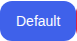

Observed:

| What | Expected | Observed | Result |
| --- | --- | --- | --- |
| background | `"oklch(0.55 0.21 268)"` | `"oklch(0.55 0.21 268)"` | pass |
| text colour | `"oklch(1 0 0)"` | `"oklch(1 0 0)"` | pass |
| height | `"40px"` | `"40px"` | pass |
| console errors and warnings | `""` | `""` | pass |

### firefox 159.0

Recording of the whole journey:

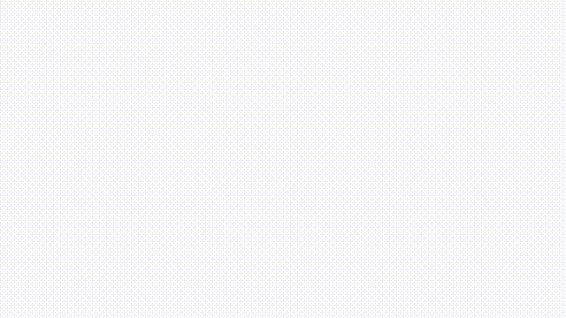

Steps:

1. Open the page.

   

2. Look at the button named Default.

   

Observed:

| What | Expected | Observed | Result |
| --- | --- | --- | --- |
| background | `"oklch(0.55 0.21 268)"` | `"oklch(0.55 0.21 268)"` | pass |
| text colour | `"oklch(1 0 0)"` | `"oklch(1 0 0)"` | pass |
| height | `"40px"` | `"40px"` | pass |
| console errors and warnings | `""` | `""` | pass |

### webkit 27.2

Recording of the whole journey:

Steps:

1. Open the page.

   

2. Look at the button named Default.

   

Observed:

| What | Expected | Observed | Result |
| --- | --- | --- | --- |
| background | `"oklch(0.55 0.21 268)"` | `"oklch(0.55 0.21 268)"` | pass |
| text colour | `"oklch(1 0 0)"` | `"oklch(1 0 0)"` | pass |
| height | `"40px"` | `"40px"` | pass |
| console errors and warnings | `""` | `""` | pass |

## A consumer's plain class overrides the library

Journey `consumer-override`.

### chromium 159.0.8154.6

Recording of the whole journey:

Steps:

1. Open the page.

   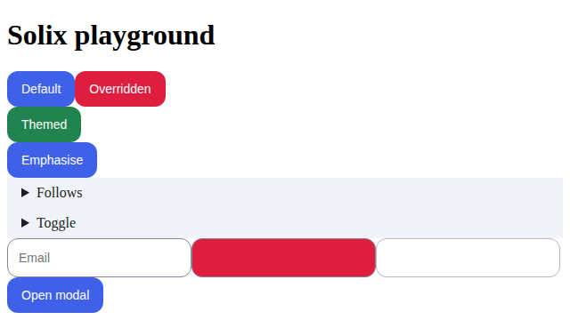

2. Look at the button named Overridden, which the app gives its own class.

   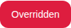

Observed:

| What | Expected | Observed | Result |
| --- | --- | --- | --- |
| background comes from the consumer's class | `"oklch(0.58 0.22 20)"` | `"oklch(0.58 0.22 20)"` | pass |
| height still comes from the library | `"40px"` | `"40px"` | pass |
| text colour still comes from the library | `"oklch(1 0 0)"` | `"oklch(1 0 0)"` | pass |
| console errors and warnings | `""` | `""` | pass |

### firefox 159.0

Recording of the whole journey:

Steps:

1. Open the page.

   

2. Look at the button named Overridden, which the app gives its own class.

   

Observed:

| What | Expected | Observed | Result |
| --- | --- | --- | --- |
| background comes from the consumer's class | `"oklch(0.58 0.22 20)"` | `"oklch(0.58 0.22 20)"` | pass |
| height still comes from the library | `"40px"` | `"40px"` | pass |
| text colour still comes from the library | `"oklch(1 0 0)"` | `"oklch(1 0 0)"` | pass |
| console errors and warnings | `""` | `""` | pass |

### webkit 27.2

Recording of the whole journey:

Steps:

1. Open the page.

   

2. Look at the button named Overridden, which the app gives its own class.

   

Observed:

| What | Expected | Observed | Result |
| --- | --- | --- | --- |
| background comes from the consumer's class | `"oklch(0.58 0.22 20)"` | `"oklch(0.58 0.22 20)"` | pass |
| height still comes from the library | `"40px"` | `"40px"` | pass |
| text colour still comes from the library | `"oklch(1 0 0)"` | `"oklch(1 0 0)"` | pass |
| console errors and warnings | `""` | `""` | pass |

## A consumer rethemes a subtree through a token

Journey `token-theme`.

### chromium 159.0.8154.6

Recording of the whole journey:

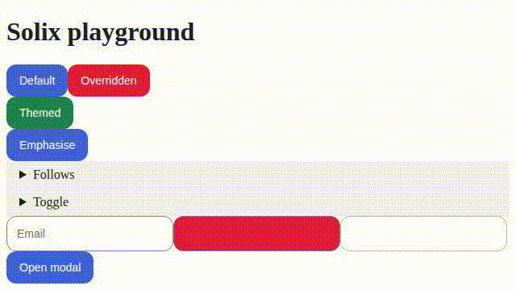

Steps:

1. Open the page.

   

2. Look at the button named Themed, which sits in a subtree where the app overrides a token.

   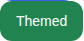

Observed:

| What | Expected | Observed | Result |
| --- | --- | --- | --- |
| background follows the consumer's token value | `"oklch(0.54 0.12 155)"` | `"oklch(0.54 0.12 155)"` | pass |
| a button outside the themed subtree keeps the default | `"oklch(0.55 0.21 268)"` | `"oklch(0.55 0.21 268)"` | pass |
| console errors and warnings | `""` | `""` | pass |

### firefox 159.0

Recording of the whole journey:

Steps:

1. Open the page.

   

2. Look at the button named Themed, which sits in a subtree where the app overrides a token.

   

Observed:

| What | Expected | Observed | Result |
| --- | --- | --- | --- |
| background follows the consumer's token value | `"oklch(0.54 0.12 155)"` | `"oklch(0.54 0.12 155)"` | pass |
| a button outside the themed subtree keeps the default | `"oklch(0.55 0.21 268)"` | `"oklch(0.55 0.21 268)"` | pass |
| console errors and warnings | `""` | `""` | pass |

### webkit 27.2

Recording of the whole journey:

Steps:

1. Open the page.

   

2. Look at the button named Themed, which sits in a subtree where the app overrides a token.

   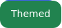

Observed:

| What | Expected | Observed | Result |
| --- | --- | --- | --- |
| background follows the consumer's token value | `"oklch(0.54 0.12 155)"` | `"oklch(0.54 0.12 155)"` | pass |
| a button outside the themed subtree keeps the default | `"oklch(0.55 0.21 268)"` | `"oklch(0.55 0.21 268)"` | pass |
| console errors and warnings | `""` | `""` | pass |

## A class and an attribute that change after the first render

Journey `changing-props`.

### chromium 159.0.8154.6

Recording of the whole journey:

Steps:

1. Open the page. The Emphasise button has the default colour and the Follows disclosure has no outline.

   

2. Click Emphasise. The app now passes it a class, and passes the Follows disclosure another.

   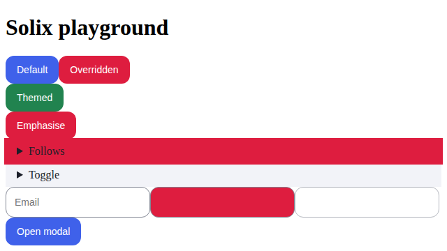

3. Click Emphasise again. Both return to how they started.

   

Observed:

| What | Expected | Observed | Result |
| --- | --- | --- | --- |
| before: Emphasise background | `"oklch(0.55 0.21 268)"` | `"oklch(0.55 0.21 268)"` | pass |
| before: Emphasise aria-pressed | `"false"` | `"false"` | pass |
| before: Follows outline | `"none"` | `"none"` | pass |
| before: Follows summary background | `"oklch(0.965 0.006 268)"` | `"oklch(0.965 0.006 268)"` | pass |
| after a click: Emphasise background comes from the class the app now passes | `"oklch(0.58 0.22 20)"` | `"oklch(0.58 0.22 20)"` | pass |
| after a click: Emphasise aria-pressed | `"true"` | `"true"` | pass |
| after a click: Follows outline comes from the class the app now passes | `"solid"` | `"solid"` | pass |
| after a click: Follows summary background comes from the class classes.summary now names | `"oklch(0.58 0.22 20)"` | `"oklch(0.58 0.22 20)"` | pass |
| after a second click: Emphasise background | `"oklch(0.55 0.21 268)"` | `"oklch(0.55 0.21 268)"` | pass |
| after a second click: Follows outline | `"none"` | `"none"` | pass |
| after a second click: Follows summary background | `"oklch(0.965 0.006 268)"` | `"oklch(0.965 0.006 268)"` | pass |
| console errors and warnings | `""` | `""` | pass |

### firefox 159.0

Recording of the whole journey:

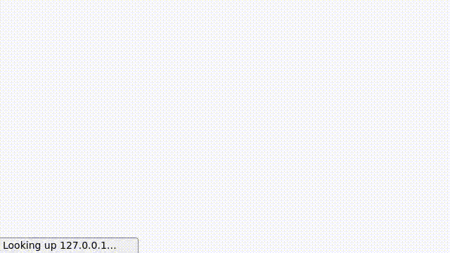

Steps:

1. Open the page. The Emphasise button has the default colour and the Follows disclosure has no outline.

   

2. Click Emphasise. The app now passes it a class, and passes the Follows disclosure another.

   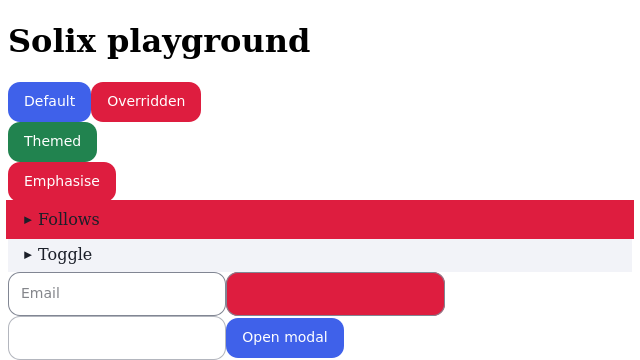

3. Click Emphasise again. Both return to how they started.

   

Observed:

| What | Expected | Observed | Result |
| --- | --- | --- | --- |
| before: Emphasise background | `"oklch(0.55 0.21 268)"` | `"oklch(0.55 0.21 268)"` | pass |
| before: Emphasise aria-pressed | `"false"` | `"false"` | pass |
| before: Follows outline | `"none"` | `"none"` | pass |
| before: Follows summary background | `"oklch(0.965 0.006 268)"` | `"oklch(0.965 0.006 268)"` | pass |
| after a click: Emphasise background comes from the class the app now passes | `"oklch(0.58 0.22 20)"` | `"oklch(0.58 0.22 20)"` | pass |
| after a click: Emphasise aria-pressed | `"true"` | `"true"` | pass |
| after a click: Follows outline comes from the class the app now passes | `"solid"` | `"solid"` | pass |
| after a click: Follows summary background comes from the class classes.summary now names | `"oklch(0.58 0.22 20)"` | `"oklch(0.58 0.22 20)"` | pass |
| after a second click: Emphasise background | `"oklch(0.55 0.21 268)"` | `"oklch(0.55 0.21 268)"` | pass |
| after a second click: Follows outline | `"none"` | `"none"` | pass |
| after a second click: Follows summary background | `"oklch(0.965 0.006 268)"` | `"oklch(0.965 0.006 268)"` | pass |
| console errors and warnings | `""` | `""` | pass |

### webkit 27.2

Recording of the whole journey:

Steps:

1. Open the page. The Emphasise button has the default colour and the Follows disclosure has no outline.

   

2. Click Emphasise. The app now passes it a class, and passes the Follows disclosure another.

   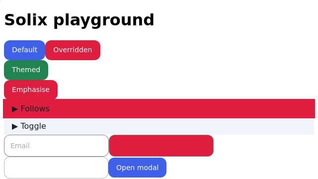

3. Click Emphasise again. Both return to how they started.

   

Observed:

| What | Expected | Observed | Result |
| --- | --- | --- | --- |
| before: Emphasise background | `"oklch(0.55 0.21 268)"` | `"oklch(0.55 0.21 268)"` | pass |
| before: Emphasise aria-pressed | `"false"` | `"false"` | pass |
| before: Follows outline | `"none"` | `"none"` | pass |
| before: Follows summary background | `"oklch(0.965 0.006 268)"` | `"oklch(0.965 0.006 268)"` | pass |
| after a click: Emphasise background comes from the class the app now passes | `"oklch(0.58 0.22 20)"` | `"oklch(0.58 0.22 20)"` | pass |
| after a click: Emphasise aria-pressed | `"true"` | `"true"` | pass |
| after a click: Follows outline comes from the class the app now passes | `"solid"` | `"solid"` | pass |
| after a click: Follows summary background comes from the class classes.summary now names | `"oklch(0.58 0.22 20)"` | `"oklch(0.58 0.22 20)"` | pass |
| after a second click: Emphasise background | `"oklch(0.55 0.21 268)"` | `"oklch(0.55 0.21 268)"` | pass |
| after a second click: Follows outline | `"none"` | `"none"` | pass |
| after a second click: Follows summary background | `"oklch(0.965 0.006 268)"` | `"oklch(0.965 0.006 268)"` | pass |
| console errors and warnings | `""` | `""` | pass |

## A disclosure opens and closes

Journey `disclosure`.

### chromium 159.0.8154.6

Recording of the whole journey:

Steps:

1. Open the page. The disclosure starts closed.

   

2. Click the summary named Toggle. The content appears and the summary changes colour.

   

3. Click Toggle again. The content goes away and the summary returns to its first colour.

   

4. Click Toggle to open it. The disclosure named Inner, inside it, still looks closed.

   

5. Focus the summary and press Enter. The disclosure opens.

   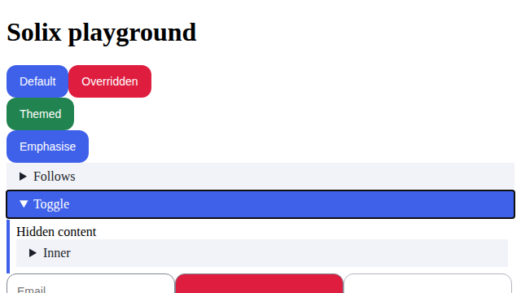

6. Press Space. The disclosure closes.

   

Observed:

| What | Expected | Observed | Result |
| --- | --- | --- | --- |
| closed: the details element's open property | `false` | `false` | pass |
| closed: summary background | `"oklch(0.965 0.006 268)"` | `"oklch(0.965 0.006 268)"` | pass |
| closed: content is visible | `false` | `false` | pass |
| open: the details element's open property | `true` | `true` | pass |
| open: summary background | `"oklch(0.55 0.21 268)"` | `"oklch(0.55 0.21 268)"` | pass |
| open: summary text colour | `"oklch(1 0 0)"` | `"oklch(1 0 0)"` | pass |
| open: content is visible | `true` | `true` | pass |
| open: content left border | `"oklch(0.55 0.21 268)"` | `"oklch(0.55 0.21 268)"` | pass |
| closed again: the details element's open property | `false` | `false` | pass |
| closed again: summary background | `"oklch(0.965 0.006 268)"` | `"oklch(0.965 0.006 268)"` | pass |
| closed again: content is visible | `false` | `false` | pass |
| inner disclosure inside the open one: summary background | `"oklch(0.965 0.006 268)"` | `"oklch(0.965 0.006 268)"` | pass |
| inner disclosure inside the open one: summary text colour | `"oklch(0.24 0.02 268)"` | `"oklch(0.24 0.02 268)"` | pass |
| Enter on the focused summary: the details element's open property | `true` | `true` | pass |
| Enter on the focused summary: summary background | `"oklch(0.55 0.21 268)"` | `"oklch(0.55 0.21 268)"` | pass |
| Enter on the focused summary: content is visible | `true` | `true` | pass |
| Space on the focused summary: the details element's open property | `false` | `false` | pass |
| Space on the focused summary: summary background | `"oklch(0.965 0.006 268)"` | `"oklch(0.965 0.006 268)"` | pass |
| Space on the focused summary: content is visible | `false` | `false` | pass |
| console errors and warnings | `""` | `""` | pass |

### firefox 159.0

Recording of the whole journey:

Steps:

1. Open the page. The disclosure starts closed.

   

2. Click the summary named Toggle. The content appears and the summary changes colour.

   

3. Click Toggle again. The content goes away and the summary returns to its first colour.

   

4. Click Toggle to open it. The disclosure named Inner, inside it, still looks closed.

   

5. Focus the summary and press Enter. The disclosure opens.

   

6. Press Space. The disclosure closes.

   

Observed:

| What | Expected | Observed | Result |
| --- | --- | --- | --- |
| closed: the details element's open property | `false` | `false` | pass |
| closed: summary background | `"oklch(0.965 0.006 268)"` | `"oklch(0.965 0.006 268)"` | pass |
| closed: content is visible | `false` | `false` | pass |
| open: the details element's open property | `true` | `true` | pass |
| open: summary background | `"oklch(0.55 0.21 268)"` | `"oklch(0.55 0.21 268)"` | pass |
| open: summary text colour | `"oklch(1 0 0)"` | `"oklch(1 0 0)"` | pass |
| open: content is visible | `true` | `true` | pass |
| open: content left border | `"oklch(0.55 0.21 268)"` | `"oklch(0.55 0.21 268)"` | pass |
| closed again: the details element's open property | `false` | `false` | pass |
| closed again: summary background | `"oklch(0.965 0.006 268)"` | `"oklch(0.965 0.006 268)"` | pass |
| closed again: content is visible | `false` | `false` | pass |
| inner disclosure inside the open one: summary background | `"oklch(0.965 0.006 268)"` | `"oklch(0.965 0.006 268)"` | pass |
| inner disclosure inside the open one: summary text colour | `"oklch(0.24 0.02 268)"` | `"oklch(0.24 0.02 268)"` | pass |
| Enter on the focused summary: the details element's open property | `true` | `true` | pass |
| Enter on the focused summary: summary background | `"oklch(0.55 0.21 268)"` | `"oklch(0.55 0.21 268)"` | pass |
| Enter on the focused summary: content is visible | `true` | `true` | pass |
| Space on the focused summary: the details element's open property | `false` | `false` | pass |
| Space on the focused summary: summary background | `"oklch(0.965 0.006 268)"` | `"oklch(0.965 0.006 268)"` | pass |
| Space on the focused summary: content is visible | `false` | `false` | pass |
| console errors and warnings | `""` | `""` | pass |

### webkit 27.2

Recording of the whole journey:

Steps:

1. Open the page. The disclosure starts closed.

   

2. Click the summary named Toggle. The content appears and the summary changes colour.

   

3. Click Toggle again. The content goes away and the summary returns to its first colour.

   

4. Click Toggle to open it. The disclosure named Inner, inside it, still looks closed.

   

5. Focus the summary and press Enter. The disclosure opens.

   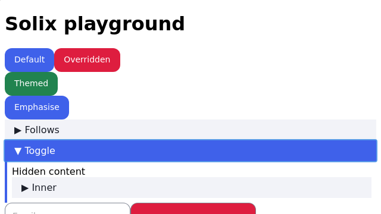

6. Press Space. The disclosure closes.

   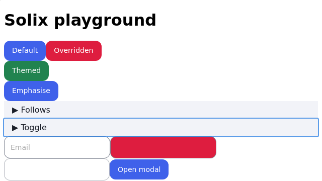

Observed:

| What | Expected | Observed | Result |
| --- | --- | --- | --- |
| closed: the details element's open property | `false` | `false` | pass |
| closed: summary background | `"oklch(0.965 0.006 268)"` | `"oklch(0.965 0.006 268)"` | pass |
| closed: content is visible | `false` | `false` | pass |
| open: the details element's open property | `true` | `true` | pass |
| open: summary background | `"oklch(0.55 0.21 268)"` | `"oklch(0.55 0.21 268)"` | pass |
| open: summary text colour | `"oklch(1 0 0)"` | `"oklch(1 0 0)"` | pass |
| open: content is visible | `true` | `true` | pass |
| open: content left border | `"oklch(0.55 0.21 268)"` | `"oklch(0.55 0.21 268)"` | pass |
| closed again: the details element's open property | `false` | `false` | pass |
| closed again: summary background | `"oklch(0.965 0.006 268)"` | `"oklch(0.965 0.006 268)"` | pass |
| closed again: content is visible | `false` | `false` | pass |
| inner disclosure inside the open one: summary background | `"oklch(0.965 0.006 268)"` | `"oklch(0.965 0.006 268)"` | pass |
| inner disclosure inside the open one: summary text colour | `"oklch(0.24 0.02 268)"` | `"oklch(0.24 0.02 268)"` | pass |
| Enter on the focused summary: the details element's open property | `true` | `true` | pass |
| Enter on the focused summary: summary background | `"oklch(0.55 0.21 268)"` | `"oklch(0.55 0.21 268)"` | pass |
| Enter on the focused summary: content is visible | `true` | `true` | pass |
| Space on the focused summary: the details element's open property | `false` | `false` | pass |
| Space on the focused summary: summary background | `"oklch(0.965 0.006 268)"` | `"oklch(0.965 0.006 268)"` | pass |
| Space on the focused summary: content is visible | `false` | `false` | pass |
| console errors and warnings | `""` | `""` | pass |

## A text input shows its border, its disabled look and its error after the user leaves it

Journey `text-input`.

### chromium 159.0.8154.6

Recording of the whole journey:

Steps:

1. Open the page. Three text inputs sit below the disclosures.

   

2. Look at the input named Email.

   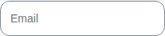

3. Type a value that is not an email address into Email. The border does not change while the user is still in the field.

   

4. Move focus to another control. The Email border takes the error colour.

   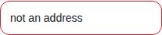

5. Type a valid address and leave the field. The border returns to the default.

   

Observed:

| What | Expected | Observed | Result |
| --- | --- | --- | --- |
| email: border colour | `"oklch(0.62 0.02 268)"` | `"oklch(0.62 0.02 268)"` | pass |
| email: height | `"40px"` | `"40px"` | pass |
| overridden input: background comes from the consumer's class | `"oklch(0.58 0.22 20)"` | `"oklch(0.58 0.22 20)"` | pass |
| overridden input: height still comes from the library | `"40px"` | `"40px"` | pass |
| disabled input: opacity | `"0.6"` | `"0.6"` | pass |
| disabled input: the user can type in it | `false` | `false` | pass |
| while typing an invalid value: border is not the error colour | `false` | `false` | pass |
| after leaving the invalid value: border colour | `"oklch(0.55 0.2 25)"` | `"oklch(0.55 0.2 25)"` | pass |
| after leaving a valid value: border colour | `"oklch(0.62 0.02 268)"` | `"oklch(0.62 0.02 268)"` | pass |
| console errors and warnings | `""` | `""` | pass |

### firefox 159.0

Recording of the whole journey:

Steps:

1. Open the page. Three text inputs sit below the disclosures.

   

2. Look at the input named Email.

   

3. Type a value that is not an email address into Email. The border does not change while the user is still in the field.

   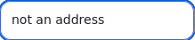

4. Move focus to another control. The Email border takes the error colour.

   

5. Type a valid address and leave the field. The border returns to the default.

   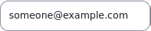

Observed:

| What | Expected | Observed | Result |
| --- | --- | --- | --- |
| email: border colour | `"oklch(0.62 0.02 268)"` | `"oklch(0.62 0.02 268)"` | pass |
| email: height | `"40px"` | `"40px"` | pass |
| overridden input: background comes from the consumer's class | `"oklch(0.58 0.22 20)"` | `"oklch(0.58 0.22 20)"` | pass |
| overridden input: height still comes from the library | `"40px"` | `"40px"` | pass |
| disabled input: opacity | `"0.6"` | `"0.6"` | pass |
| disabled input: the user can type in it | `false` | `false` | pass |
| while typing an invalid value: border is not the error colour | `false` | `false` | pass |
| after leaving the invalid value: border colour | `"oklch(0.55 0.2 25)"` | `"oklch(0.55 0.2 25)"` | pass |
| after leaving a valid value: border colour | `"oklch(0.62 0.02 268)"` | `"oklch(0.62 0.02 268)"` | pass |
| console errors and warnings | `""` | `""` | pass |

### webkit 27.2

Recording of the whole journey:

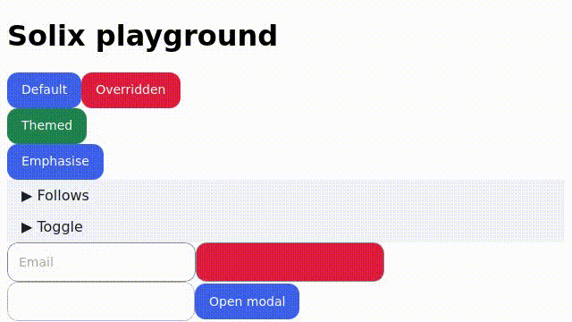

Steps:

1. Open the page. Three text inputs sit below the disclosures.

   

2. Look at the input named Email.

   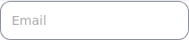

3. Type a value that is not an email address into Email. The border does not change while the user is still in the field.

   

4. Move focus to another control. The Email border takes the error colour.

   

5. Type a valid address and leave the field. The border returns to the default.

   

Observed:

| What | Expected | Observed | Result |
| --- | --- | --- | --- |
| email: border colour | `"oklch(0.62 0.02 268)"` | `"oklch(0.62 0.02 268)"` | pass |
| email: height | `"40px"` | `"40px"` | pass |
| overridden input: background comes from the consumer's class | `"oklch(0.58 0.22 20)"` | `"oklch(0.58 0.22 20)"` | pass |
| overridden input: height still comes from the library | `"40px"` | `"40px"` | pass |
| disabled input: opacity | `"0.6"` | `"0.6"` | pass |
| disabled input: the user can type in it | `false` | `false` | pass |
| while typing an invalid value: border is not the error colour | `false` | `false` | pass |
| after leaving the invalid value: border colour | `"oklch(0.55 0.2 25)"` | `"oklch(0.55 0.2 25)"` | pass |
| after leaving a valid value: border colour | `"oklch(0.62 0.02 268)"` | `"oklch(0.62 0.02 268)"` | pass |
| console errors and warnings | `""` | `""` | pass |

## A modal opens over the page and closes by Escape, its Close button and a press outside

Journey `modal`.

### chromium 159.0.8154.6

Recording of the whole journey:

Steps:

1. Open the page. The Settings modal is not showing.

   

2. Press Open modal. A dialog named Settings covers the page with a dimmed backdrop.

   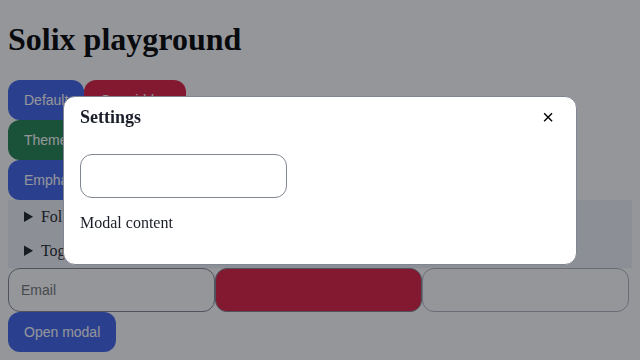

3. Press the text inside the dialog. It stays open.

   

4. Press Escape. The dialog closes.

   

5. Open it again and press the Close button. The dialog closes.

   

6. Open it a third time and press the backdrop, outside the dialog. The dialog closes.

   

Observed:

| What | Expected | Observed | Result |
| --- | --- | --- | --- |
| closed: the dialog is visible | `false` | `false` | pass |
| open: the dialog is modal | `true` | `true` | pass |
| open: dialog background | `"oklch(1 0 0)"` | `"oklch(1 0 0)"` | pass |
| open: backdrop colour | `"oklch(0.2 0.02 268 / 0.45)"` | `"oklch(0.2 0.02 268 / 0.45)"` | pass |
| open: the app records | `"The app records the modal as opened."` | `"The app records the modal as opened."` | pass |
| press inside: the dialog is visible | `true` | `true` | pass |
| Escape: the dialog is visible | `false` | `false` | pass |
| Escape: the app records | `"The app records the modal as closed."` | `"The app records the modal as closed."` | pass |
| Close button: the dialog is visible | `false` | `false` | pass |
| Close button: the app records | `"The app records the modal as closed."` | `"The app records the modal as closed."` | pass |
| press outside: the dialog is visible | `false` | `false` | pass |
| press outside: the app records | `"The app records the modal as closed."` | `"The app records the modal as closed."` | pass |
| console errors and warnings | `""` | `""` | pass |

### firefox 159.0

Recording of the whole journey:

Steps:

1. Open the page. The Settings modal is not showing.

   

2. Press Open modal. A dialog named Settings covers the page with a dimmed backdrop.

   

3. Press the text inside the dialog. It stays open.

   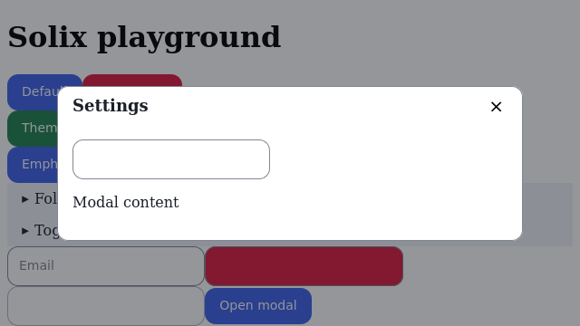

4. Press Escape. The dialog closes.

   

5. Open it again and press the Close button. The dialog closes.

   

6. Open it a third time and press the backdrop, outside the dialog. The dialog closes.

   

Observed:

| What | Expected | Observed | Result |
| --- | --- | --- | --- |
| closed: the dialog is visible | `false` | `false` | pass |
| open: the dialog is modal | `true` | `true` | pass |
| open: dialog background | `"oklch(1 0 0)"` | `"oklch(1 0 0)"` | pass |
| open: backdrop colour | `"oklch(0.2 0.02 268 / 0.45)"` | `"oklch(0.2 0.02 268 / 0.45)"` | pass |
| open: the app records | `"The app records the modal as opened."` | `"The app records the modal as opened."` | pass |
| press inside: the dialog is visible | `true` | `true` | pass |
| Escape: the dialog is visible | `false` | `false` | pass |
| Escape: the app records | `"The app records the modal as closed."` | `"The app records the modal as closed."` | pass |
| Close button: the dialog is visible | `false` | `false` | pass |
| Close button: the app records | `"The app records the modal as closed."` | `"The app records the modal as closed."` | pass |
| press outside: the dialog is visible | `false` | `false` | pass |
| press outside: the app records | `"The app records the modal as closed."` | `"The app records the modal as closed."` | pass |
| console errors and warnings | `""` | `""` | pass |

### webkit 27.2

Recording of the whole journey:

Steps:

1. Open the page. The Settings modal is not showing.

   

2. Press Open modal. A dialog named Settings covers the page with a dimmed backdrop.

   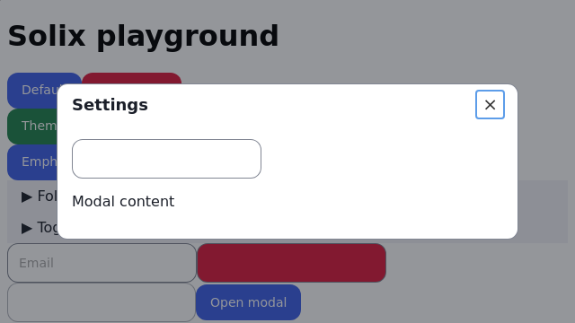

3. Press the text inside the dialog. It stays open.

   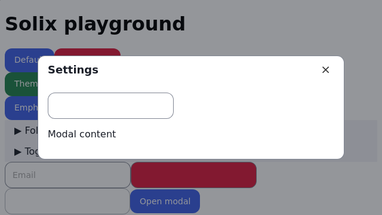

4. Press Escape. The dialog closes.

   

5. Open it again and press the Close button. The dialog closes.

   

6. Open it a third time and press the backdrop, outside the dialog. The dialog closes.

   

Observed:

| What | Expected | Observed | Result |
| --- | --- | --- | --- |
| closed: the dialog is visible | `false` | `false` | pass |
| open: the dialog is modal | `true` | `true` | pass |
| open: dialog background | `"oklch(1 0 0)"` | `"oklch(1 0 0)"` | pass |
| open: backdrop colour | `"oklch(0.2 0.02 268 / 0.45)"` | `"oklch(0.2 0.02 268 / 0.45)"` | pass |
| open: the app records | `"The app records the modal as opened."` | `"The app records the modal as opened."` | pass |
| press inside: the dialog is visible | `true` | `true` | pass |
| Escape: the dialog is visible | `false` | `false` | pass |
| Escape: the app records | `"The app records the modal as closed."` | `"The app records the modal as closed."` | pass |
| Close button: the dialog is visible | `false` | `false` | pass |
| Close button: the app records | `"The app records the modal as closed."` | `"The app records the modal as closed."` | pass |
| press outside: the dialog is visible | `false` | `false` | pass |
| press outside: the app records | `"The app records the modal as closed."` | `"The app records the modal as closed."` | pass |
| console errors and warnings | `""` | `""` | pass |

## A Box takes style props, and a consumer's class and style still win

Journey `box`.

### chromium 159.0.8154.6

Recording of the whole journey:

Steps:

1. Open the page 991 pixels wide, one pixel below the md breakpoint, and scroll to the section named Style props.

   

2. Widen the page to 992 pixels, which is the md breakpoint. The padding grows, one line goes away and another appears.

   

Observed:

| What | Expected | Observed | Result |
| --- | --- | --- | --- |
| the style prop's background beats the button's own default | `"oklch(0.55 0.2 25)"` | `"oklch(0.55 0.2 25)"` | pass |
| a style prop sets the margin | `"28px"` | `"28px"` | pass |
| the consumer's class beats the style prop | `"41.6px"` | `"41.6px"` | pass |
| the consumer's style beats the consumer's class and the style prop | `"54.4px"` | `"54.4px"` | pass |
| below md: the section's padding comes from its xs value | `"8px"` | `"8px"` | pass |
| below md: the pt longhand beats the p shorthand | `"0px"` | `"0px"` | pass |
| below md: the p shorthand sets the other sides | `"4px"` | `"4px"` | pass |
| mt=unset inside a Box with mt=xl takes no margin from it | `"0px"` | `"0px"` | pass |
| below md: Hidden from md is visible | `true` | `true` | pass |
| below md: Visible from md is visible | `false` | `false` | pass |
| at md: the section's padding comes from its md value | `"18px"` | `"18px"` | pass |
| at md: the pt longhand still beats the p shorthand's md value | `"0px"` | `"0px"` | pass |
| at md: the p shorthand sets the other sides to its md value | `"18px"` | `"18px"` | pass |
| at md: Hidden from md is visible | `false` | `false` | pass |
| at md: Visible from md is visible | `true` | `true` | pass |
| at md: the consumer's style still wins | `"54.4px"` | `"54.4px"` | pass |
| console errors and warnings | `""` | `""` | pass |

### firefox 159.0

Recording of the whole journey:

Steps:

1. Open the page 991 pixels wide, one pixel below the md breakpoint, and scroll to the section named Style props.

   

2. Widen the page to 992 pixels, which is the md breakpoint. The padding grows, one line goes away and another appears.

   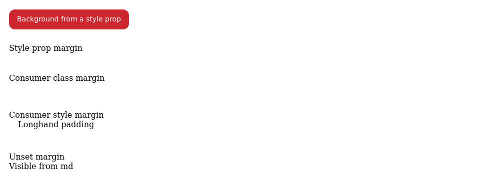

Observed:

| What | Expected | Observed | Result |
| --- | --- | --- | --- |
| the style prop's background beats the button's own default | `"oklch(0.55 0.2 25)"` | `"oklch(0.55 0.2 25)"` | pass |
| a style prop sets the margin | `"28px"` | `"28px"` | pass |
| the consumer's class beats the style prop | `"41.6px"` | `"41.6px"` | pass |
| the consumer's style beats the consumer's class and the style prop | `"54.4px"` | `"54.4px"` | pass |
| below md: the section's padding comes from its xs value | `"8px"` | `"8px"` | pass |
| below md: the pt longhand beats the p shorthand | `"0px"` | `"0px"` | pass |
| below md: the p shorthand sets the other sides | `"4px"` | `"4px"` | pass |
| mt=unset inside a Box with mt=xl takes no margin from it | `"0px"` | `"0px"` | pass |
| below md: Hidden from md is visible | `true` | `true` | pass |
| below md: Visible from md is visible | `false` | `false` | pass |
| at md: the section's padding comes from its md value | `"18px"` | `"18px"` | pass |
| at md: the pt longhand still beats the p shorthand's md value | `"0px"` | `"0px"` | pass |
| at md: the p shorthand sets the other sides to its md value | `"18px"` | `"18px"` | pass |
| at md: Hidden from md is visible | `false` | `false` | pass |
| at md: Visible from md is visible | `true` | `true` | pass |
| at md: the consumer's style still wins | `"54.4px"` | `"54.4px"` | pass |
| console errors and warnings | `""` | `""` | pass |

### webkit 27.2

Recording of the whole journey:

Steps:

1. Open the page 991 pixels wide, one pixel below the md breakpoint, and scroll to the section named Style props.

   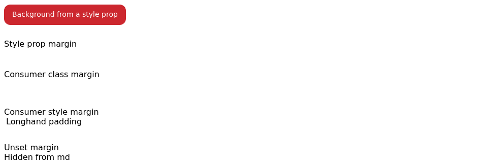

2. Widen the page to 992 pixels, which is the md breakpoint. The padding grows, one line goes away and another appears.

   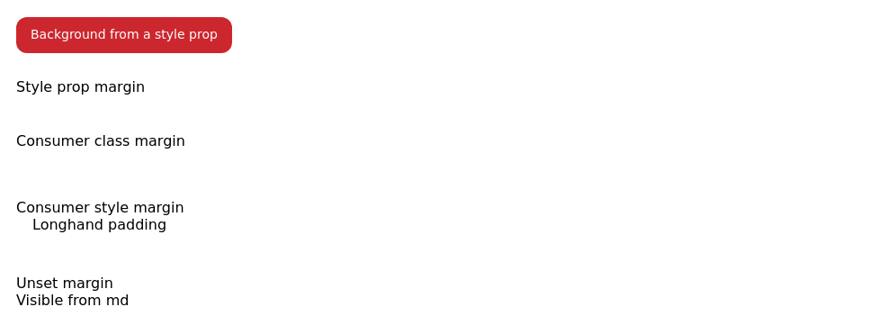

Observed:

| What | Expected | Observed | Result |
| --- | --- | --- | --- |
| the style prop's background beats the button's own default | `"oklch(0.55 0.2 25)"` | `"oklch(0.55 0.2 25)"` | pass |
| a style prop sets the margin | `"28px"` | `"28px"` | pass |
| the consumer's class beats the style prop | `"41.59375px"` | `"41.59375px"` | pass |
| the consumer's style beats the consumer's class and the style prop | `"54.390625px"` | `"54.390625px"` | pass |
| below md: the section's padding comes from its xs value | `"8px"` | `"8px"` | pass |
| below md: the pt longhand beats the p shorthand | `"0px"` | `"0px"` | pass |
| below md: the p shorthand sets the other sides | `"4px"` | `"4px"` | pass |
| mt=unset inside a Box with mt=xl takes no margin from it | `"0px"` | `"0px"` | pass |
| below md: Hidden from md is visible | `true` | `true` | pass |
| below md: Visible from md is visible | `false` | `false` | pass |
| at md: the section's padding comes from its md value | `"18px"` | `"18px"` | pass |
| at md: the pt longhand still beats the p shorthand's md value | `"0px"` | `"0px"` | pass |
| at md: the p shorthand sets the other sides to its md value | `"18px"` | `"18px"` | pass |
| at md: Hidden from md is visible | `false` | `false` | pass |
| at md: Visible from md is visible | `true` | `true` | pass |
| at md: the consumer's style still wins | `"54.390625px"` | `"54.390625px"` | pass |
| console errors and warnings | `""` | `""` | pass |

## Classes, styles and unstyled restyle a component's parts, and Button takes a style prop

Journey `styles-api`.

### chromium 159.0.8154.6

Recording of the whole journey:

Steps:

1. Open the page and scroll to the section named Styles API, at the end.

   

2. Click the summary named Styled parts. It opens, and its background still comes from styles.

   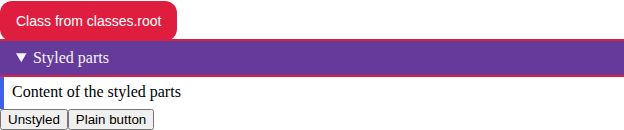

Observed:

| What | Expected | Observed | Result |
| --- | --- | --- | --- |
| classes.root: background comes from the consumer's class | `"oklch(0.58 0.22 20)"` | `"oklch(0.58 0.22 20)"` | pass |
| classes.root: height still comes from the library | `"40px"` | `"40px"` | pass |
| styles.summary: background comes from styles, not from the class classes.summary names or the library | `"oklch(0.45 0.15 300)"` | `"oklch(0.45 0.15 300)"` | pass |
| styles.summary: text colour comes from styles, not from the library | `"oklch(0.97 0.01 300)"` | `"oklch(0.97 0.01 300)"` | pass |
| classes.summary: the consumer's class still sets the outline | `"solid"` | `"solid"` | pass |
| unstyled: background-color is the Plain button's | `"rgb(239, 239, 239)"` | `"rgb(239, 239, 239)"` | pass |
| unstyled: color is the Plain button's | `"rgb(0, 0, 0)"` | `"rgb(0, 0, 0)"` | pass |
| unstyled: border-top-width is the Plain button's | `"2px"` | `"2px"` | pass |
| unstyled: border-top-style is the Plain button's | `"outset"` | `"outset"` | pass |
| unstyled: border-top-color is the Plain button's | `"rgb(0, 0, 0)"` | `"rgb(0, 0, 0)"` | pass |
| unstyled: border-right-width is the Plain button's | `"2px"` | `"2px"` | pass |
| unstyled: border-right-style is the Plain button's | `"outset"` | `"outset"` | pass |
| unstyled: border-right-color is the Plain button's | `"rgb(0, 0, 0)"` | `"rgb(0, 0, 0)"` | pass |
| unstyled: border-bottom-width is the Plain button's | `"2px"` | `"2px"` | pass |
| unstyled: border-bottom-style is the Plain button's | `"outset"` | `"outset"` | pass |
| unstyled: border-bottom-color is the Plain button's | `"rgb(0, 0, 0)"` | `"rgb(0, 0, 0)"` | pass |
| unstyled: border-left-width is the Plain button's | `"2px"` | `"2px"` | pass |
| unstyled: border-left-style is the Plain button's | `"outset"` | `"outset"` | pass |
| unstyled: border-left-color is the Plain button's | `"rgb(0, 0, 0)"` | `"rgb(0, 0, 0)"` | pass |
| unstyled: border-top-left-radius is the Plain button's | `"0px"` | `"0px"` | pass |
| unstyled: border-top-right-radius is the Plain button's | `"0px"` | `"0px"` | pass |
| unstyled: border-bottom-right-radius is the Plain button's | `"0px"` | `"0px"` | pass |
| unstyled: border-bottom-left-radius is the Plain button's | `"0px"` | `"0px"` | pass |
| unstyled: height is the Plain button's | `"21px"` | `"21px"` | pass |
| unstyled: padding-top is the Plain button's | `"1px"` | `"1px"` | pass |
| unstyled: padding-right is the Plain button's | `"6px"` | `"6px"` | pass |
| unstyled: padding-bottom is the Plain button's | `"1px"` | `"1px"` | pass |
| unstyled: padding-left is the Plain button's | `"6px"` | `"6px"` | pass |
| unstyled: the button keeps its stable class | `true` | `true` | pass |
| open: content is visible | `true` | `true` | pass |
| open: styles.summary still beats the library's open background | `"oklch(0.45 0.15 300)"` | `"oklch(0.45 0.15 300)"` | pass |
| open: styles.summary still beats the library's open text colour | `"oklch(0.97 0.01 300)"` | `"oklch(0.97 0.01 300)"` | pass |
| console errors and warnings | `""` | `""` | pass |

### firefox 159.0

Recording of the whole journey:

Steps:

1. Open the page and scroll to the section named Styles API, at the end.

   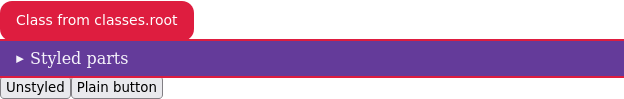

2. Click the summary named Styled parts. It opens, and its background still comes from styles.

   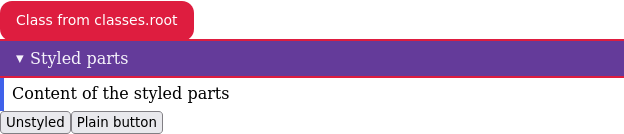

Observed:

| What | Expected | Observed | Result |
| --- | --- | --- | --- |
| classes.root: background comes from the consumer's class | `"oklch(0.58 0.22 20)"` | `"oklch(0.58 0.22 20)"` | pass |
| classes.root: height still comes from the library | `"40px"` | `"40px"` | pass |
| styles.summary: background comes from styles, not from the class classes.summary names or the library | `"oklch(0.45 0.15 300)"` | `"oklch(0.45 0.15 300)"` | pass |
| styles.summary: text colour comes from styles, not from the library | `"oklch(0.97 0.01 300)"` | `"oklch(0.97 0.01 300)"` | pass |
| classes.summary: the consumer's class still sets the outline | `"solid"` | `"solid"` | pass |
| unstyled: background-color is the Plain button's | `"rgb(233, 233, 237)"` | `"rgb(233, 233, 237)"` | pass |
| unstyled: color is the Plain button's | `"rgb(0, 0, 0)"` | `"rgb(0, 0, 0)"` | pass |
| unstyled: border-top-width is the Plain button's | `"2px"` | `"2px"` | pass |
| unstyled: border-top-style is the Plain button's | `"outset"` | `"outset"` | pass |
| unstyled: border-top-color is the Plain button's | `"rgb(129, 127, 132)"` | `"rgb(129, 127, 132)"` | pass |
| unstyled: border-right-width is the Plain button's | `"2px"` | `"2px"` | pass |
| unstyled: border-right-style is the Plain button's | `"outset"` | `"outset"` | pass |
| unstyled: border-right-color is the Plain button's | `"rgb(129, 127, 132)"` | `"rgb(129, 127, 132)"` | pass |
| unstyled: border-bottom-width is the Plain button's | `"2px"` | `"2px"` | pass |
| unstyled: border-bottom-style is the Plain button's | `"outset"` | `"outset"` | pass |
| unstyled: border-bottom-color is the Plain button's | `"rgb(129, 127, 132)"` | `"rgb(129, 127, 132)"` | pass |
| unstyled: border-left-width is the Plain button's | `"2px"` | `"2px"` | pass |
| unstyled: border-left-style is the Plain button's | `"outset"` | `"outset"` | pass |
| unstyled: border-left-color is the Plain button's | `"rgb(129, 127, 132)"` | `"rgb(129, 127, 132)"` | pass |
| unstyled: border-top-left-radius is the Plain button's | `"0px"` | `"0px"` | pass |
| unstyled: border-top-right-radius is the Plain button's | `"0px"` | `"0px"` | pass |
| unstyled: border-bottom-right-radius is the Plain button's | `"0px"` | `"0px"` | pass |
| unstyled: border-bottom-left-radius is the Plain button's | `"0px"` | `"0px"` | pass |
| unstyled: height is the Plain button's | `"23px"` | `"23px"` | pass |
| unstyled: padding-top is the Plain button's | `"1px"` | `"1px"` | pass |
| unstyled: padding-right is the Plain button's | `"4px"` | `"4px"` | pass |
| unstyled: padding-bottom is the Plain button's | `"1px"` | `"1px"` | pass |
| unstyled: padding-left is the Plain button's | `"4px"` | `"4px"` | pass |
| unstyled: the button keeps its stable class | `true` | `true` | pass |
| open: content is visible | `true` | `true` | pass |
| open: styles.summary still beats the library's open background | `"oklch(0.45 0.15 300)"` | `"oklch(0.45 0.15 300)"` | pass |
| open: styles.summary still beats the library's open text colour | `"oklch(0.97 0.01 300)"` | `"oklch(0.97 0.01 300)"` | pass |
| console errors and warnings | `""` | `""` | pass |

### webkit 27.2

Recording of the whole journey:

Steps:

1. Open the page and scroll to the section named Styles API, at the end.

   

2. Click the summary named Styled parts. It opens, and its background still comes from styles.

   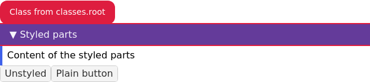

Observed:

| What | Expected | Observed | Result |
| --- | --- | --- | --- |
| classes.root: background comes from the consumer's class | `"oklch(0.58 0.22 20)"` | `"oklch(0.58 0.22 20)"` | pass |
| classes.root: height still comes from the library | `"40px"` | `"40px"` | pass |
| styles.summary: background comes from styles, not from the class classes.summary names or the library | `"oklch(0.45 0.15 300)"` | `"oklch(0.45 0.15 300)"` | pass |
| styles.summary: text colour comes from styles, not from the library | `"oklch(0.97 0.01 300)"` | `"oklch(0.97 0.01 300)"` | pass |
| classes.summary: the consumer's class still sets the outline | `"solid"` | `"solid"` | pass |
| unstyled: background-color is the Plain button's | `"rgb(192, 192, 192)"` | `"rgb(192, 192, 192)"` | pass |
| unstyled: color is the Plain button's | `"rgba(0, 0, 0, 0.8)"` | `"rgba(0, 0, 0, 0.8)"` | pass |
| unstyled: border-top-width is the Plain button's | `"2px"` | `"2px"` | pass |
| unstyled: border-top-style is the Plain button's | `"outset"` | `"outset"` | pass |
| unstyled: border-top-color is the Plain button's | `"rgb(192, 192, 192)"` | `"rgb(192, 192, 192)"` | pass |
| unstyled: border-right-width is the Plain button's | `"2px"` | `"2px"` | pass |
| unstyled: border-right-style is the Plain button's | `"outset"` | `"outset"` | pass |
| unstyled: border-right-color is the Plain button's | `"rgb(192, 192, 192)"` | `"rgb(192, 192, 192)"` | pass |
| unstyled: border-bottom-width is the Plain button's | `"2px"` | `"2px"` | pass |
| unstyled: border-bottom-style is the Plain button's | `"outset"` | `"outset"` | pass |
| unstyled: border-bottom-color is the Plain button's | `"rgb(192, 192, 192)"` | `"rgb(192, 192, 192)"` | pass |
| unstyled: border-left-width is the Plain button's | `"2px"` | `"2px"` | pass |
| unstyled: border-left-style is the Plain button's | `"outset"` | `"outset"` | pass |
| unstyled: border-left-color is the Plain button's | `"rgb(192, 192, 192)"` | `"rgb(192, 192, 192)"` | pass |
| unstyled: border-top-left-radius is the Plain button's | `"0px"` | `"0px"` | pass |
| unstyled: border-top-right-radius is the Plain button's | `"0px"` | `"0px"` | pass |
| unstyled: border-bottom-right-radius is the Plain button's | `"0px"` | `"0px"` | pass |
| unstyled: border-bottom-left-radius is the Plain button's | `"0px"` | `"0px"` | pass |
| unstyled: height is the Plain button's | `"28px"` | `"28px"` | pass |
| unstyled: padding-top is the Plain button's | `"2px"` | `"2px"` | pass |
| unstyled: padding-right is the Plain button's | `"6px"` | `"6px"` | pass |
| unstyled: padding-bottom is the Plain button's | `"3px"` | `"3px"` | pass |
| unstyled: padding-left is the Plain button's | `"6px"` | `"6px"` | pass |
| unstyled: the button keeps its stable class | `true` | `true` | pass |
| open: content is visible | `true` | `true` | pass |
| open: styles.summary still beats the library's open background | `"oklch(0.45 0.15 300)"` | `"oklch(0.45 0.15 300)"` | pass |
| open: styles.summary still beats the library's open text colour | `"oklch(0.97 0.01 300)"` | `"oklch(0.97 0.01 300)"` | pass |
| console errors and warnings | `""` | `""` | pass |

## A Space keeps the height and width it is given, at each breakpoint

Journey `space`.

### chromium 159.0.8154.6

Recording of the whole journey:

Steps:

1. Open the page 991 pixels wide, one pixel below the md breakpoint, and scroll to the section named Space.

   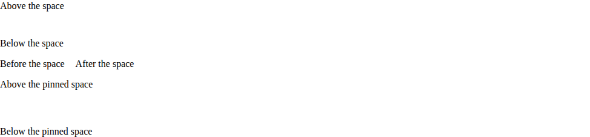

2. Widen the page to 992 pixels, the md breakpoint. The first space grows.

   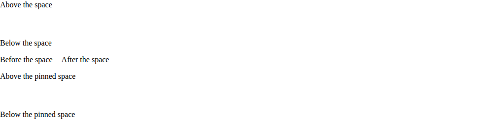

Observed:

| What | Expected | Observed | Result |
| --- | --- | --- | --- |
| below md: the space between Above the space and Below the space is at least its h, md | `"12px"` | `"12px"` | pass |
| the space between Before the space and After the space keeps its w, lg, as its minimum width in a flex row | `"18px"` | `"18px"` | pass |
| the pinned space takes its mih, xs, as its minimum height instead of its h | `"4px"` | `"4px"` | pass |
| at md: the space between Above the space and Below the space is at least its h, xl | `"28px"` | `"28px"` | pass |
| console errors and warnings | `""` | `""` | pass |

### firefox 159.0

Recording of the whole journey:

Steps:

1. Open the page 991 pixels wide, one pixel below the md breakpoint, and scroll to the section named Space.

   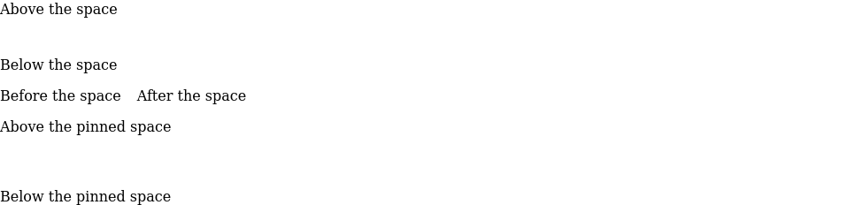

2. Widen the page to 992 pixels, the md breakpoint. The first space grows.

   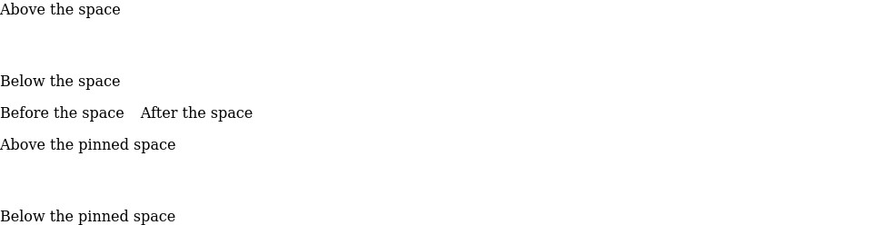

Observed:

| What | Expected | Observed | Result |
| --- | --- | --- | --- |
| below md: the space between Above the space and Below the space is at least its h, md | `"12px"` | `"12px"` | pass |
| the space between Before the space and After the space keeps its w, lg, as its minimum width in a flex row | `"18px"` | `"18px"` | pass |
| the pinned space takes its mih, xs, as its minimum height instead of its h | `"4px"` | `"4px"` | pass |
| at md: the space between Above the space and Below the space is at least its h, xl | `"28px"` | `"28px"` | pass |
| console errors and warnings | `""` | `""` | pass |

### webkit 27.2

Recording of the whole journey:

Steps:

1. Open the page 991 pixels wide, one pixel below the md breakpoint, and scroll to the section named Space.

   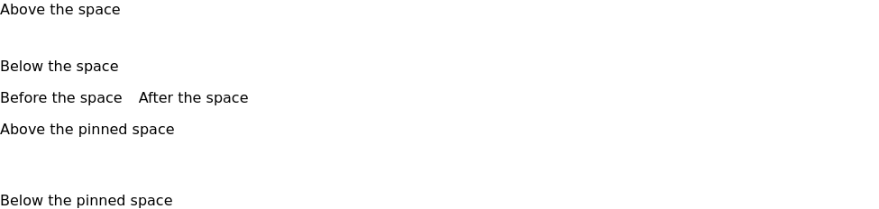

2. Widen the page to 992 pixels, the md breakpoint. The first space grows.

   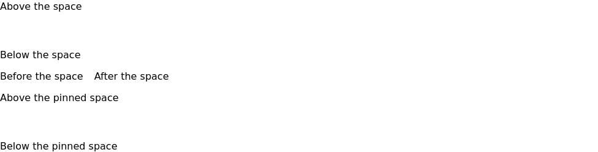

Observed:

| What | Expected | Observed | Result |
| --- | --- | --- | --- |
| below md: the space between Above the space and Below the space is at least its h, md | `"12px"` | `"12px"` | pass |
| the space between Before the space and After the space keeps its w, lg, as its minimum width in a flex row | `"18px"` | `"18px"` | pass |
| the pinned space takes its mih, xs, as its minimum height instead of its h | `"4px"` | `"4px"` | pass |
| at md: the space between Above the space and Below the space is at least its h, xl | `"28px"` | `"28px"` | pass |
| console errors and warnings | `""` | `""` | pass |

## A Center puts its content in its middle, inline or not

Journey `center`.

### chromium 159.0.8154.6

Recording of the whole journey:

Steps:

1. Open the page and scroll to the section named Center.

   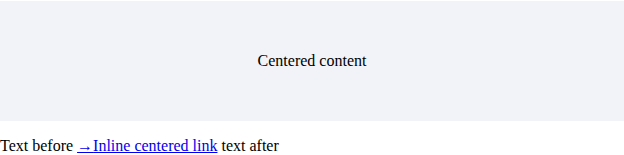

Observed:

| What | Expected | Observed | Result |
| --- | --- | --- | --- |
| the Center is a flex container | `"flex"` | `"flex"` | pass |
| Centered content sits in the middle of the Center, as far from each edge as from the one opposite | `true` | `true` | pass |
| the inline Center is an inline flex container | `"inline-flex"` | `"inline-flex"` | pass |
| the inline Center is the link its component prop names | `"#center"` | `"#center"` | pass |
| console errors and warnings | `""` | `""` | pass |

### firefox 159.0

Recording of the whole journey:

Steps:

1. Open the page and scroll to the section named Center.

   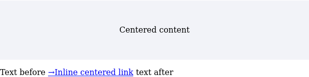

Observed:

| What | Expected | Observed | Result |
| --- | --- | --- | --- |
| the Center is a flex container | `"flex"` | `"flex"` | pass |
| Centered content sits in the middle of the Center, as far from each edge as from the one opposite | `true` | `true` | pass |
| the inline Center is an inline flex container | `"inline-flex"` | `"inline-flex"` | pass |
| the inline Center is the link its component prop names | `"#center"` | `"#center"` | pass |
| console errors and warnings | `""` | `""` | pass |

### webkit 27.2

Recording of the whole journey:

Steps:

1. Open the page and scroll to the section named Center.

   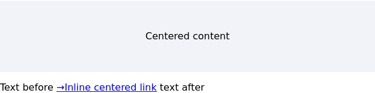

Observed:

| What | Expected | Observed | Result |
| --- | --- | --- | --- |
| the Center is a flex container | `"flex"` | `"flex"` | pass |
| Centered content sits in the middle of the Center, as far from each edge as from the one opposite | `true` | `true` | pass |
| the inline Center is an inline flex container | `"inline-flex"` | `"inline-flex"` | pass |
| the inline Center is the link its component prop names | `"#center"` | `"#center"` | pass |
| console errors and warnings | `""` | `""` | pass |

## A Stack lays its children out in a column

Journey `stack`.

### chromium 159.0.8154.6

Recording of the whole journey:

Steps:

1. Open the page and scroll to the section named Stack.

   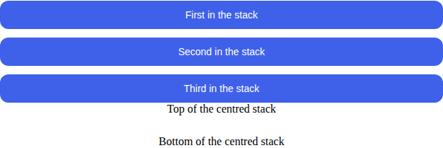

Observed:

| What | Expected | Observed | Result |
| --- | --- | --- | --- |
| the Stack lays its children out in a column | `"column"` | `"column"` | pass |
| the Stack's gap is md by default | `"12px"` | `"12px"` | pass |
| the Stack stretches its children by default | `"stretch"` | `"stretch"` | pass |
| Second in the stack sits below First in the stack | `true` | `true` | pass |
| the centred Stack takes the gap it is given, xl | `"28px"` | `"28px"` | pass |
| the centred Stack centres its children | `"center"` | `"center"` | pass |
| console errors and warnings | `""` | `""` | pass |

### firefox 159.0

Recording of the whole journey:

Steps:

1. Open the page and scroll to the section named Stack.

   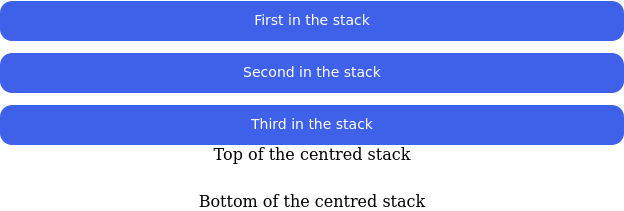

Observed:

| What | Expected | Observed | Result |
| --- | --- | --- | --- |
| the Stack lays its children out in a column | `"column"` | `"column"` | pass |
| the Stack's gap is md by default | `"12px"` | `"12px"` | pass |
| the Stack stretches its children by default | `"stretch"` | `"stretch"` | pass |
| Second in the stack sits below First in the stack | `true` | `true` | pass |
| the centred Stack takes the gap it is given, xl | `"28px"` | `"28px"` | pass |
| the centred Stack centres its children | `"center"` | `"center"` | pass |
| console errors and warnings | `""` | `""` | pass |

### webkit 27.2

Recording of the whole journey:

Steps:

1. Open the page and scroll to the section named Stack.

   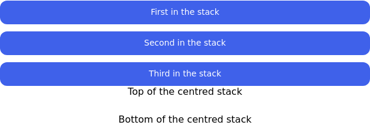

Observed:

| What | Expected | Observed | Result |
| --- | --- | --- | --- |
| the Stack lays its children out in a column | `"column"` | `"column"` | pass |
| the Stack's gap is md by default | `"12px"` | `"12px"` | pass |
| the Stack stretches its children by default | `"stretch"` | `"stretch"` | pass |
| Second in the stack sits below First in the stack | `true` | `true` | pass |
| the centred Stack takes the gap it is given, xl | `"28px"` | `"28px"` | pass |
| the centred Stack centres its children | `"center"` | `"center"` | pass |
| console errors and warnings | `""` | `""` | pass |

## A Group lays its children out in a row, and grows them into equal shares

Journey `group`.

### chromium 159.0.8154.6

Recording of the whole journey:

Steps:

1. Open the page and scroll to the section named Group.

   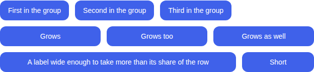

Observed:

| What | Expected | Observed | Result |
| --- | --- | --- | --- |
| the Group lays its children out in a row | `"row"` | `"row"` | pass |
| the Group wraps by default | `"wrap"` | `"wrap"` | pass |
| the Group's gap is md by default | `"12px"` | `"12px"` | pass |
| the Group centres its children across the row by default | `"center"` | `"center"` | pass |
| the growing Group carries data-grow | `"true"` | `"true"` | pass |
| each child of the growing Group takes the same share of the row | `true` | `true` | pass |
| a child of the growing Group grows | `"1"` | `"1"` | pass |
| with preventGrowOverflow false a child has no maximum width | `"none"` | `"none"` | pass |
| with preventGrowOverflow false the wide child takes more of the row than the short one | `true` | `true` | pass |
| console errors and warnings | `""` | `""` | pass |

### firefox 159.0

Recording of the whole journey:

Steps:

1. Open the page and scroll to the section named Group.

   

Observed:

| What | Expected | Observed | Result |
| --- | --- | --- | --- |
| the Group lays its children out in a row | `"row"` | `"row"` | pass |
| the Group wraps by default | `"wrap"` | `"wrap"` | pass |
| the Group's gap is md by default | `"12px"` | `"12px"` | pass |
| the Group centres its children across the row by default | `"center"` | `"center"` | pass |
| the growing Group carries data-grow | `"true"` | `"true"` | pass |
| each child of the growing Group takes the same share of the row | `true` | `true` | pass |
| a child of the growing Group grows | `"1"` | `"1"` | pass |
| with preventGrowOverflow false a child has no maximum width | `"none"` | `"none"` | pass |
| with preventGrowOverflow false the wide child takes more of the row than the short one | `true` | `true` | pass |
| console errors and warnings | `""` | `""` | pass |

### webkit 27.2

Recording of the whole journey:

Steps:

1. Open the page and scroll to the section named Group.

   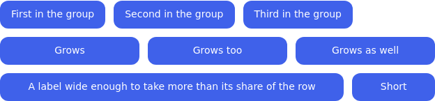

Observed:

| What | Expected | Observed | Result |
| --- | --- | --- | --- |
| the Group lays its children out in a row | `"row"` | `"row"` | pass |
| the Group wraps by default | `"wrap"` | `"wrap"` | pass |
| the Group's gap is md by default | `"12px"` | `"12px"` | pass |
| the Group centres its children across the row by default | `"center"` | `"center"` | pass |
| the growing Group carries data-grow | `"true"` | `"true"` | pass |
| each child of the growing Group takes the same share of the row | `true` | `true` | pass |
| a child of the growing Group grows | `"1"` | `"1"` | pass |
| with preventGrowOverflow false a child has no maximum width | `"none"` | `"none"` | pass |
| with preventGrowOverflow false the wide child takes more of the row than the short one | `true` | `true` | pass |
| console errors and warnings | `""` | `""` | pass |

## A Flex sets the flexbox properties it is given, responsive ones at md

Journey `flex`.

### chromium 159.0.8154.6

Recording of the whole journey:

Steps:

1. Open the page 991 pixels wide, one pixel below the md breakpoint, and scroll to the section named Flex.

   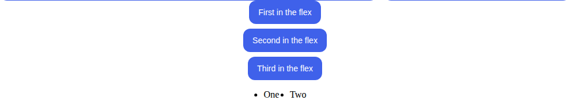

2. Widen the page to 992 pixels, the md breakpoint. The buttons move into a row.

   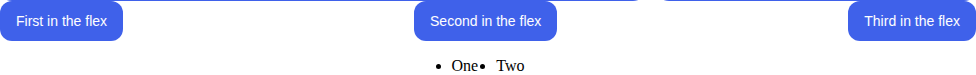

Observed:

| What | Expected | Observed | Result |
| --- | --- | --- | --- |
| below md: the Flex lays its buttons out in a column | `"column"` | `"column"` | pass |
| below md: the gap between columns is xs | `"4px"` | `"4px"` | pass |
| the gap between rows is rowGap, sm, not gap | `"8px"` | `"8px"` | pass |
| align centres the buttons across the main axis | `"center"` | `"center"` | pass |
| justify spreads the buttons along the main axis | `"space-between"` | `"space-between"` | pass |
| wrap lets the buttons wrap | `"wrap"` | `"wrap"` | pass |
| the Flex list is the <ul> its component prop names, a flex container | `"flex"` | `"flex"` | pass |
| the Flex list's gap is lg | `"18px"` | `"18px"` | pass |
| at md: the Flex lays its buttons out in a row | `"row"` | `"row"` | pass |
| at md: the gap between columns is xl | `"28px"` | `"28px"` | pass |
| at md: the gap between rows is still rowGap, sm | `"8px"` | `"8px"` | pass |
| console errors and warnings | `""` | `""` | pass |

### firefox 159.0

Recording of the whole journey:

Steps:

1. Open the page 991 pixels wide, one pixel below the md breakpoint, and scroll to the section named Flex.

   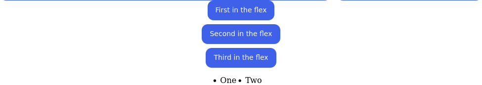

2. Widen the page to 992 pixels, the md breakpoint. The buttons move into a row.

   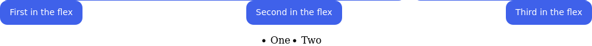

Observed:

| What | Expected | Observed | Result |
| --- | --- | --- | --- |
| below md: the Flex lays its buttons out in a column | `"column"` | `"column"` | pass |
| below md: the gap between columns is xs | `"4px"` | `"4px"` | pass |
| the gap between rows is rowGap, sm, not gap | `"8px"` | `"8px"` | pass |
| align centres the buttons across the main axis | `"center"` | `"center"` | pass |
| justify spreads the buttons along the main axis | `"space-between"` | `"space-between"` | pass |
| wrap lets the buttons wrap | `"wrap"` | `"wrap"` | pass |
| the Flex list is the <ul> its component prop names, a flex container | `"flex"` | `"flex"` | pass |
| the Flex list's gap is lg | `"18px"` | `"18px"` | pass |
| at md: the Flex lays its buttons out in a row | `"row"` | `"row"` | pass |
| at md: the gap between columns is xl | `"28px"` | `"28px"` | pass |
| at md: the gap between rows is still rowGap, sm | `"8px"` | `"8px"` | pass |
| console errors and warnings | `""` | `""` | pass |

### webkit 27.2

Recording of the whole journey:

Steps:

1. Open the page 991 pixels wide, one pixel below the md breakpoint, and scroll to the section named Flex.

   

2. Widen the page to 992 pixels, the md breakpoint. The buttons move into a row.

   

Observed:

| What | Expected | Observed | Result |
| --- | --- | --- | --- |
| below md: the Flex lays its buttons out in a column | `"column"` | `"column"` | pass |
| below md: the gap between columns is xs | `"4px"` | `"4px"` | pass |
| the gap between rows is rowGap, sm, not gap | `"8px"` | `"8px"` | pass |
| align centres the buttons across the main axis | `"center"` | `"center"` | pass |
| justify spreads the buttons along the main axis | `"space-between"` | `"space-between"` | pass |
| wrap lets the buttons wrap | `"wrap"` | `"wrap"` | pass |
| the Flex list is the <ul> its component prop names, a flex container | `"flex"` | `"flex"` | pass |
| the Flex list's gap is lg | `"18px"` | `"18px"` | pass |
| at md: the Flex lays its buttons out in a row | `"row"` | `"row"` | pass |
| at md: the gap between columns is xl | `"28px"` | `"28px"` | pass |
| at md: the gap between rows is still rowGap, sm | `"8px"` | `"8px"` | pass |
| console errors and warnings | `""` | `""` | pass |

## A Container limits its width, or not when fluid, and lays out a breakout grid

Journey `container`.

### chromium 159.0.8154.6

Recording of the whole journey:

Steps:

1. Open the page and scroll to the section named Container.

   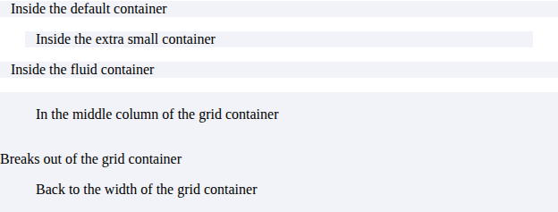

Observed:

| What | Expected | Observed | Result |
| --- | --- | --- | --- |
| the default container is at most the md container size wide | `"960px"` | `"960px"` | pass |
| the default container pads its sides by md | `"12px"` | `"12px"` | pass |
| the default container carries data-strategy=block | `"block"` | `"block"` | pass |
| the extra small container is at most the xs container size wide | `"544px"` | `"544px"` | pass |
| the fluid container takes the whole width | `"100%"` | `"100%"` | pass |
| the grid container is a grid with no maximum width | `"grid none"` | `"grid none"` | pass |
| a child of the grid container is as wide as its size, the middle column | `true` | `true` | pass |
| the breakout child spans the whole grid container | `true` | `true` | pass |
| the data-container inside the breakout is at most the xs container size wide | `"544px"` | `"544px"` | pass |
| console errors and warnings | `""` | `""` | pass |

### firefox 159.0

Recording of the whole journey:

Steps:

1. Open the page and scroll to the section named Container.

   

Observed:

| What | Expected | Observed | Result |
| --- | --- | --- | --- |
| the default container is at most the md container size wide | `"960px"` | `"960px"` | pass |
| the default container pads its sides by md | `"12px"` | `"12px"` | pass |
| the default container carries data-strategy=block | `"block"` | `"block"` | pass |
| the extra small container is at most the xs container size wide | `"544px"` | `"544px"` | pass |
| the fluid container takes the whole width | `"100%"` | `"100%"` | pass |
| the grid container is a grid with no maximum width | `"grid none"` | `"grid none"` | pass |
| a child of the grid container is as wide as its size, the middle column | `true` | `true` | pass |
| the breakout child spans the whole grid container | `true` | `true` | pass |
| the data-container inside the breakout is at most the xs container size wide | `"544px"` | `"544px"` | pass |
| console errors and warnings | `""` | `""` | pass |

### webkit 27.2

Recording of the whole journey:

Steps:

1. Open the page and scroll to the section named Container.

   

Observed:

| What | Expected | Observed | Result |
| --- | --- | --- | --- |
| the default container is at most the md container size wide | `"960px"` | `"960px"` | pass |
| the default container pads its sides by md | `"12px"` | `"12px"` | pass |
| the default container carries data-strategy=block | `"block"` | `"block"` | pass |
| the extra small container is at most the xs container size wide | `"544px"` | `"544px"` | pass |
| the fluid container takes the whole width | `"100%"` | `"100%"` | pass |
| the grid container is a grid with no maximum width | `"grid none"` | `"grid none"` | pass |
| a child of the grid container is as wide as its size, the middle column | `true` | `true` | pass |
| the breakout child spans the whole grid container | `true` | `true` | pass |
| the data-container inside the breakout is at most the xs container size wide | `"544px"` | `"544px"` | pass |
| console errors and warnings | `""` | `""` | pass |

## A SimpleGrid takes its columns from its breakpoints or its container's width

Journey `simple-grid`.

### chromium 159.0.8154.6

Recording of the whole journey:

Steps:

1. Open the page 991 pixels wide, one pixel below the md breakpoint, and scroll to the section named Simple grid.

   

2. Widen the page to 992 pixels, the md breakpoint. The first grid takes a third column.

   

Observed:

| What | Expected | Observed | Result |
| --- | --- | --- | --- |
| below md: the first grid has the 2 columns of its sm value | `2` | `2` | pass |
| below md: the gap between its columns is xs | `"4px"` | `"4px"` | pass |
| the gap between its rows is verticalSpacing, xl | `"28px"` | `"28px"` | pass |
| the grid in a 320 pixel container has 2 columns, past 18em | `2` | `2` | pass |
| the grid in a 560 pixel container has 4 columns, past 30em | `4` | `4` | pass |
| the grid in one cell of it queries its own container and has 1 column | `1` | `1` | pass |
| below md: the grid in a 1024 pixel container, past md, has the 2 columns of its md value | `2` | `2` | pass |
| the grid in a 1100 pixel container with 20 pixel type is past md and has 2 columns | `2` | `2` | pass |
| the auto-filled grid makes columns at least 160 pixels wide | `true` | `true` | pass |
| at md: the first grid has the 3 columns of its md value | `3` | `3` | pass |
| at md: the gap between its columns is lg | `"18px"` | `"18px"` | pass |
| at md: the grids in containers keep their columns | `"2 4"` | `"2 4"` | pass |
| at md: the grid in a 960 pixel container, short of md, has 1 column | `1` | `1` | pass |
| console errors and warnings | `""` | `""` | pass |

### firefox 159.0

Recording of the whole journey:

Steps:

1. Open the page 991 pixels wide, one pixel below the md breakpoint, and scroll to the section named Simple grid.

   

2. Widen the page to 992 pixels, the md breakpoint. The first grid takes a third column.

   

Observed:

| What | Expected | Observed | Result |
| --- | --- | --- | --- |
| below md: the first grid has the 2 columns of its sm value | `2` | `2` | pass |
| below md: the gap between its columns is xs | `"4px"` | `"4px"` | pass |
| the gap between its rows is verticalSpacing, xl | `"28px"` | `"28px"` | pass |
| the grid in a 320 pixel container has 2 columns, past 18em | `2` | `2` | pass |
| the grid in a 560 pixel container has 4 columns, past 30em | `4` | `4` | pass |
| the grid in one cell of it queries its own container and has 1 column | `1` | `1` | pass |
| below md: the grid in a 1024 pixel container, past md, has the 2 columns of its md value | `2` | `2` | pass |
| the grid in a 1100 pixel container with 20 pixel type is past md and has 2 columns | `2` | `2` | pass |
| the auto-filled grid makes columns at least 160 pixels wide | `true` | `true` | pass |
| at md: the first grid has the 3 columns of its md value | `3` | `3` | pass |
| at md: the gap between its columns is lg | `"18px"` | `"18px"` | pass |
| at md: the grids in containers keep their columns | `"2 4"` | `"2 4"` | pass |
| at md: the grid in a 960 pixel container, short of md, has 1 column | `1` | `1` | pass |
| console errors and warnings | `""` | `""` | pass |

### webkit 27.2

Recording of the whole journey:

Steps:

1. Open the page 991 pixels wide, one pixel below the md breakpoint, and scroll to the section named Simple grid.

   

2. Widen the page to 992 pixels, the md breakpoint. The first grid takes a third column.

   

Observed:

| What | Expected | Observed | Result |
| --- | --- | --- | --- |
| below md: the first grid has the 2 columns of its sm value | `2` | `2` | pass |
| below md: the gap between its columns is xs | `"4px"` | `"4px"` | pass |
| the gap between its rows is verticalSpacing, xl | `"28px"` | `"28px"` | pass |
| the grid in a 320 pixel container has 2 columns, past 18em | `2` | `2` | pass |
| the grid in a 560 pixel container has 4 columns, past 30em | `4` | `4` | pass |
| the grid in one cell of it queries its own container and has 1 column | `1` | `1` | pass |
| below md: the grid in a 1024 pixel container, past md, has the 2 columns of its md value | `2` | `2` | pass |
| the grid in a 1100 pixel container with 20 pixel type is past md and has 2 columns | `2` | `2` | pass |
| the auto-filled grid makes columns at least 160 pixels wide | `true` | `true` | pass |
| at md: the first grid has the 3 columns of its md value | `3` | `3` | pass |
| at md: the gap between its columns is lg | `"18px"` | `"18px"` | pass |
| at md: the grids in containers keep their columns | `"2 4"` | `"2 4"` | pass |
| at md: the grid in a 960 pixel container, short of md, has 1 column | `1` | `1` | pass |
| console errors and warnings | `""` | `""` | pass |

## A Grid gives each column the share of its row that span names

Journey `grid`.

### chromium 159.0.8154.6

Recording of the whole journey:

Steps:

1. Open the page 991 pixels wide, one pixel below the md breakpoint, and scroll to the section named Grid.

   

2. Widen the page to 992 pixels, the md breakpoint. The first two columns share a row, and the ordered columns swap.

   

Observed:

| What | Expected | Observed | Result |
| --- | --- | --- | --- |
| below md: Half from md spans all 12 columns | `true` | `true` | pass |
| below md: the gap is xs | `"4px"` | `"4px"` | pass |
| A third spans 4 of 12 columns | `true` | `true` | pass |
| A third after an offset leaves 4 columns empty before it | `true` | `true` | pass |
| below md: Ordered two comes before Ordered one, in one row | `true` | `true` | pass |
| Content column is as wide as its content | `"auto"` | `"auto"` | pass |
| Auto column grows into the rest of its row | `"1"` | `"1"` | pass |
| with grow, two columns of 6 out of 24 each fill half the row | `true` | `true` | pass |
| justify and overflow reach the grid | `"center hidden"` | `"center hidden"` | pass |
| align flex-end puts the shorter column level with the bottom of the taller one | `true` | `true` | pass |
| in a 480 pixel container, past 20em, a column spans 6 of 12 | `true` | `true` | pass |
| in a 240 pixel container, short of 20em, a column spans 12 of 12 | `true` | `true` | pass |
| below md: without breakpoints, in a 1024 pixel container, past md, a column spans 6 of 12 | `true` | `true` | pass |
| at md: Half from md spans 6 of 12 columns | `true` | `true` | pass |
| at md: the gap is lg | `"18px"` | `"18px"` | pass |
| at md: Ordered one comes before Ordered two, in one row | `true` | `true` | pass |
| at md: without breakpoints, in a 960 pixel container, short of md, a column spans 12 of 12 | `true` | `true` | pass |
| console errors and warnings | `""` | `""` | pass |

### firefox 159.0

Recording of the whole journey:

Steps:

1. Open the page 991 pixels wide, one pixel below the md breakpoint, and scroll to the section named Grid.

   

2. Widen the page to 992 pixels, the md breakpoint. The first two columns share a row, and the ordered columns swap.

   

Observed:

| What | Expected | Observed | Result |
| --- | --- | --- | --- |
| below md: Half from md spans all 12 columns | `true` | `true` | pass |
| below md: the gap is xs | `"4px"` | `"4px"` | pass |
| A third spans 4 of 12 columns | `true` | `true` | pass |
| A third after an offset leaves 4 columns empty before it | `true` | `true` | pass |
| below md: Ordered two comes before Ordered one, in one row | `true` | `true` | pass |
| Content column is as wide as its content | `"auto"` | `"auto"` | pass |
| Auto column grows into the rest of its row | `"1"` | `"1"` | pass |
| with grow, two columns of 6 out of 24 each fill half the row | `true` | `true` | pass |
| justify and overflow reach the grid | `"center hidden"` | `"center hidden"` | pass |
| align flex-end puts the shorter column level with the bottom of the taller one | `true` | `true` | pass |
| in a 480 pixel container, past 20em, a column spans 6 of 12 | `true` | `true` | pass |
| in a 240 pixel container, short of 20em, a column spans 12 of 12 | `true` | `true` | pass |
| below md: without breakpoints, in a 1024 pixel container, past md, a column spans 6 of 12 | `true` | `true` | pass |
| at md: Half from md spans 6 of 12 columns | `true` | `true` | pass |
| at md: the gap is lg | `"18px"` | `"18px"` | pass |
| at md: Ordered one comes before Ordered two, in one row | `true` | `true` | pass |
| at md: without breakpoints, in a 960 pixel container, short of md, a column spans 12 of 12 | `true` | `true` | pass |
| console errors and warnings | `""` | `""` | pass |

### webkit 27.2

Recording of the whole journey:

Steps:

1. Open the page 991 pixels wide, one pixel below the md breakpoint, and scroll to the section named Grid.

   

2. Widen the page to 992 pixels, the md breakpoint. The first two columns share a row, and the ordered columns swap.

   

Observed:

| What | Expected | Observed | Result |
| --- | --- | --- | --- |
| below md: Half from md spans all 12 columns | `true` | `true` | pass |
| below md: the gap is xs | `"4px"` | `"4px"` | pass |
| A third spans 4 of 12 columns | `true` | `true` | pass |
| A third after an offset leaves 4 columns empty before it | `true` | `true` | pass |
| below md: Ordered two comes before Ordered one, in one row | `true` | `true` | pass |
| Content column is as wide as its content | `"auto"` | `"auto"` | pass |
| Auto column grows into the rest of its row | `"1"` | `"1"` | pass |
| with grow, two columns of 6 out of 24 each fill half the row | `true` | `true` | pass |
| justify and overflow reach the grid | `"center hidden"` | `"center hidden"` | pass |
| align flex-end puts the shorter column level with the bottom of the taller one | `true` | `true` | pass |
| in a 480 pixel container, past 20em, a column spans 6 of 12 | `true` | `true` | pass |
| in a 240 pixel container, short of 20em, a column spans 12 of 12 | `true` | `true` | pass |
| below md: without breakpoints, in a 1024 pixel container, past md, a column spans 6 of 12 | `true` | `true` | pass |
| at md: Half from md spans 6 of 12 columns | `true` | `true` | pass |
| at md: the gap is lg | `"18px"` | `"18px"` | pass |
| at md: Ordered one comes before Ordered two, in one row | `true` | `true` | pass |
| at md: without breakpoints, in a 960 pixel container, short of md, a column spans 12 of 12 | `true` | `true` | pass |
| console errors and warnings | `""` | `""` | pass |

## Tabs select by click and by key, step over a disabled tab, and can select none

Journey `tabs`.

### chromium 159.0.8154.6

Recording of the whole journey:

Steps:

1. Open the page and scroll to the section named Tabs.

   

2. Click the tab named Members. Its panel replaces the Overview panel.

   

3. Click Overview and press the right arrow. Focus and selection step over the disabled Billing tab to Members.

   

4. Press End. The last tab, Security, is focused and selected.

   

5. Press the right arrow on the last tab. It wraps to Overview.

   

6. In the vertical list, click Two and press the down arrow. Focus moves to Three and Two stays selected.

   

7. Press Enter. Three is selected.

   

8. Press the down arrow on the last tab. This list does not wrap, so focus stays on Three.

   

9. Click Notes in the list named Optional. Its panel shows.

   

10. Click Notes again. No tab is selected and no panel shows.

   

11. Click Locked in the list named Controlled. The app's own handler refuses the press, so Drafts stays selected.

   

Observed:

| What | Expected | Observed | Result |
| --- | --- | --- | --- |
| at first: selected tab | `"Overview"` | `"Overview"` | pass |
| at first: panels shown | `"Overview panel"` | `"Overview panel"` | pass |
| at first: selected tab text colour | `"oklch(0.55 0.21 268)"` | `"oklch(0.55 0.21 268)"` | pass |
| at first: another tab text colour | `"oklch(0.24 0.02 268)"` | `"oklch(0.24 0.02 268)"` | pass |
| at first: the disabled tab is disabled | `true` | `true` | pass |
| after a click on Members: selected tab | `"Members"` | `"Members"` | pass |
| after a click on Members: panels shown | `"Members panel"` | `"Members panel"` | pass |
| after a click on Members: the tab names its panel | `"account-panel-members"` | `"account-panel-members"` | pass |
| right arrow from Overview: focused tab | `"Members"` | `"Members"` | pass |
| right arrow from Overview: selected tab | `"Members"` | `"Members"` | pass |
| End: focused and selected tab | `"Security Security"` | `"Security Security"` | pass |
| right arrow from the last tab: focused and selected tab | `"Overview Overview"` | `"Overview Overview"` | pass |
| manual, down arrow from Two: focused tab | `"Three"` | `"Three"` | pass |
| manual, down arrow from Two: selected tab | `"Two"` | `"Two"` | pass |
| manual, Enter on Three: selected tab | `"Three"` | `"Three"` | pass |
| manual, Enter on Three: the selected tab's edge at its inline end, and under it | `"solid none"` | `"solid none"` | pass |
| manual, down arrow on the last tab: focused tab | `"Three"` | `"Three"` | pass |
| optional: nothing is selected at first | `null` | `null` | pass |
| optional, after a click on Notes: panels shown | `"Notes panel"` | `"Notes panel"` | pass |
| optional, after a second click on Notes: selected tab | `null` | `null` | pass |
| optional, after a second click on Notes: panels shown | `""` | `""` | pass |
| controlled, after a click on Locked: selected tab | `"Drafts"` | `"Drafts"` | pass |
| controlled, after a click on Locked: presses the app refused | `"1"` | `"1"` | pass |
| console errors and warnings | `""` | `""` | pass |

### firefox 159.0

Recording of the whole journey:

Steps:

1. Open the page and scroll to the section named Tabs.

   

2. Click the tab named Members. Its panel replaces the Overview panel.

   

3. Click Overview and press the right arrow. Focus and selection step over the disabled Billing tab to Members.

   

4. Press End. The last tab, Security, is focused and selected.

   

5. Press the right arrow on the last tab. It wraps to Overview.

   

6. In the vertical list, click Two and press the down arrow. Focus moves to Three and Two stays selected.

   

7. Press Enter. Three is selected.

   

8. Press the down arrow on the last tab. This list does not wrap, so focus stays on Three.

   

9. Click Notes in the list named Optional. Its panel shows.

   

10. Click Notes again. No tab is selected and no panel shows.

   

11. Click Locked in the list named Controlled. The app's own handler refuses the press, so Drafts stays selected.

   

Observed:

| What | Expected | Observed | Result |
| --- | --- | --- | --- |
| at first: selected tab | `"Overview"` | `"Overview"` | pass |
| at first: panels shown | `"Overview panel"` | `"Overview panel"` | pass |
| at first: selected tab text colour | `"oklch(0.55 0.21 268)"` | `"oklch(0.55 0.21 268)"` | pass |
| at first: another tab text colour | `"oklch(0.24 0.02 268)"` | `"oklch(0.24 0.02 268)"` | pass |
| at first: the disabled tab is disabled | `true` | `true` | pass |
| after a click on Members: selected tab | `"Members"` | `"Members"` | pass |
| after a click on Members: panels shown | `"Members panel"` | `"Members panel"` | pass |
| after a click on Members: the tab names its panel | `"account-panel-members"` | `"account-panel-members"` | pass |
| right arrow from Overview: focused tab | `"Members"` | `"Members"` | pass |
| right arrow from Overview: selected tab | `"Members"` | `"Members"` | pass |
| End: focused and selected tab | `"Security Security"` | `"Security Security"` | pass |
| right arrow from the last tab: focused and selected tab | `"Overview Overview"` | `"Overview Overview"` | pass |
| manual, down arrow from Two: focused tab | `"Three"` | `"Three"` | pass |
| manual, down arrow from Two: selected tab | `"Two"` | `"Two"` | pass |
| manual, Enter on Three: selected tab | `"Three"` | `"Three"` | pass |
| manual, Enter on Three: the selected tab's edge at its inline end, and under it | `"solid none"` | `"solid none"` | pass |
| manual, down arrow on the last tab: focused tab | `"Three"` | `"Three"` | pass |
| optional: nothing is selected at first | `null` | `null` | pass |
| optional, after a click on Notes: panels shown | `"Notes panel"` | `"Notes panel"` | pass |
| optional, after a second click on Notes: selected tab | `null` | `null` | pass |
| optional, after a second click on Notes: panels shown | `""` | `""` | pass |
| controlled, after a click on Locked: selected tab | `"Drafts"` | `"Drafts"` | pass |
| controlled, after a click on Locked: presses the app refused | `"1"` | `"1"` | pass |
| console errors and warnings | `""` | `""` | pass |

### webkit 27.2

Recording of the whole journey:

Steps:

1. Open the page and scroll to the section named Tabs.

   

2. Click the tab named Members. Its panel replaces the Overview panel.

   

3. Click Overview and press the right arrow. Focus and selection step over the disabled Billing tab to Members.

   

4. Press End. The last tab, Security, is focused and selected.

   

5. Press the right arrow on the last tab. It wraps to Overview.

   

6. In the vertical list, click Two and press the down arrow. Focus moves to Three and Two stays selected.

   

7. Press Enter. Three is selected.

   

8. Press the down arrow on the last tab. This list does not wrap, so focus stays on Three.

   

9. Click Notes in the list named Optional. Its panel shows.

   

10. Click Notes again. No tab is selected and no panel shows.

   

11. Click Locked in the list named Controlled. The app's own handler refuses the press, so Drafts stays selected.

   

Observed:

| What | Expected | Observed | Result |
| --- | --- | --- | --- |
| at first: selected tab | `"Overview"` | `"Overview"` | pass |
| at first: panels shown | `"Overview panel"` | `"Overview panel"` | pass |
| at first: selected tab text colour | `"oklch(0.55 0.21 268)"` | `"oklch(0.55 0.21 268)"` | pass |
| at first: another tab text colour | `"oklch(0.24 0.02 268)"` | `"oklch(0.24 0.02 268)"` | pass |
| at first: the disabled tab is disabled | `true` | `true` | pass |
| after a click on Members: selected tab | `"Members"` | `"Members"` | pass |
| after a click on Members: panels shown | `"Members panel"` | `"Members panel"` | pass |
| after a click on Members: the tab names its panel | `"account-panel-members"` | `"account-panel-members"` | pass |
| right arrow from Overview: focused tab | `"Members"` | `"Members"` | pass |
| right arrow from Overview: selected tab | `"Members"` | `"Members"` | pass |
| End: focused and selected tab | `"Security Security"` | `"Security Security"` | pass |
| right arrow from the last tab: focused and selected tab | `"Overview Overview"` | `"Overview Overview"` | pass |
| manual, down arrow from Two: focused tab | `"Three"` | `"Three"` | pass |
| manual, down arrow from Two: selected tab | `"Two"` | `"Two"` | pass |
| manual, Enter on Three: selected tab | `"Three"` | `"Three"` | pass |
| manual, Enter on Three: the selected tab's edge at its inline end, and under it | `"solid none"` | `"solid none"` | pass |
| manual, down arrow on the last tab: focused tab | `"Three"` | `"Three"` | pass |
| optional: nothing is selected at first | `null` | `null` | pass |
| optional, after a click on Notes: panels shown | `"Notes panel"` | `"Notes panel"` | pass |
| optional, after a second click on Notes: selected tab | `null` | `null` | pass |
| optional, after a second click on Notes: panels shown | `""` | `""` | pass |
| controlled, after a click on Locked: selected tab | `"Drafts"` | `"Drafts"` | pass |
| controlled, after a click on Locked: presses the app refused | `"1"` | `"1"` | pass |
| console errors and warnings | `""` | `""` | pass |

## Every row of the keyboard table moves focus and selection as the tabs pattern says

Journey `tabs-keyboard`.

### chromium 159.0.8154.6

Recording of the whole journey:

Steps:

1. Open the page and scroll to the section named Tabs.

   

2. In Account, start at Overview and press ArrowRight.

   

3. In Account, start at Members and press ArrowLeft.

   

4. In Account, start at Overview and press ArrowLeft.

   

5. In Account, start at Security and press ArrowRight.

   

6. In Account, start at Members and press Home.

   

7. In Account, start at Overview and press End.

   

8. In Account, start at Members and press ArrowDown.

   

9. In Account, start at Members and press ArrowUp.

   

10. In Account, start at Overview and press ArrowRight, then ArrowRight.

   

11. In Right to left, start at North and press ArrowLeft.

   

12. In Right to left, start at South and press ArrowRight.

   

13. In Right to left, start at North and press ArrowRight.

   

14. In Right to left, start at West and press ArrowLeft.

   

15. In Right to left, start at South and press Home.

   

16. In Right to left, start at South and press End.

   

17. In Manual vertical, start at Two and press ArrowDown.

   

18. In Manual vertical, start at Two and press ArrowDown, then Enter.

   

19. In Manual vertical, start at Two and press ArrowUp, then Space.

   

20. In Manual vertical, start at Three and press ArrowDown.

   

21. In Manual vertical, start at One and press ArrowUp.

   

22. In Manual vertical, start at Two and press ArrowRight.

   

23. In Manual vertical, start at Two and press Home.

   

24. In Manual vertical, start at Two and press End.

   

25. In Vertical, start at Beta and press ArrowUp.

   

26. In Vertical, start at Alpha and press ArrowUp.

   

27. In Vertical, start at Gamma and press ArrowDown.

   

28. In Vertical, start at Alpha and press ArrowDown.

   

29. In Vertical, start at Beta and press ArrowLeft.

   

30. In Vertical, start at Alpha and press End.

   

31. In Optional, start at Files and press Home.

   

32. In Optional, start at Notes and press End.

   

33. In Optional, start at Files and press ArrowRight.

   

34. In Optional, start at Notes and press ArrowLeft.

   

Observed:

| What | Expected | Observed | Result |
| --- | --- | --- | --- |
| Account, from Overview, ArrowRight: focused tab | `"Members"` | `"Members"` | pass |
| Account, from Overview, ArrowRight: selected tab | `"Members"` | `"Members"` | pass |
| Account, from Overview, ArrowRight: panels shown | `"Members panel"` | `"Members panel"` | pass |
| Account, from Overview, ArrowRight: tab stops | `"Members"` | `"Members"` | pass |
| Account, from Members, ArrowLeft: focused tab | `"Overview"` | `"Overview"` | pass |
| Account, from Members, ArrowLeft: selected tab | `"Overview"` | `"Overview"` | pass |
| Account, from Members, ArrowLeft: panels shown | `"Overview panel"` | `"Overview panel"` | pass |
| Account, from Members, ArrowLeft: tab stops | `"Overview"` | `"Overview"` | pass |
| Account, from Overview, ArrowLeft: focused tab | `"Security"` | `"Security"` | pass |
| Account, from Overview, ArrowLeft: selected tab | `"Security"` | `"Security"` | pass |
| Account, from Overview, ArrowLeft: panels shown | `"Security panel"` | `"Security panel"` | pass |
| Account, from Overview, ArrowLeft: tab stops | `"Security"` | `"Security"` | pass |
| Account, from Security, ArrowRight: focused tab | `"Overview"` | `"Overview"` | pass |
| Account, from Security, ArrowRight: selected tab | `"Overview"` | `"Overview"` | pass |
| Account, from Security, ArrowRight: panels shown | `"Overview panel"` | `"Overview panel"` | pass |
| Account, from Security, ArrowRight: tab stops | `"Overview"` | `"Overview"` | pass |
| Account, from Members, Home: focused tab | `"Overview"` | `"Overview"` | pass |
| Account, from Members, Home: selected tab | `"Overview"` | `"Overview"` | pass |
| Account, from Members, Home: panels shown | `"Overview panel"` | `"Overview panel"` | pass |
| Account, from Members, Home: tab stops | `"Overview"` | `"Overview"` | pass |
| Account, from Overview, End: focused tab | `"Security"` | `"Security"` | pass |
| Account, from Overview, End: selected tab | `"Security"` | `"Security"` | pass |
| Account, from Overview, End: panels shown | `"Security panel"` | `"Security panel"` | pass |
| Account, from Overview, End: tab stops | `"Security"` | `"Security"` | pass |
| Account, from Members, ArrowDown: focused tab | `"Members"` | `"Members"` | pass |
| Account, from Members, ArrowDown: selected tab | `"Members"` | `"Members"` | pass |
| Account, from Members, ArrowDown: panels shown | `"Members panel"` | `"Members panel"` | pass |
| Account, from Members, ArrowDown: tab stops | `"Members"` | `"Members"` | pass |
| Account, from Members, ArrowUp: focused tab | `"Members"` | `"Members"` | pass |
| Account, from Members, ArrowUp: selected tab | `"Members"` | `"Members"` | pass |
| Account, from Members, ArrowUp: panels shown | `"Members panel"` | `"Members panel"` | pass |
| Account, from Members, ArrowUp: tab stops | `"Members"` | `"Members"` | pass |
| Account, from Overview, ArrowRight then ArrowRight: focused tab | `"Security"` | `"Security"` | pass |
| Account, from Overview, ArrowRight then ArrowRight: selected tab | `"Security"` | `"Security"` | pass |
| Account, from Overview, ArrowRight then ArrowRight: panels shown | `"Security panel"` | `"Security panel"` | pass |
| Account, from Overview, ArrowRight then ArrowRight: tab stops | `"Security"` | `"Security"` | pass |
| Right to left, from North, ArrowLeft: focused tab | `"South"` | `"South"` | pass |
| Right to left, from North, ArrowLeft: selected tab | `"South"` | `"South"` | pass |
| Right to left, from North, ArrowLeft: panels shown | `"South panel"` | `"South panel"` | pass |
| Right to left, from North, ArrowLeft: tab stops | `"South"` | `"South"` | pass |
| Right to left, from South, ArrowRight: focused tab | `"North"` | `"North"` | pass |
| Right to left, from South, ArrowRight: selected tab | `"North"` | `"North"` | pass |
| Right to left, from South, ArrowRight: panels shown | `"North panel"` | `"North panel"` | pass |
| Right to left, from South, ArrowRight: tab stops | `"North"` | `"North"` | pass |
| Right to left, from North, ArrowRight: focused tab | `"West"` | `"West"` | pass |
| Right to left, from North, ArrowRight: selected tab | `"West"` | `"West"` | pass |
| Right to left, from North, ArrowRight: panels shown | `"West panel"` | `"West panel"` | pass |
| Right to left, from North, ArrowRight: tab stops | `"West"` | `"West"` | pass |
| Right to left, from West, ArrowLeft: focused tab | `"North"` | `"North"` | pass |
| Right to left, from West, ArrowLeft: selected tab | `"North"` | `"North"` | pass |
| Right to left, from West, ArrowLeft: panels shown | `"North panel"` | `"North panel"` | pass |
| Right to left, from West, ArrowLeft: tab stops | `"North"` | `"North"` | pass |
| Right to left, from South, Home: focused tab | `"North"` | `"North"` | pass |
| Right to left, from South, Home: selected tab | `"North"` | `"North"` | pass |
| Right to left, from South, Home: panels shown | `"North panel"` | `"North panel"` | pass |
| Right to left, from South, Home: tab stops | `"North"` | `"North"` | pass |
| Right to left, from South, End: focused tab | `"West"` | `"West"` | pass |
| Right to left, from South, End: selected tab | `"West"` | `"West"` | pass |
| Right to left, from South, End: panels shown | `"West panel"` | `"West panel"` | pass |
| Right to left, from South, End: tab stops | `"West"` | `"West"` | pass |
| Manual vertical, from Two, ArrowDown: focused tab | `"Three"` | `"Three"` | pass |
| Manual vertical, from Two, ArrowDown: selected tab | `"Two"` | `"Two"` | pass |
| Manual vertical, from Two, ArrowDown: panels shown | `"Two panel"` | `"Two panel"` | pass |
| Manual vertical, from Two, ArrowDown: tab stops | `"Two"` | `"Two"` | pass |
| Manual vertical, from Two, ArrowDown then Enter: focused tab | `"Three"` | `"Three"` | pass |
| Manual vertical, from Two, ArrowDown then Enter: selected tab | `"Three"` | `"Three"` | pass |
| Manual vertical, from Two, ArrowDown then Enter: panels shown | `"Three panel"` | `"Three panel"` | pass |
| Manual vertical, from Two, ArrowDown then Enter: tab stops | `"Three"` | `"Three"` | pass |
| Manual vertical, from Two, ArrowUp then Space: focused tab | `"One"` | `"One"` | pass |
| Manual vertical, from Two, ArrowUp then Space: selected tab | `"One"` | `"One"` | pass |
| Manual vertical, from Two, ArrowUp then Space: panels shown | `"One panel"` | `"One panel"` | pass |
| Manual vertical, from Two, ArrowUp then Space: tab stops | `"One"` | `"One"` | pass |
| Manual vertical, from Three, ArrowDown: focused tab | `"Three"` | `"Three"` | pass |
| Manual vertical, from Three, ArrowDown: selected tab | `"Three"` | `"Three"` | pass |
| Manual vertical, from Three, ArrowDown: panels shown | `"Three panel"` | `"Three panel"` | pass |
| Manual vertical, from Three, ArrowDown: tab stops | `"Three"` | `"Three"` | pass |
| Manual vertical, from One, ArrowUp: focused tab | `"One"` | `"One"` | pass |
| Manual vertical, from One, ArrowUp: selected tab | `"One"` | `"One"` | pass |
| Manual vertical, from One, ArrowUp: panels shown | `"One panel"` | `"One panel"` | pass |
| Manual vertical, from One, ArrowUp: tab stops | `"One"` | `"One"` | pass |
| Manual vertical, from Two, ArrowRight: focused tab | `"Two"` | `"Two"` | pass |
| Manual vertical, from Two, ArrowRight: selected tab | `"Two"` | `"Two"` | pass |
| Manual vertical, from Two, ArrowRight: panels shown | `"Two panel"` | `"Two panel"` | pass |
| Manual vertical, from Two, ArrowRight: tab stops | `"Two"` | `"Two"` | pass |
| Manual vertical, from Two, Home: focused tab | `"One"` | `"One"` | pass |
| Manual vertical, from Two, Home: selected tab | `"Two"` | `"Two"` | pass |
| Manual vertical, from Two, Home: panels shown | `"Two panel"` | `"Two panel"` | pass |
| Manual vertical, from Two, Home: tab stops | `"Two"` | `"Two"` | pass |
| Manual vertical, from Two, End: focused tab | `"Three"` | `"Three"` | pass |
| Manual vertical, from Two, End: selected tab | `"Two"` | `"Two"` | pass |
| Manual vertical, from Two, End: panels shown | `"Two panel"` | `"Two panel"` | pass |
| Manual vertical, from Two, End: tab stops | `"Two"` | `"Two"` | pass |
| Vertical, from Beta, ArrowUp: focused tab | `"Alpha"` | `"Alpha"` | pass |
| Vertical, from Beta, ArrowUp: selected tab | `"Alpha"` | `"Alpha"` | pass |
| Vertical, from Beta, ArrowUp: panels shown | `"Alpha panel"` | `"Alpha panel"` | pass |
| Vertical, from Beta, ArrowUp: tab stops | `"Alpha"` | `"Alpha"` | pass |
| Vertical, from Alpha, ArrowUp: focused tab | `"Gamma"` | `"Gamma"` | pass |
| Vertical, from Alpha, ArrowUp: selected tab | `"Gamma"` | `"Gamma"` | pass |
| Vertical, from Alpha, ArrowUp: panels shown | `"Gamma panel"` | `"Gamma panel"` | pass |
| Vertical, from Alpha, ArrowUp: tab stops | `"Gamma"` | `"Gamma"` | pass |
| Vertical, from Gamma, ArrowDown: focused tab | `"Alpha"` | `"Alpha"` | pass |
| Vertical, from Gamma, ArrowDown: selected tab | `"Alpha"` | `"Alpha"` | pass |
| Vertical, from Gamma, ArrowDown: panels shown | `"Alpha panel"` | `"Alpha panel"` | pass |
| Vertical, from Gamma, ArrowDown: tab stops | `"Alpha"` | `"Alpha"` | pass |
| Vertical, from Alpha, ArrowDown: focused tab | `"Beta"` | `"Beta"` | pass |
| Vertical, from Alpha, ArrowDown: selected tab | `"Beta"` | `"Beta"` | pass |
| Vertical, from Alpha, ArrowDown: panels shown | `"Beta panel"` | `"Beta panel"` | pass |
| Vertical, from Alpha, ArrowDown: tab stops | `"Beta"` | `"Beta"` | pass |
| Vertical, from Beta, ArrowLeft: focused tab | `"Beta"` | `"Beta"` | pass |
| Vertical, from Beta, ArrowLeft: selected tab | `"Beta"` | `"Beta"` | pass |
| Vertical, from Beta, ArrowLeft: panels shown | `"Beta panel"` | `"Beta panel"` | pass |
| Vertical, from Beta, ArrowLeft: tab stops | `"Beta"` | `"Beta"` | pass |
| Vertical, from Alpha, End: focused tab | `"Gamma"` | `"Gamma"` | pass |
| Vertical, from Alpha, End: selected tab | `"Gamma"` | `"Gamma"` | pass |
| Vertical, from Alpha, End: panels shown | `"Gamma panel"` | `"Gamma panel"` | pass |
| Vertical, from Alpha, End: tab stops | `"Gamma"` | `"Gamma"` | pass |
| Optional, from Files, Home: focused tab | `"Notes"` | `"Notes"` | pass |
| Optional, from Files, Home: selected tab | `"Notes"` | `"Notes"` | pass |
| Optional, from Files, Home: panels shown | `"Notes panel"` | `"Notes panel"` | pass |
| Optional, from Files, Home: tab stops | `"Notes"` | `"Notes"` | pass |
| Optional, from Notes, End: focused tab | `"Files"` | `"Files"` | pass |
| Optional, from Notes, End: selected tab | `"Files"` | `"Files"` | pass |
| Optional, from Notes, End: panels shown | `"Files panel"` | `"Files panel"` | pass |
| Optional, from Notes, End: tab stops | `"Files"` | `"Files"` | pass |
| Optional, from Files, ArrowRight: focused tab | `"Notes"` | `"Notes"` | pass |
| Optional, from Files, ArrowRight: selected tab | `"Notes"` | `"Notes"` | pass |
| Optional, from Files, ArrowRight: panels shown | `"Notes panel"` | `"Notes panel"` | pass |
| Optional, from Files, ArrowRight: tab stops | `"Notes"` | `"Notes"` | pass |
| Optional, from Notes, ArrowLeft: focused tab | `"Files"` | `"Files"` | pass |
| Optional, from Notes, ArrowLeft: selected tab | `"Files"` | `"Files"` | pass |
| Optional, from Notes, ArrowLeft: panels shown | `"Files panel"` | `"Files panel"` | pass |
| Optional, from Notes, ArrowLeft: tab stops | `"Files"` | `"Files"` | pass |
| console errors and warnings | `""` | `""` | pass |

### firefox 159.0

Recording of the whole journey:

Steps:

1. Open the page and scroll to the section named Tabs.

   

2. In Account, start at Overview and press ArrowRight.

   

3. In Account, start at Members and press ArrowLeft.

   

4. In Account, start at Overview and press ArrowLeft.

   

5. In Account, start at Security and press ArrowRight.

   

6. In Account, start at Members and press Home.

   

7. In Account, start at Overview and press End.

   

8. In Account, start at Members and press ArrowDown.

   

9. In Account, start at Members and press ArrowUp.

   

10. In Account, start at Overview and press ArrowRight, then ArrowRight.

   

11. In Right to left, start at North and press ArrowLeft.

   

12. In Right to left, start at South and press ArrowRight.

   

13. In Right to left, start at North and press ArrowRight.

   

14. In Right to left, start at West and press ArrowLeft.

   

15. In Right to left, start at South and press Home.

   

16. In Right to left, start at South and press End.

   

17. In Manual vertical, start at Two and press ArrowDown.

   

18. In Manual vertical, start at Two and press ArrowDown, then Enter.

   

19. In Manual vertical, start at Two and press ArrowUp, then Space.

   

20. In Manual vertical, start at Three and press ArrowDown.

   

21. In Manual vertical, start at One and press ArrowUp.

   

22. In Manual vertical, start at Two and press ArrowRight.

   

23. In Manual vertical, start at Two and press Home.

   

24. In Manual vertical, start at Two and press End.

   

25. In Vertical, start at Beta and press ArrowUp.

   

26. In Vertical, start at Alpha and press ArrowUp.

   

27. In Vertical, start at Gamma and press ArrowDown.

   

28. In Vertical, start at Alpha and press ArrowDown.

   

29. In Vertical, start at Beta and press ArrowLeft.

   

30. In Vertical, start at Alpha and press End.

   

31. In Optional, start at Files and press Home.

   

32. In Optional, start at Notes and press End.

   

33. In Optional, start at Files and press ArrowRight.

   

34. In Optional, start at Notes and press ArrowLeft.

   

Observed:

| What | Expected | Observed | Result |
| --- | --- | --- | --- |
| Account, from Overview, ArrowRight: focused tab | `"Members"` | `"Members"` | pass |
| Account, from Overview, ArrowRight: selected tab | `"Members"` | `"Members"` | pass |
| Account, from Overview, ArrowRight: panels shown | `"Members panel"` | `"Members panel"` | pass |
| Account, from Overview, ArrowRight: tab stops | `"Members"` | `"Members"` | pass |
| Account, from Members, ArrowLeft: focused tab | `"Overview"` | `"Overview"` | pass |
| Account, from Members, ArrowLeft: selected tab | `"Overview"` | `"Overview"` | pass |
| Account, from Members, ArrowLeft: panels shown | `"Overview panel"` | `"Overview panel"` | pass |
| Account, from Members, ArrowLeft: tab stops | `"Overview"` | `"Overview"` | pass |
| Account, from Overview, ArrowLeft: focused tab | `"Security"` | `"Security"` | pass |
| Account, from Overview, ArrowLeft: selected tab | `"Security"` | `"Security"` | pass |
| Account, from Overview, ArrowLeft: panels shown | `"Security panel"` | `"Security panel"` | pass |
| Account, from Overview, ArrowLeft: tab stops | `"Security"` | `"Security"` | pass |
| Account, from Security, ArrowRight: focused tab | `"Overview"` | `"Overview"` | pass |
| Account, from Security, ArrowRight: selected tab | `"Overview"` | `"Overview"` | pass |
| Account, from Security, ArrowRight: panels shown | `"Overview panel"` | `"Overview panel"` | pass |
| Account, from Security, ArrowRight: tab stops | `"Overview"` | `"Overview"` | pass |
| Account, from Members, Home: focused tab | `"Overview"` | `"Overview"` | pass |
| Account, from Members, Home: selected tab | `"Overview"` | `"Overview"` | pass |
| Account, from Members, Home: panels shown | `"Overview panel"` | `"Overview panel"` | pass |
| Account, from Members, Home: tab stops | `"Overview"` | `"Overview"` | pass |
| Account, from Overview, End: focused tab | `"Security"` | `"Security"` | pass |
| Account, from Overview, End: selected tab | `"Security"` | `"Security"` | pass |
| Account, from Overview, End: panels shown | `"Security panel"` | `"Security panel"` | pass |
| Account, from Overview, End: tab stops | `"Security"` | `"Security"` | pass |
| Account, from Members, ArrowDown: focused tab | `"Members"` | `"Members"` | pass |
| Account, from Members, ArrowDown: selected tab | `"Members"` | `"Members"` | pass |
| Account, from Members, ArrowDown: panels shown | `"Members panel"` | `"Members panel"` | pass |
| Account, from Members, ArrowDown: tab stops | `"Members"` | `"Members"` | pass |
| Account, from Members, ArrowUp: focused tab | `"Members"` | `"Members"` | pass |
| Account, from Members, ArrowUp: selected tab | `"Members"` | `"Members"` | pass |
| Account, from Members, ArrowUp: panels shown | `"Members panel"` | `"Members panel"` | pass |
| Account, from Members, ArrowUp: tab stops | `"Members"` | `"Members"` | pass |
| Account, from Overview, ArrowRight then ArrowRight: focused tab | `"Security"` | `"Security"` | pass |
| Account, from Overview, ArrowRight then ArrowRight: selected tab | `"Security"` | `"Security"` | pass |
| Account, from Overview, ArrowRight then ArrowRight: panels shown | `"Security panel"` | `"Security panel"` | pass |
| Account, from Overview, ArrowRight then ArrowRight: tab stops | `"Security"` | `"Security"` | pass |
| Right to left, from North, ArrowLeft: focused tab | `"South"` | `"South"` | pass |
| Right to left, from North, ArrowLeft: selected tab | `"South"` | `"South"` | pass |
| Right to left, from North, ArrowLeft: panels shown | `"South panel"` | `"South panel"` | pass |
| Right to left, from North, ArrowLeft: tab stops | `"South"` | `"South"` | pass |
| Right to left, from South, ArrowRight: focused tab | `"North"` | `"North"` | pass |
| Right to left, from South, ArrowRight: selected tab | `"North"` | `"North"` | pass |
| Right to left, from South, ArrowRight: panels shown | `"North panel"` | `"North panel"` | pass |
| Right to left, from South, ArrowRight: tab stops | `"North"` | `"North"` | pass |
| Right to left, from North, ArrowRight: focused tab | `"West"` | `"West"` | pass |
| Right to left, from North, ArrowRight: selected tab | `"West"` | `"West"` | pass |
| Right to left, from North, ArrowRight: panels shown | `"West panel"` | `"West panel"` | pass |
| Right to left, from North, ArrowRight: tab stops | `"West"` | `"West"` | pass |
| Right to left, from West, ArrowLeft: focused tab | `"North"` | `"North"` | pass |
| Right to left, from West, ArrowLeft: selected tab | `"North"` | `"North"` | pass |
| Right to left, from West, ArrowLeft: panels shown | `"North panel"` | `"North panel"` | pass |
| Right to left, from West, ArrowLeft: tab stops | `"North"` | `"North"` | pass |
| Right to left, from South, Home: focused tab | `"North"` | `"North"` | pass |
| Right to left, from South, Home: selected tab | `"North"` | `"North"` | pass |
| Right to left, from South, Home: panels shown | `"North panel"` | `"North panel"` | pass |
| Right to left, from South, Home: tab stops | `"North"` | `"North"` | pass |
| Right to left, from South, End: focused tab | `"West"` | `"West"` | pass |
| Right to left, from South, End: selected tab | `"West"` | `"West"` | pass |
| Right to left, from South, End: panels shown | `"West panel"` | `"West panel"` | pass |
| Right to left, from South, End: tab stops | `"West"` | `"West"` | pass |
| Manual vertical, from Two, ArrowDown: focused tab | `"Three"` | `"Three"` | pass |
| Manual vertical, from Two, ArrowDown: selected tab | `"Two"` | `"Two"` | pass |
| Manual vertical, from Two, ArrowDown: panels shown | `"Two panel"` | `"Two panel"` | pass |
| Manual vertical, from Two, ArrowDown: tab stops | `"Two"` | `"Two"` | pass |
| Manual vertical, from Two, ArrowDown then Enter: focused tab | `"Three"` | `"Three"` | pass |
| Manual vertical, from Two, ArrowDown then Enter: selected tab | `"Three"` | `"Three"` | pass |
| Manual vertical, from Two, ArrowDown then Enter: panels shown | `"Three panel"` | `"Three panel"` | pass |
| Manual vertical, from Two, ArrowDown then Enter: tab stops | `"Three"` | `"Three"` | pass |
| Manual vertical, from Two, ArrowUp then Space: focused tab | `"One"` | `"One"` | pass |
| Manual vertical, from Two, ArrowUp then Space: selected tab | `"One"` | `"One"` | pass |
| Manual vertical, from Two, ArrowUp then Space: panels shown | `"One panel"` | `"One panel"` | pass |
| Manual vertical, from Two, ArrowUp then Space: tab stops | `"One"` | `"One"` | pass |
| Manual vertical, from Three, ArrowDown: focused tab | `"Three"` | `"Three"` | pass |
| Manual vertical, from Three, ArrowDown: selected tab | `"Three"` | `"Three"` | pass |
| Manual vertical, from Three, ArrowDown: panels shown | `"Three panel"` | `"Three panel"` | pass |
| Manual vertical, from Three, ArrowDown: tab stops | `"Three"` | `"Three"` | pass |
| Manual vertical, from One, ArrowUp: focused tab | `"One"` | `"One"` | pass |
| Manual vertical, from One, ArrowUp: selected tab | `"One"` | `"One"` | pass |
| Manual vertical, from One, ArrowUp: panels shown | `"One panel"` | `"One panel"` | pass |
| Manual vertical, from One, ArrowUp: tab stops | `"One"` | `"One"` | pass |
| Manual vertical, from Two, ArrowRight: focused tab | `"Two"` | `"Two"` | pass |
| Manual vertical, from Two, ArrowRight: selected tab | `"Two"` | `"Two"` | pass |
| Manual vertical, from Two, ArrowRight: panels shown | `"Two panel"` | `"Two panel"` | pass |
| Manual vertical, from Two, ArrowRight: tab stops | `"Two"` | `"Two"` | pass |
| Manual vertical, from Two, Home: focused tab | `"One"` | `"One"` | pass |
| Manual vertical, from Two, Home: selected tab | `"Two"` | `"Two"` | pass |
| Manual vertical, from Two, Home: panels shown | `"Two panel"` | `"Two panel"` | pass |
| Manual vertical, from Two, Home: tab stops | `"Two"` | `"Two"` | pass |
| Manual vertical, from Two, End: focused tab | `"Three"` | `"Three"` | pass |
| Manual vertical, from Two, End: selected tab | `"Two"` | `"Two"` | pass |
| Manual vertical, from Two, End: panels shown | `"Two panel"` | `"Two panel"` | pass |
| Manual vertical, from Two, End: tab stops | `"Two"` | `"Two"` | pass |
| Vertical, from Beta, ArrowUp: focused tab | `"Alpha"` | `"Alpha"` | pass |
| Vertical, from Beta, ArrowUp: selected tab | `"Alpha"` | `"Alpha"` | pass |
| Vertical, from Beta, ArrowUp: panels shown | `"Alpha panel"` | `"Alpha panel"` | pass |
| Vertical, from Beta, ArrowUp: tab stops | `"Alpha"` | `"Alpha"` | pass |
| Vertical, from Alpha, ArrowUp: focused tab | `"Gamma"` | `"Gamma"` | pass |
| Vertical, from Alpha, ArrowUp: selected tab | `"Gamma"` | `"Gamma"` | pass |
| Vertical, from Alpha, ArrowUp: panels shown | `"Gamma panel"` | `"Gamma panel"` | pass |
| Vertical, from Alpha, ArrowUp: tab stops | `"Gamma"` | `"Gamma"` | pass |
| Vertical, from Gamma, ArrowDown: focused tab | `"Alpha"` | `"Alpha"` | pass |
| Vertical, from Gamma, ArrowDown: selected tab | `"Alpha"` | `"Alpha"` | pass |
| Vertical, from Gamma, ArrowDown: panels shown | `"Alpha panel"` | `"Alpha panel"` | pass |
| Vertical, from Gamma, ArrowDown: tab stops | `"Alpha"` | `"Alpha"` | pass |
| Vertical, from Alpha, ArrowDown: focused tab | `"Beta"` | `"Beta"` | pass |
| Vertical, from Alpha, ArrowDown: selected tab | `"Beta"` | `"Beta"` | pass |
| Vertical, from Alpha, ArrowDown: panels shown | `"Beta panel"` | `"Beta panel"` | pass |
| Vertical, from Alpha, ArrowDown: tab stops | `"Beta"` | `"Beta"` | pass |
| Vertical, from Beta, ArrowLeft: focused tab | `"Beta"` | `"Beta"` | pass |
| Vertical, from Beta, ArrowLeft: selected tab | `"Beta"` | `"Beta"` | pass |
| Vertical, from Beta, ArrowLeft: panels shown | `"Beta panel"` | `"Beta panel"` | pass |
| Vertical, from Beta, ArrowLeft: tab stops | `"Beta"` | `"Beta"` | pass |
| Vertical, from Alpha, End: focused tab | `"Gamma"` | `"Gamma"` | pass |
| Vertical, from Alpha, End: selected tab | `"Gamma"` | `"Gamma"` | pass |
| Vertical, from Alpha, End: panels shown | `"Gamma panel"` | `"Gamma panel"` | pass |
| Vertical, from Alpha, End: tab stops | `"Gamma"` | `"Gamma"` | pass |
| Optional, from Files, Home: focused tab | `"Notes"` | `"Notes"` | pass |
| Optional, from Files, Home: selected tab | `"Notes"` | `"Notes"` | pass |
| Optional, from Files, Home: panels shown | `"Notes panel"` | `"Notes panel"` | pass |
| Optional, from Files, Home: tab stops | `"Notes"` | `"Notes"` | pass |
| Optional, from Notes, End: focused tab | `"Files"` | `"Files"` | pass |
| Optional, from Notes, End: selected tab | `"Files"` | `"Files"` | pass |
| Optional, from Notes, End: panels shown | `"Files panel"` | `"Files panel"` | pass |
| Optional, from Notes, End: tab stops | `"Files"` | `"Files"` | pass |
| Optional, from Files, ArrowRight: focused tab | `"Notes"` | `"Notes"` | pass |
| Optional, from Files, ArrowRight: selected tab | `"Notes"` | `"Notes"` | pass |
| Optional, from Files, ArrowRight: panels shown | `"Notes panel"` | `"Notes panel"` | pass |
| Optional, from Files, ArrowRight: tab stops | `"Notes"` | `"Notes"` | pass |
| Optional, from Notes, ArrowLeft: focused tab | `"Files"` | `"Files"` | pass |
| Optional, from Notes, ArrowLeft: selected tab | `"Files"` | `"Files"` | pass |
| Optional, from Notes, ArrowLeft: panels shown | `"Files panel"` | `"Files panel"` | pass |
| Optional, from Notes, ArrowLeft: tab stops | `"Files"` | `"Files"` | pass |
| console errors and warnings | `""` | `""` | pass |

### webkit 27.2

Recording of the whole journey:

Steps:

1. Open the page and scroll to the section named Tabs.

   

2. In Account, start at Overview and press ArrowRight.

   

3. In Account, start at Members and press ArrowLeft.

   

4. In Account, start at Overview and press ArrowLeft.

   

5. In Account, start at Security and press ArrowRight.

   

6. In Account, start at Members and press Home.

   

7. In Account, start at Overview and press End.

   

8. In Account, start at Members and press ArrowDown.

   

9. In Account, start at Members and press ArrowUp.

   

10. In Account, start at Overview and press ArrowRight, then ArrowRight.

   

11. In Right to left, start at North and press ArrowLeft.

   

12. In Right to left, start at South and press ArrowRight.

   

13. In Right to left, start at North and press ArrowRight.

   

14. In Right to left, start at West and press ArrowLeft.

   

15. In Right to left, start at South and press Home.

   

16. In Right to left, start at South and press End.

   

17. In Manual vertical, start at Two and press ArrowDown.

   

18. In Manual vertical, start at Two and press ArrowDown, then Enter.

   

19. In Manual vertical, start at Two and press ArrowUp, then Space.

   

20. In Manual vertical, start at Three and press ArrowDown.

   

21. In Manual vertical, start at One and press ArrowUp.

   

22. In Manual vertical, start at Two and press ArrowRight.

   

23. In Manual vertical, start at Two and press Home.

   

24. In Manual vertical, start at Two and press End.

   

25. In Vertical, start at Beta and press ArrowUp.

   

26. In Vertical, start at Alpha and press ArrowUp.

   

27. In Vertical, start at Gamma and press ArrowDown.

   

28. In Vertical, start at Alpha and press ArrowDown.

   

29. In Vertical, start at Beta and press ArrowLeft.

   

30. In Vertical, start at Alpha and press End.

   

31. In Optional, start at Files and press Home.

   

32. In Optional, start at Notes and press End.

   

33. In Optional, start at Files and press ArrowRight.

   

34. In Optional, start at Notes and press ArrowLeft.

   

Observed:

| What | Expected | Observed | Result |
| --- | --- | --- | --- |
| Account, from Overview, ArrowRight: focused tab | `"Members"` | `"Members"` | pass |
| Account, from Overview, ArrowRight: selected tab | `"Members"` | `"Members"` | pass |
| Account, from Overview, ArrowRight: panels shown | `"Members panel"` | `"Members panel"` | pass |
| Account, from Overview, ArrowRight: tab stops | `"Members"` | `"Members"` | pass |
| Account, from Members, ArrowLeft: focused tab | `"Overview"` | `"Overview"` | pass |
| Account, from Members, ArrowLeft: selected tab | `"Overview"` | `"Overview"` | pass |
| Account, from Members, ArrowLeft: panels shown | `"Overview panel"` | `"Overview panel"` | pass |
| Account, from Members, ArrowLeft: tab stops | `"Overview"` | `"Overview"` | pass |
| Account, from Overview, ArrowLeft: focused tab | `"Security"` | `"Security"` | pass |
| Account, from Overview, ArrowLeft: selected tab | `"Security"` | `"Security"` | pass |
| Account, from Overview, ArrowLeft: panels shown | `"Security panel"` | `"Security panel"` | pass |
| Account, from Overview, ArrowLeft: tab stops | `"Security"` | `"Security"` | pass |
| Account, from Security, ArrowRight: focused tab | `"Overview"` | `"Overview"` | pass |
| Account, from Security, ArrowRight: selected tab | `"Overview"` | `"Overview"` | pass |
| Account, from Security, ArrowRight: panels shown | `"Overview panel"` | `"Overview panel"` | pass |
| Account, from Security, ArrowRight: tab stops | `"Overview"` | `"Overview"` | pass |
| Account, from Members, Home: focused tab | `"Overview"` | `"Overview"` | pass |
| Account, from Members, Home: selected tab | `"Overview"` | `"Overview"` | pass |
| Account, from Members, Home: panels shown | `"Overview panel"` | `"Overview panel"` | pass |
| Account, from Members, Home: tab stops | `"Overview"` | `"Overview"` | pass |
| Account, from Overview, End: focused tab | `"Security"` | `"Security"` | pass |
| Account, from Overview, End: selected tab | `"Security"` | `"Security"` | pass |
| Account, from Overview, End: panels shown | `"Security panel"` | `"Security panel"` | pass |
| Account, from Overview, End: tab stops | `"Security"` | `"Security"` | pass |
| Account, from Members, ArrowDown: focused tab | `"Members"` | `"Members"` | pass |
| Account, from Members, ArrowDown: selected tab | `"Members"` | `"Members"` | pass |
| Account, from Members, ArrowDown: panels shown | `"Members panel"` | `"Members panel"` | pass |
| Account, from Members, ArrowDown: tab stops | `"Members"` | `"Members"` | pass |
| Account, from Members, ArrowUp: focused tab | `"Members"` | `"Members"` | pass |
| Account, from Members, ArrowUp: selected tab | `"Members"` | `"Members"` | pass |
| Account, from Members, ArrowUp: panels shown | `"Members panel"` | `"Members panel"` | pass |
| Account, from Members, ArrowUp: tab stops | `"Members"` | `"Members"` | pass |
| Account, from Overview, ArrowRight then ArrowRight: focused tab | `"Security"` | `"Security"` | pass |
| Account, from Overview, ArrowRight then ArrowRight: selected tab | `"Security"` | `"Security"` | pass |
| Account, from Overview, ArrowRight then ArrowRight: panels shown | `"Security panel"` | `"Security panel"` | pass |
| Account, from Overview, ArrowRight then ArrowRight: tab stops | `"Security"` | `"Security"` | pass |
| Right to left, from North, ArrowLeft: focused tab | `"South"` | `"South"` | pass |
| Right to left, from North, ArrowLeft: selected tab | `"South"` | `"South"` | pass |
| Right to left, from North, ArrowLeft: panels shown | `"South panel"` | `"South panel"` | pass |
| Right to left, from North, ArrowLeft: tab stops | `"South"` | `"South"` | pass |
| Right to left, from South, ArrowRight: focused tab | `"North"` | `"North"` | pass |
| Right to left, from South, ArrowRight: selected tab | `"North"` | `"North"` | pass |
| Right to left, from South, ArrowRight: panels shown | `"North panel"` | `"North panel"` | pass |
| Right to left, from South, ArrowRight: tab stops | `"North"` | `"North"` | pass |
| Right to left, from North, ArrowRight: focused tab | `"West"` | `"West"` | pass |
| Right to left, from North, ArrowRight: selected tab | `"West"` | `"West"` | pass |
| Right to left, from North, ArrowRight: panels shown | `"West panel"` | `"West panel"` | pass |
| Right to left, from North, ArrowRight: tab stops | `"West"` | `"West"` | pass |
| Right to left, from West, ArrowLeft: focused tab | `"North"` | `"North"` | pass |
| Right to left, from West, ArrowLeft: selected tab | `"North"` | `"North"` | pass |
| Right to left, from West, ArrowLeft: panels shown | `"North panel"` | `"North panel"` | pass |
| Right to left, from West, ArrowLeft: tab stops | `"North"` | `"North"` | pass |
| Right to left, from South, Home: focused tab | `"North"` | `"North"` | pass |
| Right to left, from South, Home: selected tab | `"North"` | `"North"` | pass |
| Right to left, from South, Home: panels shown | `"North panel"` | `"North panel"` | pass |
| Right to left, from South, Home: tab stops | `"North"` | `"North"` | pass |
| Right to left, from South, End: focused tab | `"West"` | `"West"` | pass |
| Right to left, from South, End: selected tab | `"West"` | `"West"` | pass |
| Right to left, from South, End: panels shown | `"West panel"` | `"West panel"` | pass |
| Right to left, from South, End: tab stops | `"West"` | `"West"` | pass |
| Manual vertical, from Two, ArrowDown: focused tab | `"Three"` | `"Three"` | pass |
| Manual vertical, from Two, ArrowDown: selected tab | `"Two"` | `"Two"` | pass |
| Manual vertical, from Two, ArrowDown: panels shown | `"Two panel"` | `"Two panel"` | pass |
| Manual vertical, from Two, ArrowDown: tab stops | `"Two"` | `"Two"` | pass |
| Manual vertical, from Two, ArrowDown then Enter: focused tab | `"Three"` | `"Three"` | pass |
| Manual vertical, from Two, ArrowDown then Enter: selected tab | `"Three"` | `"Three"` | pass |
| Manual vertical, from Two, ArrowDown then Enter: panels shown | `"Three panel"` | `"Three panel"` | pass |
| Manual vertical, from Two, ArrowDown then Enter: tab stops | `"Three"` | `"Three"` | pass |
| Manual vertical, from Two, ArrowUp then Space: focused tab | `"One"` | `"One"` | pass |
| Manual vertical, from Two, ArrowUp then Space: selected tab | `"One"` | `"One"` | pass |
| Manual vertical, from Two, ArrowUp then Space: panels shown | `"One panel"` | `"One panel"` | pass |
| Manual vertical, from Two, ArrowUp then Space: tab stops | `"One"` | `"One"` | pass |
| Manual vertical, from Three, ArrowDown: focused tab | `"Three"` | `"Three"` | pass |
| Manual vertical, from Three, ArrowDown: selected tab | `"Three"` | `"Three"` | pass |
| Manual vertical, from Three, ArrowDown: panels shown | `"Three panel"` | `"Three panel"` | pass |
| Manual vertical, from Three, ArrowDown: tab stops | `"Three"` | `"Three"` | pass |
| Manual vertical, from One, ArrowUp: focused tab | `"One"` | `"One"` | pass |
| Manual vertical, from One, ArrowUp: selected tab | `"One"` | `"One"` | pass |
| Manual vertical, from One, ArrowUp: panels shown | `"One panel"` | `"One panel"` | pass |
| Manual vertical, from One, ArrowUp: tab stops | `"One"` | `"One"` | pass |
| Manual vertical, from Two, ArrowRight: focused tab | `"Two"` | `"Two"` | pass |
| Manual vertical, from Two, ArrowRight: selected tab | `"Two"` | `"Two"` | pass |
| Manual vertical, from Two, ArrowRight: panels shown | `"Two panel"` | `"Two panel"` | pass |
| Manual vertical, from Two, ArrowRight: tab stops | `"Two"` | `"Two"` | pass |
| Manual vertical, from Two, Home: focused tab | `"One"` | `"One"` | pass |
| Manual vertical, from Two, Home: selected tab | `"Two"` | `"Two"` | pass |
| Manual vertical, from Two, Home: panels shown | `"Two panel"` | `"Two panel"` | pass |
| Manual vertical, from Two, Home: tab stops | `"Two"` | `"Two"` | pass |
| Manual vertical, from Two, End: focused tab | `"Three"` | `"Three"` | pass |
| Manual vertical, from Two, End: selected tab | `"Two"` | `"Two"` | pass |
| Manual vertical, from Two, End: panels shown | `"Two panel"` | `"Two panel"` | pass |
| Manual vertical, from Two, End: tab stops | `"Two"` | `"Two"` | pass |
| Vertical, from Beta, ArrowUp: focused tab | `"Alpha"` | `"Alpha"` | pass |
| Vertical, from Beta, ArrowUp: selected tab | `"Alpha"` | `"Alpha"` | pass |
| Vertical, from Beta, ArrowUp: panels shown | `"Alpha panel"` | `"Alpha panel"` | pass |
| Vertical, from Beta, ArrowUp: tab stops | `"Alpha"` | `"Alpha"` | pass |
| Vertical, from Alpha, ArrowUp: focused tab | `"Gamma"` | `"Gamma"` | pass |
| Vertical, from Alpha, ArrowUp: selected tab | `"Gamma"` | `"Gamma"` | pass |
| Vertical, from Alpha, ArrowUp: panels shown | `"Gamma panel"` | `"Gamma panel"` | pass |
| Vertical, from Alpha, ArrowUp: tab stops | `"Gamma"` | `"Gamma"` | pass |
| Vertical, from Gamma, ArrowDown: focused tab | `"Alpha"` | `"Alpha"` | pass |
| Vertical, from Gamma, ArrowDown: selected tab | `"Alpha"` | `"Alpha"` | pass |
| Vertical, from Gamma, ArrowDown: panels shown | `"Alpha panel"` | `"Alpha panel"` | pass |
| Vertical, from Gamma, ArrowDown: tab stops | `"Alpha"` | `"Alpha"` | pass |
| Vertical, from Alpha, ArrowDown: focused tab | `"Beta"` | `"Beta"` | pass |
| Vertical, from Alpha, ArrowDown: selected tab | `"Beta"` | `"Beta"` | pass |
| Vertical, from Alpha, ArrowDown: panels shown | `"Beta panel"` | `"Beta panel"` | pass |
| Vertical, from Alpha, ArrowDown: tab stops | `"Beta"` | `"Beta"` | pass |
| Vertical, from Beta, ArrowLeft: focused tab | `"Beta"` | `"Beta"` | pass |
| Vertical, from Beta, ArrowLeft: selected tab | `"Beta"` | `"Beta"` | pass |
| Vertical, from Beta, ArrowLeft: panels shown | `"Beta panel"` | `"Beta panel"` | pass |
| Vertical, from Beta, ArrowLeft: tab stops | `"Beta"` | `"Beta"` | pass |
| Vertical, from Alpha, End: focused tab | `"Gamma"` | `"Gamma"` | pass |
| Vertical, from Alpha, End: selected tab | `"Gamma"` | `"Gamma"` | pass |
| Vertical, from Alpha, End: panels shown | `"Gamma panel"` | `"Gamma panel"` | pass |
| Vertical, from Alpha, End: tab stops | `"Gamma"` | `"Gamma"` | pass |
| Optional, from Files, Home: focused tab | `"Notes"` | `"Notes"` | pass |
| Optional, from Files, Home: selected tab | `"Notes"` | `"Notes"` | pass |
| Optional, from Files, Home: panels shown | `"Notes panel"` | `"Notes panel"` | pass |
| Optional, from Files, Home: tab stops | `"Notes"` | `"Notes"` | pass |
| Optional, from Notes, End: focused tab | `"Files"` | `"Files"` | pass |
| Optional, from Notes, End: selected tab | `"Files"` | `"Files"` | pass |
| Optional, from Notes, End: panels shown | `"Files panel"` | `"Files panel"` | pass |
| Optional, from Notes, End: tab stops | `"Files"` | `"Files"` | pass |
| Optional, from Files, ArrowRight: focused tab | `"Notes"` | `"Notes"` | pass |
| Optional, from Files, ArrowRight: selected tab | `"Notes"` | `"Notes"` | pass |
| Optional, from Files, ArrowRight: panels shown | `"Notes panel"` | `"Notes panel"` | pass |
| Optional, from Files, ArrowRight: tab stops | `"Notes"` | `"Notes"` | pass |
| Optional, from Notes, ArrowLeft: focused tab | `"Files"` | `"Files"` | pass |
| Optional, from Notes, ArrowLeft: selected tab | `"Files"` | `"Files"` | pass |
| Optional, from Notes, ArrowLeft: panels shown | `"Files panel"` | `"Files panel"` | pass |
| Optional, from Notes, ArrowLeft: tab stops | `"Files"` | `"Files"` | pass |
| console errors and warnings | `""` | `""` | pass |

## The Tab key enters a tab list at its selected tab and leaves it for the panel

Journey `tabs-focus`.

### chromium 159.0.8154.6

Recording of the whole journey:

Steps:

1. Click Two in Manual vertical and Security in Account. Leave the Account list with Shift+Tab and come back with Tab. Focus returns to the selected tab, Security, which shows a focus ring.

   

2. Press Tab. Focus leaves the list for the panel.

   

3. Press Tab. Focus enters the next list at its selected tab, Two.

   

Observed:

| What | Expected | Observed | Result |
| --- | --- | --- | --- |
| Tab into the list: focused tab | `"Security"` | `"Security"` | pass |
| focus ring: outline style | `"solid"` | `"solid"` | pass |
| focus ring: outline colour | `"oklch(0.55 0.21 268)"` | `"oklch(0.55 0.21 268)"` | pass |
| Tab out of the list: focused element | `"Security panel"` | `"Security panel"` | pass |
| Tab into the next list: focused tab | `"Two"` | `"Two"` | pass |
| console errors and warnings | `""` | `""` | pass |

### firefox 159.0

Recording of the whole journey:

Steps:

1. Click Two in Manual vertical and Security in Account. Leave the Account list with Shift+Tab and come back with Tab. Focus returns to the selected tab, Security, which shows a focus ring.

   

2. Press Tab. Focus leaves the list for the panel.

   

3. Press Tab. Focus enters the next list at its selected tab, Two.

   

Observed:

| What | Expected | Observed | Result |
| --- | --- | --- | --- |
| Tab into the list: focused tab | `"Security"` | `"Security"` | pass |
| focus ring: outline style | `"solid"` | `"solid"` | pass |
| focus ring: outline colour | `"oklch(0.55 0.21 268)"` | `"oklch(0.55 0.21 268)"` | pass |
| Tab out of the list: focused element | `"Security panel"` | `"Security panel"` | pass |
| Tab into the next list: focused tab | `"Two"` | `"Two"` | pass |
| console errors and warnings | `""` | `""` | pass |

### webkit 27.2

Recording of the whole journey:

Steps:

1. Click Two in Manual vertical and Security in Account. Leave the Account list with Shift+Tab and come back with Tab. Focus returns to the selected tab, Security, which shows a focus ring.

   

2. Press Tab. Focus leaves the list for the panel.

   

3. Press Tab. Focus enters the next list at its selected tab, Two.

   

Observed:

| What | Expected | Observed | Result |
| --- | --- | --- | --- |
| Tab into the list: focused tab | `"Security"` | `"Security"` | pass |
| focus ring: outline style | `"solid"` | `"solid"` | pass |
| focus ring: outline colour | `"oklch(0.55 0.21 268)"` | `"oklch(0.55 0.21 268)"` | pass |
| Tab out of the list: focused element | `"Security panel"` | `"Security panel"` | pass |
| Tab into the next list: focused tab | `"Two"` | `"Two"` | pass |
| console errors and warnings | `""` | `""` | pass |

## The SDK writes one style element into the page, and no style or class on the parts

Journey `tabs-run-time-writes`.

### chromium 159.0.8154.6

Recording of the whole journey:

Steps:

1. Open the page and scroll to the section named Tabs.

   

2. Click Overview in Account and press the right arrow, End and Home. Click Notes in Optional twice.

   

Observed:

| What | Expected | Observed | Result |
| --- | --- | --- | --- |
| after hydration: rules the SDK added outside its layer | `""` | `""` | pass |
| after hydration: rules of the library's marked styles that name no solix layer | `""` | `""` | pass |
| after hydration: important declarations outside the SDK's layer | `""` | `""` | pass |
| after hydration: the SDK added the hidden rule the build reads from it | `true` | `true` | pass |
| after hydration: style attributes on the parts | `" | --sx-display:flex | display:grid"` | `" | --sx-display:flex | display:grid"` | pass |
| after hydration: style attribute on the html element | `""` | `""` | pass |
| after hydration: inert elements | `0` | `0` | pass |
| after hydration: parts that carry a class neither the library nor the app gave | `0` | `0` | pass |
| after clicks and keys: rules the SDK added outside its layer | `""` | `""` | pass |
| after clicks and keys: rules of the library's marked styles that name no solix layer | `""` | `""` | pass |
| after clicks and keys: important declarations outside the SDK's layer | `""` | `""` | pass |
| after clicks and keys: the SDK added the hidden rule the build reads from it | `true` | `true` | pass |
| after clicks and keys: style attributes on the parts | `" | --sx-display:flex | display:grid"` | `" | --sx-display:flex | display:grid"` | pass |
| after clicks and keys: style attribute on the html element | `""` | `""` | pass |
| after clicks and keys: inert elements | `0` | `0` | pass |
| after clicks and keys: parts that carry a class neither the library nor the app gave | `0` | `0` | pass |
| console errors and warnings | `""` | `""` | pass |

### firefox 159.0

Recording of the whole journey:

Steps:

1. Open the page and scroll to the section named Tabs.

   

2. Click Overview in Account and press the right arrow, End and Home. Click Notes in Optional twice.

   

Observed:

| What | Expected | Observed | Result |
| --- | --- | --- | --- |
| after hydration: rules the SDK added outside its layer | `""` | `""` | pass |
| after hydration: rules of the library's marked styles that name no solix layer | `""` | `""` | pass |
| after hydration: important declarations outside the SDK's layer | `""` | `""` | pass |
| after hydration: the SDK added the hidden rule the build reads from it | `true` | `true` | pass |
| after hydration: style attributes on the parts | `" | --sx-display:flex | display:grid"` | `" | --sx-display:flex | display:grid"` | pass |
| after hydration: style attribute on the html element | `""` | `""` | pass |
| after hydration: inert elements | `0` | `0` | pass |
| after hydration: parts that carry a class neither the library nor the app gave | `0` | `0` | pass |
| after clicks and keys: rules the SDK added outside its layer | `""` | `""` | pass |
| after clicks and keys: rules of the library's marked styles that name no solix layer | `""` | `""` | pass |
| after clicks and keys: important declarations outside the SDK's layer | `""` | `""` | pass |
| after clicks and keys: the SDK added the hidden rule the build reads from it | `true` | `true` | pass |
| after clicks and keys: style attributes on the parts | `" | --sx-display:flex | display:grid"` | `" | --sx-display:flex | display:grid"` | pass |
| after clicks and keys: style attribute on the html element | `""` | `""` | pass |
| after clicks and keys: inert elements | `0` | `0` | pass |
| after clicks and keys: parts that carry a class neither the library nor the app gave | `0` | `0` | pass |
| console errors and warnings | `""` | `""` | pass |

### webkit 27.2

Recording of the whole journey:

Steps:

1. Open the page and scroll to the section named Tabs.

   

2. Click Overview in Account and press the right arrow, End and Home. Click Notes in Optional twice.

   

Observed:

| What | Expected | Observed | Result |
| --- | --- | --- | --- |
| after hydration: rules the SDK added outside its layer | `""` | `""` | pass |
| after hydration: rules of the library's marked styles that name no solix layer | `""` | `""` | pass |
| after hydration: important declarations outside the SDK's layer | `""` | `""` | pass |
| after hydration: the SDK added the hidden rule the build reads from it | `true` | `true` | pass |
| after hydration: style attributes on the parts | `" | --sx-display:flex | display:grid"` | `" | --sx-display:flex | display:grid"` | pass |
| after hydration: style attribute on the html element | `""` | `""` | pass |
| after hydration: inert elements | `0` | `0` | pass |
| after hydration: parts that carry a class neither the library nor the app gave | `0` | `0` | pass |
| after clicks and keys: rules the SDK added outside its layer | `""` | `""` | pass |
| after clicks and keys: rules of the library's marked styles that name no solix layer | `""` | `""` | pass |
| after clicks and keys: important declarations outside the SDK's layer | `""` | `""` | pass |
| after clicks and keys: the SDK added the hidden rule the build reads from it | `true` | `true` | pass |
| after clicks and keys: style attributes on the parts | `" | --sx-display:flex | display:grid"` | `" | --sx-display:flex | display:grid"` | pass |
| after clicks and keys: style attribute on the html element | `""` | `""` | pass |
| after clicks and keys: inert elements | `0` | `0` | pass |
| after clicks and keys: parts that carry a class neither the library nor the app gave | `0` | `0` | pass |
| console errors and warnings | `""` | `""` | pass |

## The page is server-rendered and styled without JavaScript

Journey `server-render`.

### chromium 159.0.8154.6

Recording of the whole journey:

Steps:

1. Request the page with JavaScript turned off in the browser.

   

2. Still with JavaScript off, click the summary named Toggle. The disclosure opens.

   

Observed:

| What | Expected | Observed | Result |
| --- | --- | --- | --- |
| the response already contains the Default button | `true` | `true` | pass |
| the response already contains the Toggle summary | `true` | `true` | pass |
| with JavaScript off the Default button is styled | `"oklch(0.55 0.21 268)"` | `"oklch(0.55 0.21 268)"` | pass |
| with JavaScript off the disclosure opens on a click | `true` | `true` | pass |
| with JavaScript off the open summary takes the primary colour | `"oklch(0.55 0.21 268)"` | `"oklch(0.55 0.21 268)"` | pass |
| with JavaScript off the modal is not showing | `false` | `false` | pass |
| with JavaScript off the Email input is styled | `"oklch(0.62 0.02 268)"` | `"oklch(0.62 0.02 268)"` | pass |
| console errors and warnings | `""` | `""` | pass |

### firefox 159.0

Recording of the whole journey:

Steps:

1. Request the page with JavaScript turned off in the browser.

   

2. Still with JavaScript off, click the summary named Toggle. The disclosure opens.

   

Observed:

| What | Expected | Observed | Result |
| --- | --- | --- | --- |
| the response already contains the Default button | `true` | `true` | pass |
| the response already contains the Toggle summary | `true` | `true` | pass |
| with JavaScript off the Default button is styled | `"oklch(0.55 0.21 268)"` | `"oklch(0.55 0.21 268)"` | pass |
| with JavaScript off the disclosure opens on a click | `true` | `true` | pass |
| with JavaScript off the open summary takes the primary colour | `"oklch(0.55 0.21 268)"` | `"oklch(0.55 0.21 268)"` | pass |
| with JavaScript off the modal is not showing | `false` | `false` | pass |
| with JavaScript off the Email input is styled | `"oklch(0.62 0.02 268)"` | `"oklch(0.62 0.02 268)"` | pass |
| console errors and warnings | `""` | `""` | pass |

### webkit 27.2

Recording of the whole journey:

Steps:

1. Request the page with JavaScript turned off in the browser.

   

2. Still with JavaScript off, click the summary named Toggle. The disclosure opens.

   

Observed:

| What | Expected | Observed | Result |
| --- | --- | --- | --- |
| the response already contains the Default button | `true` | `true` | pass |
| the response already contains the Toggle summary | `true` | `true` | pass |
| with JavaScript off the Default button is styled | `"oklch(0.55 0.21 268)"` | `"oklch(0.55 0.21 268)"` | pass |
| with JavaScript off the disclosure opens on a click | `true` | `true` | pass |
| with JavaScript off the open summary takes the primary colour | `"oklch(0.55 0.21 268)"` | `"oklch(0.55 0.21 268)"` | pass |
| with JavaScript off the modal is not showing | `false` | `false` | pass |
| with JavaScript off the Email input is styled | `"oklch(0.62 0.02 268)"` | `"oklch(0.62 0.02 268)"` | pass |
| console errors and warnings | `""` | `""` | pass |
