# Verification evidence

Generated by `vp run evidence`. Do not edit by hand.

| | |
| --- | --- |
| Recorded | 2026-11-16 09:17 UTC |
| Source | `a9fda11` |
| Solid | solid-js 2.0.0-rc.21, @solidjs/web 2.0.0-rc.21 |
| StyleX | @stylexjs/stylex 0.19.2 |
| Vite+ | vite-plus 1.6.0 |
| Browser engines | chromium 159.0.8154.6 firefox 159.0 webkit 27.2 |
| Checks | `vp check`, `solid2-kit check` and `vp test` passed (Test Files 190 passed (190); Tests 1761 passed | 24 skipped (1785)) |

## How this was verified

1. `vp check --deny-warnings`, `vp run lint:solid` and `vp test` ran and passed. The tests include the app on Solid's development build, generated style definitions, generated consumer props for each component, and generated modal sequences of presses, keys and typing.
2. `launch.sh` built the library and the app in production mode and started the built server.
3. `doctor.sh` confirmed the running instance came from this checkout and this build.
4. `drive.mjs` drove each journey below in each installed browser engine, as a user would, and recorded it.
5. `cleanup.sh` stopped the server.

The scripts are in `.agents/skills/verify-playground/scripts`.

## Solid development diagnostics

Solid's development build reported no diagnostics at all.

## A library button with its default style

Journey `button-default`.

### chromium 159.0.8154.6

Recording of the whole journey:

Steps:

1. Open the page.

   

2. Look at the button named Default.

   

Observed:

| What | Expected | Observed | Result |
| --- | --- | --- | --- |
| background | `"oklch(0.55 0.21 268)"` | `"oklch(0.55 0.21 268)"` | pass |
| text colour | `"oklch(1 0 0)"` | `"oklch(1 0 0)"` | pass |
| height | `"40px"` | `"40px"` | pass |
| console errors and warnings | `""` | `""` | pass |

### firefox 159.0

Recording of the whole journey:

Steps:

1. Open the page.

   

2. Look at the button named Default.

   

Observed:

| What | Expected | Observed | Result |
| --- | --- | --- | --- |
| background | `"oklch(0.55 0.21 268)"` | `"oklch(0.55 0.21 268)"` | pass |
| text colour | `"oklch(1 0 0)"` | `"oklch(1 0 0)"` | pass |
| height | `"40px"` | `"40px"` | pass |
| console errors and warnings | `""` | `""` | pass |

### webkit 27.2

Recording of the whole journey:

Steps:

1. Open the page.

   

2. Look at the button named Default.

   

Observed:

| What | Expected | Observed | Result |
| --- | --- | --- | --- |
| background | `"oklch(0.55 0.21 268)"` | `"oklch(0.55 0.21 268)"` | pass |
| text colour | `"oklch(1 0 0)"` | `"oklch(1 0 0)"` | pass |
| height | `"40px"` | `"40px"` | pass |
| console errors and warnings | `""` | `""` | pass |

## A consumer's plain class overrides the library

Journey `consumer-override`.

### chromium 159.0.8154.6

Recording of the whole journey:

Steps:

1. Open the page.

   

2. Look at the button named Overridden, which the app gives its own class.

   

Observed:

| What | Expected | Observed | Result |
| --- | --- | --- | --- |
| background comes from the consumer's class | `"oklch(0.58 0.22 20)"` | `"oklch(0.58 0.22 20)"` | pass |
| height still comes from the library | `"40px"` | `"40px"` | pass |
| text colour still comes from the library | `"oklch(1 0 0)"` | `"oklch(1 0 0)"` | pass |
| console errors and warnings | `""` | `""` | pass |

### firefox 159.0

Recording of the whole journey:

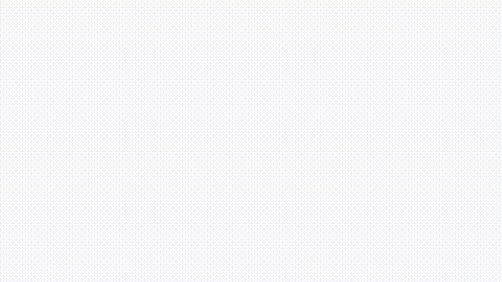

Steps:

1. Open the page.

   

2. Look at the button named Overridden, which the app gives its own class.

   

Observed:

| What | Expected | Observed | Result |
| --- | --- | --- | --- |
| background comes from the consumer's class | `"oklch(0.58 0.22 20)"` | `"oklch(0.58 0.22 20)"` | pass |
| height still comes from the library | `"40px"` | `"40px"` | pass |
| text colour still comes from the library | `"oklch(1 0 0)"` | `"oklch(1 0 0)"` | pass |
| console errors and warnings | `""` | `""` | pass |

### webkit 27.2

Recording of the whole journey:

Steps:

1. Open the page.

   

2. Look at the button named Overridden, which the app gives its own class.

   

Observed:

| What | Expected | Observed | Result |
| --- | --- | --- | --- |
| background comes from the consumer's class | `"oklch(0.58 0.22 20)"` | `"oklch(0.58 0.22 20)"` | pass |
| height still comes from the library | `"40px"` | `"40px"` | pass |
| text colour still comes from the library | `"oklch(1 0 0)"` | `"oklch(1 0 0)"` | pass |
| console errors and warnings | `""` | `""` | pass |

## A consumer rethemes a subtree through a token

Journey `token-theme`.

### chromium 159.0.8154.6

Recording of the whole journey:

Steps:

1. Open the page.

   

2. Look at the button named Themed, which sits in a subtree where the app overrides a token.

   

Observed:

| What | Expected | Observed | Result |
| --- | --- | --- | --- |
| background follows the consumer's token value | `"oklch(0.54 0.12 155)"` | `"oklch(0.54 0.12 155)"` | pass |
| a button outside the themed subtree keeps the default | `"oklch(0.55 0.21 268)"` | `"oklch(0.55 0.21 268)"` | pass |
| console errors and warnings | `""` | `""` | pass |

### firefox 159.0

Recording of the whole journey:

Steps:

1. Open the page.

   

2. Look at the button named Themed, which sits in a subtree where the app overrides a token.

   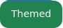

Observed:

| What | Expected | Observed | Result |
| --- | --- | --- | --- |
| background follows the consumer's token value | `"oklch(0.54 0.12 155)"` | `"oklch(0.54 0.12 155)"` | pass |
| a button outside the themed subtree keeps the default | `"oklch(0.55 0.21 268)"` | `"oklch(0.55 0.21 268)"` | pass |
| console errors and warnings | `""` | `""` | pass |

### webkit 27.2

Recording of the whole journey:

Steps:

1. Open the page.

   

2. Look at the button named Themed, which sits in a subtree where the app overrides a token.

   

Observed:

| What | Expected | Observed | Result |
| --- | --- | --- | --- |
| background follows the consumer's token value | `"oklch(0.54 0.12 155)"` | `"oklch(0.54 0.12 155)"` | pass |
| a button outside the themed subtree keeps the default | `"oklch(0.55 0.21 268)"` | `"oklch(0.55 0.21 268)"` | pass |
| console errors and warnings | `""` | `""` | pass |

## A class and an attribute that change after the first render

Journey `changing-props`.

### chromium 159.0.8154.6

Recording of the whole journey:

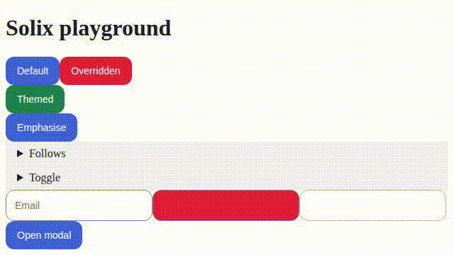

Steps:

1. Open the page. The Emphasise button has the default colour and the Follows disclosure has no outline.

   

2. Click Emphasise. The app now passes it a class, and passes the Follows disclosure another.

   

3. Click Emphasise again. Both return to how they started.

   

Observed:

| What | Expected | Observed | Result |
| --- | --- | --- | --- |
| before: Emphasise background | `"oklch(0.55 0.21 268)"` | `"oklch(0.55 0.21 268)"` | pass |
| before: Emphasise aria-pressed | `"false"` | `"false"` | pass |
| before: Follows outline | `"none"` | `"none"` | pass |
| before: Follows summary background | `"oklch(0.965 0.006 268)"` | `"oklch(0.965 0.006 268)"` | pass |
| after a click: Emphasise background comes from the class the app now passes | `"oklch(0.58 0.22 20)"` | `"oklch(0.58 0.22 20)"` | pass |
| after a click: Emphasise aria-pressed | `"true"` | `"true"` | pass |
| after a click: Follows outline comes from the class the app now passes | `"solid"` | `"solid"` | pass |
| after a click: Follows summary background comes from the class classes.summary now names | `"oklch(0.58 0.22 20)"` | `"oklch(0.58 0.22 20)"` | pass |
| after a second click: Emphasise background | `"oklch(0.55 0.21 268)"` | `"oklch(0.55 0.21 268)"` | pass |
| after a second click: Follows outline | `"none"` | `"none"` | pass |
| after a second click: Follows summary background | `"oklch(0.965 0.006 268)"` | `"oklch(0.965 0.006 268)"` | pass |
| console errors and warnings | `""` | `""` | pass |

### firefox 159.0

Recording of the whole journey:

Steps:

1. Open the page. The Emphasise button has the default colour and the Follows disclosure has no outline.

   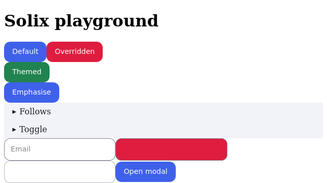

2. Click Emphasise. The app now passes it a class, and passes the Follows disclosure another.

   

3. Click Emphasise again. Both return to how they started.

   

Observed:

| What | Expected | Observed | Result |
| --- | --- | --- | --- |
| before: Emphasise background | `"oklch(0.55 0.21 268)"` | `"oklch(0.55 0.21 268)"` | pass |
| before: Emphasise aria-pressed | `"false"` | `"false"` | pass |
| before: Follows outline | `"none"` | `"none"` | pass |
| before: Follows summary background | `"oklch(0.965 0.006 268)"` | `"oklch(0.965 0.006 268)"` | pass |
| after a click: Emphasise background comes from the class the app now passes | `"oklch(0.58 0.22 20)"` | `"oklch(0.58 0.22 20)"` | pass |
| after a click: Emphasise aria-pressed | `"true"` | `"true"` | pass |
| after a click: Follows outline comes from the class the app now passes | `"solid"` | `"solid"` | pass |
| after a click: Follows summary background comes from the class classes.summary now names | `"oklch(0.58 0.22 20)"` | `"oklch(0.58 0.22 20)"` | pass |
| after a second click: Emphasise background | `"oklch(0.55 0.21 268)"` | `"oklch(0.55 0.21 268)"` | pass |
| after a second click: Follows outline | `"none"` | `"none"` | pass |
| after a second click: Follows summary background | `"oklch(0.965 0.006 268)"` | `"oklch(0.965 0.006 268)"` | pass |
| console errors and warnings | `""` | `""` | pass |

### webkit 27.2

Recording of the whole journey:

Steps:

1. Open the page. The Emphasise button has the default colour and the Follows disclosure has no outline.

   

2. Click Emphasise. The app now passes it a class, and passes the Follows disclosure another.

   

3. Click Emphasise again. Both return to how they started.

   

Observed:

| What | Expected | Observed | Result |
| --- | --- | --- | --- |
| before: Emphasise background | `"oklch(0.55 0.21 268)"` | `"oklch(0.55 0.21 268)"` | pass |
| before: Emphasise aria-pressed | `"false"` | `"false"` | pass |
| before: Follows outline | `"none"` | `"none"` | pass |
| before: Follows summary background | `"oklch(0.965 0.006 268)"` | `"oklch(0.965 0.006 268)"` | pass |
| after a click: Emphasise background comes from the class the app now passes | `"oklch(0.58 0.22 20)"` | `"oklch(0.58 0.22 20)"` | pass |
| after a click: Emphasise aria-pressed | `"true"` | `"true"` | pass |
| after a click: Follows outline comes from the class the app now passes | `"solid"` | `"solid"` | pass |
| after a click: Follows summary background comes from the class classes.summary now names | `"oklch(0.58 0.22 20)"` | `"oklch(0.58 0.22 20)"` | pass |
| after a second click: Emphasise background | `"oklch(0.55 0.21 268)"` | `"oklch(0.55 0.21 268)"` | pass |
| after a second click: Follows outline | `"none"` | `"none"` | pass |
| after a second click: Follows summary background | `"oklch(0.965 0.006 268)"` | `"oklch(0.965 0.006 268)"` | pass |
| console errors and warnings | `""` | `""` | pass |

## A disclosure opens and closes

Journey `disclosure`.

### chromium 159.0.8154.6

Recording of the whole journey:

Steps:

1. Open the page. The disclosure starts closed.

   

2. Click the summary named Toggle. The content appears and the summary changes colour.

   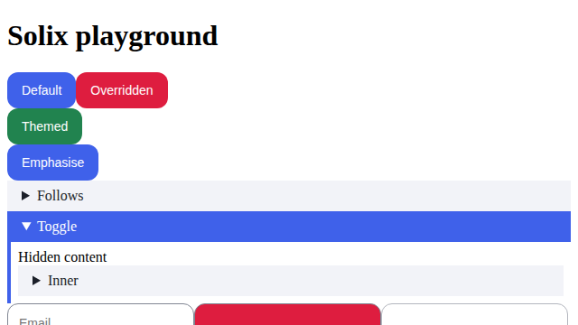

3. Click Toggle again. The content goes away and the summary returns to its first colour.

   

4. Click Toggle to open it. The disclosure named Inner, inside it, still looks closed.

   

5. Focus the summary and press Enter. The disclosure opens.

   

6. Press Space. The disclosure closes.

   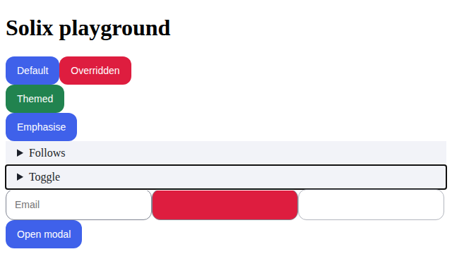

Observed:

| What | Expected | Observed | Result |
| --- | --- | --- | --- |
| closed: the details element's open property | `false` | `false` | pass |
| closed: summary background | `"oklch(0.965 0.006 268)"` | `"oklch(0.965 0.006 268)"` | pass |
| closed: content is visible | `false` | `false` | pass |
| open: the details element's open property | `true` | `true` | pass |
| open: summary background | `"oklch(0.55 0.21 268)"` | `"oklch(0.55 0.21 268)"` | pass |
| open: summary text colour | `"oklch(1 0 0)"` | `"oklch(1 0 0)"` | pass |
| open: content is visible | `true` | `true` | pass |
| open: content left border | `"oklch(0.55 0.21 268)"` | `"oklch(0.55 0.21 268)"` | pass |
| closed again: the details element's open property | `false` | `false` | pass |
| closed again: summary background | `"oklch(0.965 0.006 268)"` | `"oklch(0.965 0.006 268)"` | pass |
| closed again: content is visible | `false` | `false` | pass |
| inner disclosure inside the open one: summary background | `"oklch(0.965 0.006 268)"` | `"oklch(0.965 0.006 268)"` | pass |
| inner disclosure inside the open one: summary text colour | `"oklch(0.24 0.02 268)"` | `"oklch(0.24 0.02 268)"` | pass |
| Enter on the focused summary: the details element's open property | `true` | `true` | pass |
| Enter on the focused summary: summary background | `"oklch(0.55 0.21 268)"` | `"oklch(0.55 0.21 268)"` | pass |
| Enter on the focused summary: content is visible | `true` | `true` | pass |
| Space on the focused summary: the details element's open property | `false` | `false` | pass |
| Space on the focused summary: summary background | `"oklch(0.965 0.006 268)"` | `"oklch(0.965 0.006 268)"` | pass |
| Space on the focused summary: content is visible | `false` | `false` | pass |
| console errors and warnings | `""` | `""` | pass |

### firefox 159.0

Recording of the whole journey:

Steps:

1. Open the page. The disclosure starts closed.

   

2. Click the summary named Toggle. The content appears and the summary changes colour.

   

3. Click Toggle again. The content goes away and the summary returns to its first colour.

   

4. Click Toggle to open it. The disclosure named Inner, inside it, still looks closed.

   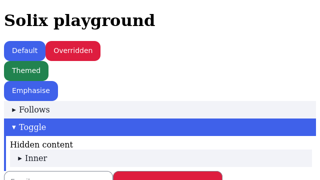

5. Focus the summary and press Enter. The disclosure opens.

   

6. Press Space. The disclosure closes.

   

Observed:

| What | Expected | Observed | Result |
| --- | --- | --- | --- |
| closed: the details element's open property | `false` | `false` | pass |
| closed: summary background | `"oklch(0.965 0.006 268)"` | `"oklch(0.965 0.006 268)"` | pass |
| closed: content is visible | `false` | `false` | pass |
| open: the details element's open property | `true` | `true` | pass |
| open: summary background | `"oklch(0.55 0.21 268)"` | `"oklch(0.55 0.21 268)"` | pass |
| open: summary text colour | `"oklch(1 0 0)"` | `"oklch(1 0 0)"` | pass |
| open: content is visible | `true` | `true` | pass |
| open: content left border | `"oklch(0.55 0.21 268)"` | `"oklch(0.55 0.21 268)"` | pass |
| closed again: the details element's open property | `false` | `false` | pass |
| closed again: summary background | `"oklch(0.965 0.006 268)"` | `"oklch(0.965 0.006 268)"` | pass |
| closed again: content is visible | `false` | `false` | pass |
| inner disclosure inside the open one: summary background | `"oklch(0.965 0.006 268)"` | `"oklch(0.965 0.006 268)"` | pass |
| inner disclosure inside the open one: summary text colour | `"oklch(0.24 0.02 268)"` | `"oklch(0.24 0.02 268)"` | pass |
| Enter on the focused summary: the details element's open property | `true` | `true` | pass |
| Enter on the focused summary: summary background | `"oklch(0.55 0.21 268)"` | `"oklch(0.55 0.21 268)"` | pass |
| Enter on the focused summary: content is visible | `true` | `true` | pass |
| Space on the focused summary: the details element's open property | `false` | `false` | pass |
| Space on the focused summary: summary background | `"oklch(0.965 0.006 268)"` | `"oklch(0.965 0.006 268)"` | pass |
| Space on the focused summary: content is visible | `false` | `false` | pass |
| console errors and warnings | `""` | `""` | pass |

### webkit 27.2

Recording of the whole journey:

Steps:

1. Open the page. The disclosure starts closed.

   

2. Click the summary named Toggle. The content appears and the summary changes colour.

   

3. Click Toggle again. The content goes away and the summary returns to its first colour.

   

4. Click Toggle to open it. The disclosure named Inner, inside it, still looks closed.

   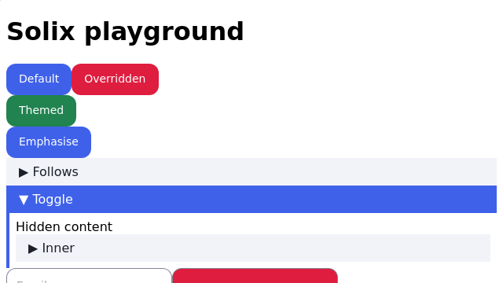

5. Focus the summary and press Enter. The disclosure opens.

   

6. Press Space. The disclosure closes.

   

Observed:

| What | Expected | Observed | Result |
| --- | --- | --- | --- |
| closed: the details element's open property | `false` | `false` | pass |
| closed: summary background | `"oklch(0.965 0.006 268)"` | `"oklch(0.965 0.006 268)"` | pass |
| closed: content is visible | `false` | `false` | pass |
| open: the details element's open property | `true` | `true` | pass |
| open: summary background | `"oklch(0.55 0.21 268)"` | `"oklch(0.55 0.21 268)"` | pass |
| open: summary text colour | `"oklch(1 0 0)"` | `"oklch(1 0 0)"` | pass |
| open: content is visible | `true` | `true` | pass |
| open: content left border | `"oklch(0.55 0.21 268)"` | `"oklch(0.55 0.21 268)"` | pass |
| closed again: the details element's open property | `false` | `false` | pass |
| closed again: summary background | `"oklch(0.965 0.006 268)"` | `"oklch(0.965 0.006 268)"` | pass |
| closed again: content is visible | `false` | `false` | pass |
| inner disclosure inside the open one: summary background | `"oklch(0.965 0.006 268)"` | `"oklch(0.965 0.006 268)"` | pass |
| inner disclosure inside the open one: summary text colour | `"oklch(0.24 0.02 268)"` | `"oklch(0.24 0.02 268)"` | pass |
| Enter on the focused summary: the details element's open property | `true` | `true` | pass |
| Enter on the focused summary: summary background | `"oklch(0.55 0.21 268)"` | `"oklch(0.55 0.21 268)"` | pass |
| Enter on the focused summary: content is visible | `true` | `true` | pass |
| Space on the focused summary: the details element's open property | `false` | `false` | pass |
| Space on the focused summary: summary background | `"oklch(0.965 0.006 268)"` | `"oklch(0.965 0.006 268)"` | pass |
| Space on the focused summary: content is visible | `false` | `false` | pass |
| console errors and warnings | `""` | `""` | pass |

## A text input shows its border, its disabled look and its error after the user leaves it

Journey `text-input`.

### chromium 159.0.8154.6

Recording of the whole journey:

Steps:

1. Open the page. Three text inputs sit below the disclosures.

   

2. Look at the input named Email.

   

3. Type a value that is not an email address into Email. The border does not change while the user is still in the field.

   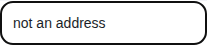

4. Move focus to another control. The Email border takes the error colour.

   

5. Type a valid address and leave the field. The border returns to the default.

   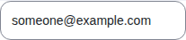

Observed:

| What | Expected | Observed | Result |
| --- | --- | --- | --- |
| email: border colour | `"oklch(0.62 0.02 268)"` | `"oklch(0.62 0.02 268)"` | pass |
| email: height | `"40px"` | `"40px"` | pass |
| overridden input: background comes from the consumer's class | `"oklch(0.58 0.22 20)"` | `"oklch(0.58 0.22 20)"` | pass |
| overridden input: height still comes from the library | `"40px"` | `"40px"` | pass |
| disabled input: opacity | `"0.6"` | `"0.6"` | pass |
| disabled input: the user can type in it | `false` | `false` | pass |
| while typing an invalid value: border is not the error colour | `false` | `false` | pass |
| after leaving the invalid value: border colour | `"oklch(0.55 0.2 25)"` | `"oklch(0.55 0.2 25)"` | pass |
| after leaving a valid value: border colour | `"oklch(0.62 0.02 268)"` | `"oklch(0.62 0.02 268)"` | pass |
| console errors and warnings | `""` | `""` | pass |

### firefox 159.0

Recording of the whole journey:

Steps:

1. Open the page. Three text inputs sit below the disclosures.

   

2. Look at the input named Email.

   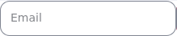

3. Type a value that is not an email address into Email. The border does not change while the user is still in the field.

   

4. Move focus to another control. The Email border takes the error colour.

   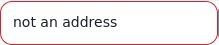

5. Type a valid address and leave the field. The border returns to the default.

   

Observed:

| What | Expected | Observed | Result |
| --- | --- | --- | --- |
| email: border colour | `"oklch(0.62 0.02 268)"` | `"oklch(0.62 0.02 268)"` | pass |
| email: height | `"40px"` | `"40px"` | pass |
| overridden input: background comes from the consumer's class | `"oklch(0.58 0.22 20)"` | `"oklch(0.58 0.22 20)"` | pass |
| overridden input: height still comes from the library | `"40px"` | `"40px"` | pass |
| disabled input: opacity | `"0.6"` | `"0.6"` | pass |
| disabled input: the user can type in it | `false` | `false` | pass |
| while typing an invalid value: border is not the error colour | `false` | `false` | pass |
| after leaving the invalid value: border colour | `"oklch(0.55 0.2 25)"` | `"oklch(0.55 0.2 25)"` | pass |
| after leaving a valid value: border colour | `"oklch(0.62 0.02 268)"` | `"oklch(0.62 0.02 268)"` | pass |
| console errors and warnings | `""` | `""` | pass |

### webkit 27.2

Recording of the whole journey:

Steps:

1. Open the page. Three text inputs sit below the disclosures.

   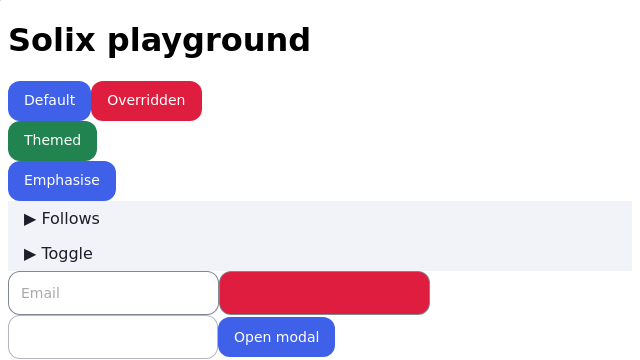

2. Look at the input named Email.

   

3. Type a value that is not an email address into Email. The border does not change while the user is still in the field.

   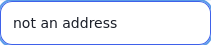

4. Move focus to another control. The Email border takes the error colour.

   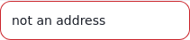

5. Type a valid address and leave the field. The border returns to the default.

   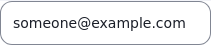

Observed:

| What | Expected | Observed | Result |
| --- | --- | --- | --- |
| email: border colour | `"oklch(0.62 0.02 268)"` | `"oklch(0.62 0.02 268)"` | pass |
| email: height | `"40px"` | `"40px"` | pass |
| overridden input: background comes from the consumer's class | `"oklch(0.58 0.22 20)"` | `"oklch(0.58 0.22 20)"` | pass |
| overridden input: height still comes from the library | `"40px"` | `"40px"` | pass |
| disabled input: opacity | `"0.6"` | `"0.6"` | pass |
| disabled input: the user can type in it | `false` | `false` | pass |
| while typing an invalid value: border is not the error colour | `false` | `false` | pass |
| after leaving the invalid value: border colour | `"oklch(0.55 0.2 25)"` | `"oklch(0.55 0.2 25)"` | pass |
| after leaving a valid value: border colour | `"oklch(0.62 0.02 268)"` | `"oklch(0.62 0.02 268)"` | pass |
| console errors and warnings | `""` | `""` | pass |

## A modal opens over the page and closes by Escape, its Close button and a press outside

Journey `modal`.

### chromium 159.0.8154.6

Recording of the whole journey:

Steps:

1. Open the page. The Settings modal is not showing.

   

2. Press Open modal. A dialog named Settings covers the page with a dimmed backdrop.

   

3. Press the text inside the dialog. It stays open.

   

4. Press Escape. The dialog closes.

   

5. Open it again and press the Close button. The dialog closes.

   

6. Open it a third time and press the backdrop, outside the dialog. The dialog closes.

   

Observed:

| What | Expected | Observed | Result |
| --- | --- | --- | --- |
| closed: the dialog is visible | `false` | `false` | pass |
| open: the dialog is modal | `true` | `true` | pass |
| open: dialog background | `"oklch(1 0 0)"` | `"oklch(1 0 0)"` | pass |
| open: backdrop colour | `"oklch(0.2 0.02 268 / 0.45)"` | `"oklch(0.2 0.02 268 / 0.45)"` | pass |
| open: the app records | `"The app records the modal as opened."` | `"The app records the modal as opened."` | pass |
| press inside: the dialog is visible | `true` | `true` | pass |
| Escape: the dialog is visible | `false` | `false` | pass |
| Escape: the app records | `"The app records the modal as closed."` | `"The app records the modal as closed."` | pass |
| Close button: the dialog is visible | `false` | `false` | pass |
| Close button: the app records | `"The app records the modal as closed."` | `"The app records the modal as closed."` | pass |
| press outside: the dialog is visible | `false` | `false` | pass |
| press outside: the app records | `"The app records the modal as closed."` | `"The app records the modal as closed."` | pass |
| console errors and warnings | `""` | `""` | pass |

### firefox 159.0

Recording of the whole journey:

Steps:

1. Open the page. The Settings modal is not showing.

   

2. Press Open modal. A dialog named Settings covers the page with a dimmed backdrop.

   

3. Press the text inside the dialog. It stays open.

   

4. Press Escape. The dialog closes.

   

5. Open it again and press the Close button. The dialog closes.

   

6. Open it a third time and press the backdrop, outside the dialog. The dialog closes.

   

Observed:

| What | Expected | Observed | Result |
| --- | --- | --- | --- |
| closed: the dialog is visible | `false` | `false` | pass |
| open: the dialog is modal | `true` | `true` | pass |
| open: dialog background | `"oklch(1 0 0)"` | `"oklch(1 0 0)"` | pass |
| open: backdrop colour | `"oklch(0.2 0.02 268 / 0.45)"` | `"oklch(0.2 0.02 268 / 0.45)"` | pass |
| open: the app records | `"The app records the modal as opened."` | `"The app records the modal as opened."` | pass |
| press inside: the dialog is visible | `true` | `true` | pass |
| Escape: the dialog is visible | `false` | `false` | pass |
| Escape: the app records | `"The app records the modal as closed."` | `"The app records the modal as closed."` | pass |
| Close button: the dialog is visible | `false` | `false` | pass |
| Close button: the app records | `"The app records the modal as closed."` | `"The app records the modal as closed."` | pass |
| press outside: the dialog is visible | `false` | `false` | pass |
| press outside: the app records | `"The app records the modal as closed."` | `"The app records the modal as closed."` | pass |
| console errors and warnings | `""` | `""` | pass |

### webkit 27.2

Recording of the whole journey:

Steps:

1. Open the page. The Settings modal is not showing.

   

2. Press Open modal. A dialog named Settings covers the page with a dimmed backdrop.

   

3. Press the text inside the dialog. It stays open.

   

4. Press Escape. The dialog closes.

   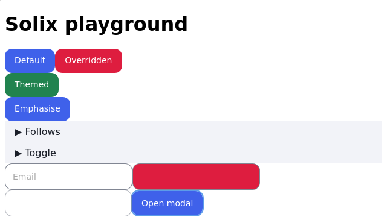

5. Open it again and press the Close button. The dialog closes.

   

6. Open it a third time and press the backdrop, outside the dialog. The dialog closes.

   

Observed:

| What | Expected | Observed | Result |
| --- | --- | --- | --- |
| closed: the dialog is visible | `false` | `false` | pass |
| open: the dialog is modal | `true` | `true` | pass |
| open: dialog background | `"oklch(1 0 0)"` | `"oklch(1 0 0)"` | pass |
| open: backdrop colour | `"oklch(0.2 0.02 268 / 0.45)"` | `"oklch(0.2 0.02 268 / 0.45)"` | pass |
| open: the app records | `"The app records the modal as opened."` | `"The app records the modal as opened."` | pass |
| press inside: the dialog is visible | `true` | `true` | pass |
| Escape: the dialog is visible | `false` | `false` | pass |
| Escape: the app records | `"The app records the modal as closed."` | `"The app records the modal as closed."` | pass |
| Close button: the dialog is visible | `false` | `false` | pass |
| Close button: the app records | `"The app records the modal as closed."` | `"The app records the modal as closed."` | pass |
| press outside: the dialog is visible | `false` | `false` | pass |
| press outside: the app records | `"The app records the modal as closed."` | `"The app records the modal as closed."` | pass |
| console errors and warnings | `""` | `""` | pass |

## A Box takes style props, and a consumer's class and style still win

Journey `box`.

### chromium 159.0.8154.6

Recording of the whole journey:

Steps:

1. Open the page 991 pixels wide, one pixel below the md breakpoint, and scroll to the section named Style props.

   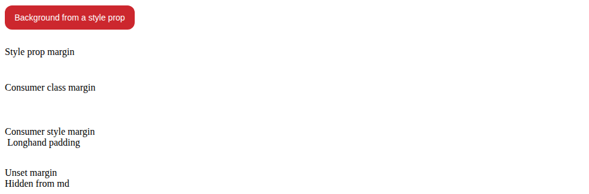

2. Widen the page to 992 pixels, which is the md breakpoint. The padding grows, one line goes away and another appears.

   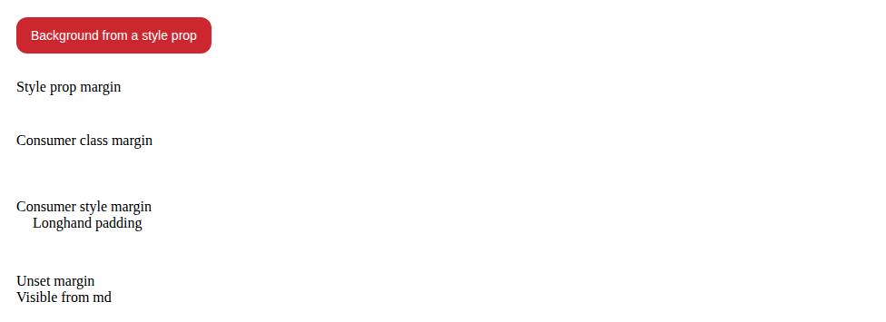

Observed:

| What | Expected | Observed | Result |
| --- | --- | --- | --- |
| the style prop's background beats the button's own default | `"oklch(0.55 0.2 25)"` | `"oklch(0.55 0.2 25)"` | pass |
| a style prop sets the margin | `"28px"` | `"28px"` | pass |
| the consumer's class beats the style prop | `"41.6px"` | `"41.6px"` | pass |
| the consumer's style beats the consumer's class and the style prop | `"54.4px"` | `"54.4px"` | pass |
| below md: the section's padding comes from its xs value | `"8px"` | `"8px"` | pass |
| below md: the pt longhand beats the p shorthand | `"0px"` | `"0px"` | pass |
| below md: the p shorthand sets the other sides | `"4px"` | `"4px"` | pass |
| mt=unset inside a Box with mt=xl takes no margin from it | `"0px"` | `"0px"` | pass |
| below md: Hidden from md is visible | `true` | `true` | pass |
| below md: Visible from md is visible | `false` | `false` | pass |
| at md: the section's padding comes from its md value | `"18px"` | `"18px"` | pass |
| at md: the pt longhand still beats the p shorthand's md value | `"0px"` | `"0px"` | pass |
| at md: the p shorthand sets the other sides to its md value | `"18px"` | `"18px"` | pass |
| at md: Hidden from md is visible | `false` | `false` | pass |
| at md: Visible from md is visible | `true` | `true` | pass |
| at md: the consumer's style still wins | `"54.4px"` | `"54.4px"` | pass |
| console errors and warnings | `""` | `""` | pass |

### firefox 159.0

Recording of the whole journey:

Steps:

1. Open the page 991 pixels wide, one pixel below the md breakpoint, and scroll to the section named Style props.

   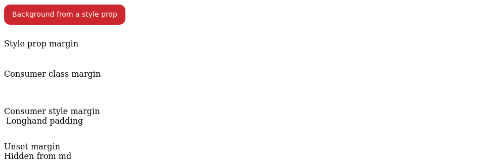

2. Widen the page to 992 pixels, which is the md breakpoint. The padding grows, one line goes away and another appears.

   

Observed:

| What | Expected | Observed | Result |
| --- | --- | --- | --- |
| the style prop's background beats the button's own default | `"oklch(0.55 0.2 25)"` | `"oklch(0.55 0.2 25)"` | pass |
| a style prop sets the margin | `"28px"` | `"28px"` | pass |
| the consumer's class beats the style prop | `"41.6px"` | `"41.6px"` | pass |
| the consumer's style beats the consumer's class and the style prop | `"54.4px"` | `"54.4px"` | pass |
| below md: the section's padding comes from its xs value | `"8px"` | `"8px"` | pass |
| below md: the pt longhand beats the p shorthand | `"0px"` | `"0px"` | pass |
| below md: the p shorthand sets the other sides | `"4px"` | `"4px"` | pass |
| mt=unset inside a Box with mt=xl takes no margin from it | `"0px"` | `"0px"` | pass |
| below md: Hidden from md is visible | `true` | `true` | pass |
| below md: Visible from md is visible | `false` | `false` | pass |
| at md: the section's padding comes from its md value | `"18px"` | `"18px"` | pass |
| at md: the pt longhand still beats the p shorthand's md value | `"0px"` | `"0px"` | pass |
| at md: the p shorthand sets the other sides to its md value | `"18px"` | `"18px"` | pass |
| at md: Hidden from md is visible | `false` | `false` | pass |
| at md: Visible from md is visible | `true` | `true` | pass |
| at md: the consumer's style still wins | `"54.4px"` | `"54.4px"` | pass |
| console errors and warnings | `""` | `""` | pass |

### webkit 27.2

Recording of the whole journey:

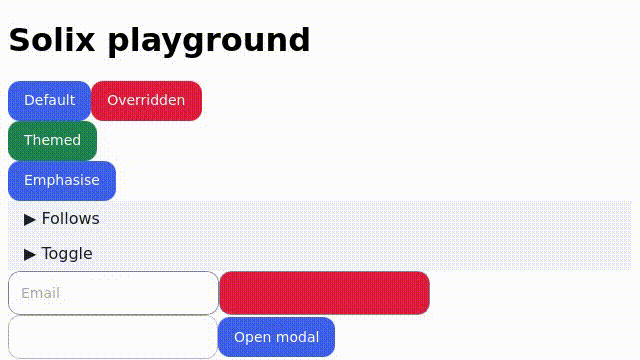

Steps:

1. Open the page 991 pixels wide, one pixel below the md breakpoint, and scroll to the section named Style props.

   

2. Widen the page to 992 pixels, which is the md breakpoint. The padding grows, one line goes away and another appears.

   

Observed:

| What | Expected | Observed | Result |
| --- | --- | --- | --- |
| the style prop's background beats the button's own default | `"oklch(0.55 0.2 25)"` | `"oklch(0.55 0.2 25)"` | pass |
| a style prop sets the margin | `"28px"` | `"28px"` | pass |
| the consumer's class beats the style prop | `"41.59375px"` | `"41.59375px"` | pass |
| the consumer's style beats the consumer's class and the style prop | `"54.390625px"` | `"54.390625px"` | pass |
| below md: the section's padding comes from its xs value | `"8px"` | `"8px"` | pass |
| below md: the pt longhand beats the p shorthand | `"0px"` | `"0px"` | pass |
| below md: the p shorthand sets the other sides | `"4px"` | `"4px"` | pass |
| mt=unset inside a Box with mt=xl takes no margin from it | `"0px"` | `"0px"` | pass |
| below md: Hidden from md is visible | `true` | `true` | pass |
| below md: Visible from md is visible | `false` | `false` | pass |
| at md: the section's padding comes from its md value | `"18px"` | `"18px"` | pass |
| at md: the pt longhand still beats the p shorthand's md value | `"0px"` | `"0px"` | pass |
| at md: the p shorthand sets the other sides to its md value | `"18px"` | `"18px"` | pass |
| at md: Hidden from md is visible | `false` | `false` | pass |
| at md: Visible from md is visible | `true` | `true` | pass |
| at md: the consumer's style still wins | `"54.390625px"` | `"54.390625px"` | pass |
| console errors and warnings | `""` | `""` | pass |

## Classes, styles and unstyled restyle a component's parts, and Button takes a style prop

Journey `styles-api`.

### chromium 159.0.8154.6

Recording of the whole journey:

Steps:

1. Open the page and scroll to the section named Styles API, at the end.

   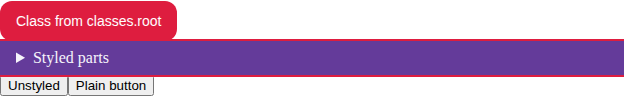

2. Click the summary named Styled parts. It opens, and its background still comes from styles.

   

Observed:

| What | Expected | Observed | Result |
| --- | --- | --- | --- |
| classes.root: background comes from the consumer's class | `"oklch(0.58 0.22 20)"` | `"oklch(0.58 0.22 20)"` | pass |
| classes.root: height still comes from the library | `"40px"` | `"40px"` | pass |
| styles.summary: background comes from styles, not from the class classes.summary names or the library | `"oklch(0.45 0.15 300)"` | `"oklch(0.45 0.15 300)"` | pass |
| styles.summary: text colour comes from styles, not from the library | `"oklch(0.97 0.01 300)"` | `"oklch(0.97 0.01 300)"` | pass |
| classes.summary: the consumer's class still sets the outline | `"solid"` | `"solid"` | pass |
| unstyled: background-color is the Plain button's | `"rgb(239, 239, 239)"` | `"rgb(239, 239, 239)"` | pass |
| unstyled: color is the Plain button's | `"rgb(0, 0, 0)"` | `"rgb(0, 0, 0)"` | pass |
| unstyled: border-top-width is the Plain button's | `"2px"` | `"2px"` | pass |
| unstyled: border-top-style is the Plain button's | `"outset"` | `"outset"` | pass |
| unstyled: border-top-color is the Plain button's | `"rgb(0, 0, 0)"` | `"rgb(0, 0, 0)"` | pass |
| unstyled: border-right-width is the Plain button's | `"2px"` | `"2px"` | pass |
| unstyled: border-right-style is the Plain button's | `"outset"` | `"outset"` | pass |
| unstyled: border-right-color is the Plain button's | `"rgb(0, 0, 0)"` | `"rgb(0, 0, 0)"` | pass |
| unstyled: border-bottom-width is the Plain button's | `"2px"` | `"2px"` | pass |
| unstyled: border-bottom-style is the Plain button's | `"outset"` | `"outset"` | pass |
| unstyled: border-bottom-color is the Plain button's | `"rgb(0, 0, 0)"` | `"rgb(0, 0, 0)"` | pass |
| unstyled: border-left-width is the Plain button's | `"2px"` | `"2px"` | pass |
| unstyled: border-left-style is the Plain button's | `"outset"` | `"outset"` | pass |
| unstyled: border-left-color is the Plain button's | `"rgb(0, 0, 0)"` | `"rgb(0, 0, 0)"` | pass |
| unstyled: border-top-left-radius is the Plain button's | `"0px"` | `"0px"` | pass |
| unstyled: border-top-right-radius is the Plain button's | `"0px"` | `"0px"` | pass |
| unstyled: border-bottom-right-radius is the Plain button's | `"0px"` | `"0px"` | pass |
| unstyled: border-bottom-left-radius is the Plain button's | `"0px"` | `"0px"` | pass |
| unstyled: height is the Plain button's | `"21px"` | `"21px"` | pass |
| unstyled: padding-top is the Plain button's | `"1px"` | `"1px"` | pass |
| unstyled: padding-right is the Plain button's | `"6px"` | `"6px"` | pass |
| unstyled: padding-bottom is the Plain button's | `"1px"` | `"1px"` | pass |
| unstyled: padding-left is the Plain button's | `"6px"` | `"6px"` | pass |
| unstyled: the button keeps its stable class | `true` | `true` | pass |
| open: content is visible | `true` | `true` | pass |
| open: styles.summary still beats the library's open background | `"oklch(0.45 0.15 300)"` | `"oklch(0.45 0.15 300)"` | pass |
| open: styles.summary still beats the library's open text colour | `"oklch(0.97 0.01 300)"` | `"oklch(0.97 0.01 300)"` | pass |
| console errors and warnings | `""` | `""` | pass |

### firefox 159.0

Recording of the whole journey:

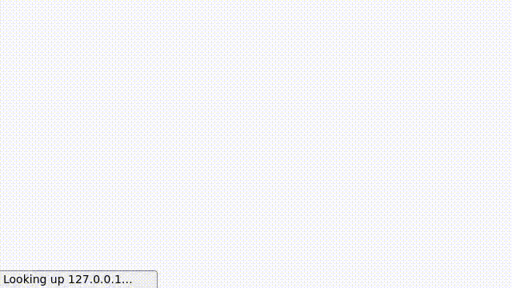

Steps:

1. Open the page and scroll to the section named Styles API, at the end.

   

2. Click the summary named Styled parts. It opens, and its background still comes from styles.

   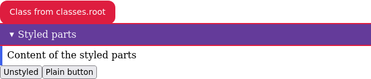

Observed:

| What | Expected | Observed | Result |
| --- | --- | --- | --- |
| classes.root: background comes from the consumer's class | `"oklch(0.58 0.22 20)"` | `"oklch(0.58 0.22 20)"` | pass |
| classes.root: height still comes from the library | `"40px"` | `"40px"` | pass |
| styles.summary: background comes from styles, not from the class classes.summary names or the library | `"oklch(0.45 0.15 300)"` | `"oklch(0.45 0.15 300)"` | pass |
| styles.summary: text colour comes from styles, not from the library | `"oklch(0.97 0.01 300)"` | `"oklch(0.97 0.01 300)"` | pass |
| classes.summary: the consumer's class still sets the outline | `"solid"` | `"solid"` | pass |
| unstyled: background-color is the Plain button's | `"rgb(233, 233, 237)"` | `"rgb(233, 233, 237)"` | pass |
| unstyled: color is the Plain button's | `"rgb(0, 0, 0)"` | `"rgb(0, 0, 0)"` | pass |
| unstyled: border-top-width is the Plain button's | `"2px"` | `"2px"` | pass |
| unstyled: border-top-style is the Plain button's | `"outset"` | `"outset"` | pass |
| unstyled: border-top-color is the Plain button's | `"rgb(129, 127, 132)"` | `"rgb(129, 127, 132)"` | pass |
| unstyled: border-right-width is the Plain button's | `"2px"` | `"2px"` | pass |
| unstyled: border-right-style is the Plain button's | `"outset"` | `"outset"` | pass |
| unstyled: border-right-color is the Plain button's | `"rgb(129, 127, 132)"` | `"rgb(129, 127, 132)"` | pass |
| unstyled: border-bottom-width is the Plain button's | `"2px"` | `"2px"` | pass |
| unstyled: border-bottom-style is the Plain button's | `"outset"` | `"outset"` | pass |
| unstyled: border-bottom-color is the Plain button's | `"rgb(129, 127, 132)"` | `"rgb(129, 127, 132)"` | pass |
| unstyled: border-left-width is the Plain button's | `"2px"` | `"2px"` | pass |
| unstyled: border-left-style is the Plain button's | `"outset"` | `"outset"` | pass |
| unstyled: border-left-color is the Plain button's | `"rgb(129, 127, 132)"` | `"rgb(129, 127, 132)"` | pass |
| unstyled: border-top-left-radius is the Plain button's | `"0px"` | `"0px"` | pass |
| unstyled: border-top-right-radius is the Plain button's | `"0px"` | `"0px"` | pass |
| unstyled: border-bottom-right-radius is the Plain button's | `"0px"` | `"0px"` | pass |
| unstyled: border-bottom-left-radius is the Plain button's | `"0px"` | `"0px"` | pass |
| unstyled: height is the Plain button's | `"23px"` | `"23px"` | pass |
| unstyled: padding-top is the Plain button's | `"1px"` | `"1px"` | pass |
| unstyled: padding-right is the Plain button's | `"4px"` | `"4px"` | pass |
| unstyled: padding-bottom is the Plain button's | `"1px"` | `"1px"` | pass |
| unstyled: padding-left is the Plain button's | `"4px"` | `"4px"` | pass |
| unstyled: the button keeps its stable class | `true` | `true` | pass |
| open: content is visible | `true` | `true` | pass |
| open: styles.summary still beats the library's open background | `"oklch(0.45 0.15 300)"` | `"oklch(0.45 0.15 300)"` | pass |
| open: styles.summary still beats the library's open text colour | `"oklch(0.97 0.01 300)"` | `"oklch(0.97 0.01 300)"` | pass |
| console errors and warnings | `""` | `""` | pass |

### webkit 27.2

Recording of the whole journey:

Steps:

1. Open the page and scroll to the section named Styles API, at the end.

   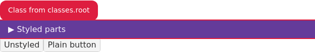

2. Click the summary named Styled parts. It opens, and its background still comes from styles.

   

Observed:

| What | Expected | Observed | Result |
| --- | --- | --- | --- |
| classes.root: background comes from the consumer's class | `"oklch(0.58 0.22 20)"` | `"oklch(0.58 0.22 20)"` | pass |
| classes.root: height still comes from the library | `"40px"` | `"40px"` | pass |
| styles.summary: background comes from styles, not from the class classes.summary names or the library | `"oklch(0.45 0.15 300)"` | `"oklch(0.45 0.15 300)"` | pass |
| styles.summary: text colour comes from styles, not from the library | `"oklch(0.97 0.01 300)"` | `"oklch(0.97 0.01 300)"` | pass |
| classes.summary: the consumer's class still sets the outline | `"solid"` | `"solid"` | pass |
| unstyled: background-color is the Plain button's | `"rgb(192, 192, 192)"` | `"rgb(192, 192, 192)"` | pass |
| unstyled: color is the Plain button's | `"rgba(0, 0, 0, 0.8)"` | `"rgba(0, 0, 0, 0.8)"` | pass |
| unstyled: border-top-width is the Plain button's | `"2px"` | `"2px"` | pass |
| unstyled: border-top-style is the Plain button's | `"outset"` | `"outset"` | pass |
| unstyled: border-top-color is the Plain button's | `"rgb(192, 192, 192)"` | `"rgb(192, 192, 192)"` | pass |
| unstyled: border-right-width is the Plain button's | `"2px"` | `"2px"` | pass |
| unstyled: border-right-style is the Plain button's | `"outset"` | `"outset"` | pass |
| unstyled: border-right-color is the Plain button's | `"rgb(192, 192, 192)"` | `"rgb(192, 192, 192)"` | pass |
| unstyled: border-bottom-width is the Plain button's | `"2px"` | `"2px"` | pass |
| unstyled: border-bottom-style is the Plain button's | `"outset"` | `"outset"` | pass |
| unstyled: border-bottom-color is the Plain button's | `"rgb(192, 192, 192)"` | `"rgb(192, 192, 192)"` | pass |
| unstyled: border-left-width is the Plain button's | `"2px"` | `"2px"` | pass |
| unstyled: border-left-style is the Plain button's | `"outset"` | `"outset"` | pass |
| unstyled: border-left-color is the Plain button's | `"rgb(192, 192, 192)"` | `"rgb(192, 192, 192)"` | pass |
| unstyled: border-top-left-radius is the Plain button's | `"0px"` | `"0px"` | pass |
| unstyled: border-top-right-radius is the Plain button's | `"0px"` | `"0px"` | pass |
| unstyled: border-bottom-right-radius is the Plain button's | `"0px"` | `"0px"` | pass |
| unstyled: border-bottom-left-radius is the Plain button's | `"0px"` | `"0px"` | pass |
| unstyled: height is the Plain button's | `"28px"` | `"28px"` | pass |
| unstyled: padding-top is the Plain button's | `"2px"` | `"2px"` | pass |
| unstyled: padding-right is the Plain button's | `"6px"` | `"6px"` | pass |
| unstyled: padding-bottom is the Plain button's | `"3px"` | `"3px"` | pass |
| unstyled: padding-left is the Plain button's | `"6px"` | `"6px"` | pass |
| unstyled: the button keeps its stable class | `true` | `true` | pass |
| open: content is visible | `true` | `true` | pass |
| open: styles.summary still beats the library's open background | `"oklch(0.45 0.15 300)"` | `"oklch(0.45 0.15 300)"` | pass |
| open: styles.summary still beats the library's open text colour | `"oklch(0.97 0.01 300)"` | `"oklch(0.97 0.01 300)"` | pass |
| console errors and warnings | `""` | `""` | pass |

## The page is server-rendered and styled without JavaScript

Journey `server-render`.

### chromium 159.0.8154.6

Recording of the whole journey:

Steps:

1. Request the page with JavaScript turned off in the browser.

   

2. Still with JavaScript off, click the summary named Toggle. The disclosure opens.

   

Observed:

| What | Expected | Observed | Result |
| --- | --- | --- | --- |
| the response already contains the Default button | `true` | `true` | pass |
| the response already contains the Toggle summary | `true` | `true` | pass |
| with JavaScript off the Default button is styled | `"oklch(0.55 0.21 268)"` | `"oklch(0.55 0.21 268)"` | pass |
| with JavaScript off the disclosure opens on a click | `true` | `true` | pass |
| with JavaScript off the open summary takes the primary colour | `"oklch(0.55 0.21 268)"` | `"oklch(0.55 0.21 268)"` | pass |
| with JavaScript off the modal is not showing | `false` | `false` | pass |
| with JavaScript off the Email input is styled | `"oklch(0.62 0.02 268)"` | `"oklch(0.62 0.02 268)"` | pass |
| console errors and warnings | `""` | `""` | pass |

### firefox 159.0

Recording of the whole journey:

Steps:

1. Request the page with JavaScript turned off in the browser.

   

2. Still with JavaScript off, click the summary named Toggle. The disclosure opens.

   

Observed:

| What | Expected | Observed | Result |
| --- | --- | --- | --- |
| the response already contains the Default button | `true` | `true` | pass |
| the response already contains the Toggle summary | `true` | `true` | pass |
| with JavaScript off the Default button is styled | `"oklch(0.55 0.21 268)"` | `"oklch(0.55 0.21 268)"` | pass |
| with JavaScript off the disclosure opens on a click | `true` | `true` | pass |
| with JavaScript off the open summary takes the primary colour | `"oklch(0.55 0.21 268)"` | `"oklch(0.55 0.21 268)"` | pass |
| with JavaScript off the modal is not showing | `false` | `false` | pass |
| with JavaScript off the Email input is styled | `"oklch(0.62 0.02 268)"` | `"oklch(0.62 0.02 268)"` | pass |
| console errors and warnings | `""` | `""` | pass |

### webkit 27.2

Recording of the whole journey:

Steps:

1. Request the page with JavaScript turned off in the browser.

   

2. Still with JavaScript off, click the summary named Toggle. The disclosure opens.

   

Observed:

| What | Expected | Observed | Result |
| --- | --- | --- | --- |
| the response already contains the Default button | `true` | `true` | pass |
| the response already contains the Toggle summary | `true` | `true` | pass |
| with JavaScript off the Default button is styled | `"oklch(0.55 0.21 268)"` | `"oklch(0.55 0.21 268)"` | pass |
| with JavaScript off the disclosure opens on a click | `true` | `true` | pass |
| with JavaScript off the open summary takes the primary colour | `"oklch(0.55 0.21 268)"` | `"oklch(0.55 0.21 268)"` | pass |
| with JavaScript off the modal is not showing | `false` | `false` | pass |
| with JavaScript off the Email input is styled | `"oklch(0.62 0.02 268)"` | `"oklch(0.62 0.02 268)"` | pass |
| console errors and warnings | `""` | `""` | pass |
